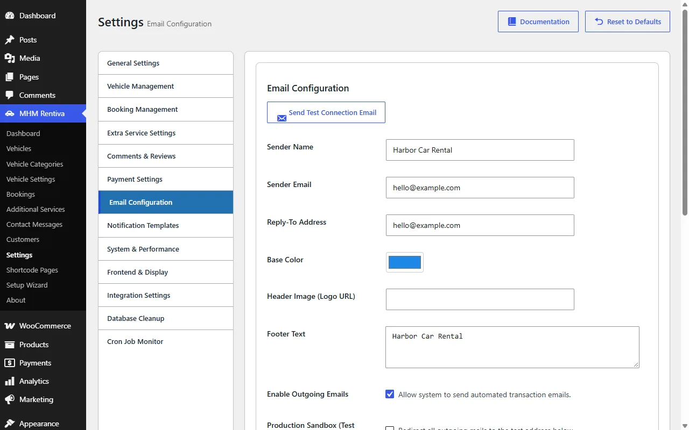

  

La pestaña Configuración del correo electrónico es donde defines la identidad del remitente, los detalles de diseño y los modos de envío de las notificaciones automáticas que envía el sistema. Accede a ella desde **MHM Rentiva > Ajustes > Configuración del correo electrónico**.

:::info Integración con WooCommerce
Cuando WooCommerce está instalado, los correos electrónicos transaccionales principales (confirmaciones de pedido, etc.) se gestionan a través de WooCommerce. Los ajustes de esta pestaña se aplican a las notificaciones internas propias del plugin (alertas para el administrador, mensajes personalizados para clientes, etc.).
:::

---

## 📧 Ajustes de remitente y diseño

Define cómo ven los clientes los correos electrónicos:

- **Nombre del remitente:** el nombre que aparece en el campo «Desde» de los correos electrónicos (p. ej., Rentiva Fleet).
- **Correo electrónico del remitente:** la dirección desde la que se envían los correos electrónicos (p. ej., info@site.com).
- **Dirección de respuesta (Reply-To):** la dirección a la que llegan las respuestas cuando un cliente contesta a un correo electrónico.
- **Color base:** establece los colores de los botones, los encabezados y los elementos destacados en las plantillas de correo electrónico.
- **Imagen de cabecera (URL del logotipo):** el logotipo que se muestra en la parte superior de los correos electrónicos.
- **Texto del pie de página:** la nota de copyright y contacto que aparece al final de todos los correos electrónicos.

---

## 🛠️ Herramientas de envío y prueba

- **Enviar correo de prueba de conexión:** te envía al instante un mensaje de prueba para comprobar que tu configuración funciona correctamente.
- **Activar correos salientes:** activa o desactiva el permiso del sistema para enviar correos electrónicos automáticos.
- **Entorno de pruebas de producción (Modo de prueba):** cuando está activo, no se entrega ningún correo electrónico a los clientes; todos los mensajes se redirigen a la «Dirección de correo electrónico de prueba» indicada.

---

## ⚙️ Ajustes técnicos avanzados

- **Ruta de sobrescritura de plantillas:** la ruta de la carpeta que se utiliza cuando quieres personalizar el diseño de los correos electrónicos desde tu tema (por defecto: `mhm-rentiva/emails/`).
- **Envío automático en segundo plano:** envía los correos electrónicos automáticos en segundo plano para no afectar a la velocidad de carga de las páginas.
- **Activar registros de comunicación:** guarda una copia de todos los correos electrónicos enviados en la base de datos.
- **Conservación de registros (días):** define cuántos días pasan antes de que los registros se eliminen automáticamente (p. ej., 30 días).

---

*Pestaña Ajustes > Configuración del correo electrónico, área de ajustes del remitente y de los registros*

---

### Resumen de la sección
- Configura el nombre del remitente y los colores para que coincidan con tu **identidad de marca**.
- Usa el **Modo de prueba** para comprobar las notificaciones de forma segura antes de pasar a producción.
- Usa el **envío en segundo plano** para mantener el rendimiento de tu sitio.

### Registro de cambios
| Fecha | Versión | Nota |
| :--- | :--- | :--- |
| 23.04.2026 | 4.27.2 | Se ha añadido la traducción al inglés. |
| 19.03.2026 | 4.21.2 | Se ha creado la documentación de Configuración del correo electrónico a partir de una captura de pantalla del panel y del análisis del código. |
