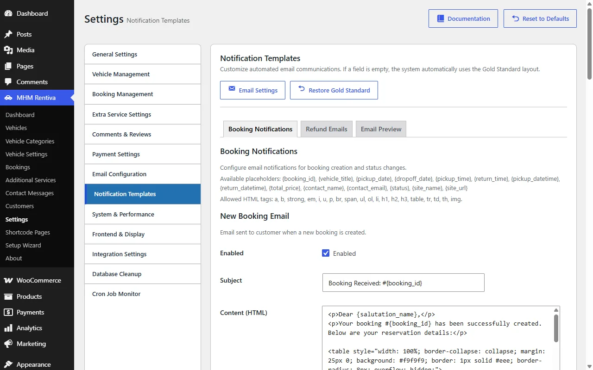

  

MHM Rentiva incluye un sistema de avisos por correo electrónico que mantiene informados tanto al administrador como al cliente en cada paso del proceso de reserva. Los datos del remitente y el aspecto de los correos se configuran en **MHM Rentiva > Ajustes > Correo electrónico**; el contenido de cada correo se edita en **MHM Rentiva > Ajustes > Plantillas de aviso**.

---

## 📧 Configuración general del correo electrónico

Configura lo básico para que todos los correos tengan un aspecto profesional (consulta [Configuración del correo electrónico](./email-configuration.md) para ver todos los campos):
- **Nombre del remitente y correo electrónico del remitente:** el nombre y la dirección que verán tus clientes en su bandeja de entrada.
- **Imagen de cabecera (URL del logotipo):** el logotipo de la empresa que aparece en la parte superior de los correos.
- **Color base:** un color que encaje con tu marca para los botones y los encabezados.

:::important Recomendación sobre SMTP
La función `mail()` predeterminada de WordPress suele hacer que los correos acaben en la carpeta de «Spam». Para una entrega fiable, te recomendamos encarecidamente conectar un servidor SMTP —como SendGrid, Mailgun o el tuyo propio— mediante un plugin como **WP Mail SMTP**.
:::

---

## 📝 Variables de plantilla (marcadores de posición)

Usa las siguientes etiquetas dinámicas para personalizar las plantillas. El sistema sustituye estas etiquetas por datos reales al enviar el correo:

| Etiqueta | Descripción |
| :--- | :--- |
| `{salutation_name}` | El nombre del cliente para el saludo («`Dear {salutation_name},`»). Cuando la reserva no tiene nombre, muestra «valued customer», de modo que un cliente nunca lee «Dear ,». |
| `{contact_name}` / `{customer_name}` | El nombre completo del cliente. |
| `{contact_email}` | La dirección de correo electrónico del cliente. |
| `{booking_id}` | El número de reserva que se muestra al cliente (el número de pedido, si lo hay). |
| `{vehicle_title}` | El título del vehículo alquilado. |
| `{pickup_date}` | La fecha de recogida. |
| `{dropoff_date}` / `{return_date}` | La fecha de devolución. |
| `{pickup_time}` | La hora de recogida. |
| `{return_time}` / `{dropoff_time}` | La hora de devolución. |
| `{pickup_datetime}` | La fecha y la hora de recogida juntas, por ejemplo «01/07/2099, 10:00». Muestra solo la fecha cuando no hay ninguna hora guardada. |
| `{return_datetime}` / `{dropoff_datetime}` | La fecha y la hora de devolución juntas; solo la fecha cuando no hay ninguna hora guardada. |
| `{total_price}` | Coste total del alquiler (con el símbolo de la moneda). |
| `{status}` | El estado de la reserva. |
| `{site_name}` | El nombre de tu sitio web. |
| `{site_url}` | La dirección de tu sitio web. |
| `{my_account_url}` | La página Mi cuenta del cliente. |

Los correos de reembolso también admiten `{amount}`, `{currency}` y `{reason}`.

:::info Fechas y horas
Las fechas y horas de los correos siguen el formato de fecha, el formato de hora, la zona horaria y el idioma de tu sitio (**Ajustes > General** en WordPress), y los correos de reserva predeterminados muestran la fecha junto con la hora a su lado. El correo de recordatorio incluye tanto la recogida como la devolución, y el correo de cancelación también muestra las fechas.
:::

---

## 🧪 Pruebas y vista previa

Comprueba siempre los cambios en tus plantillas antes de publicarlos:
1. **Vista previa:** usa la pestaña **Vista previa del correo electrónico** de la página Plantillas de aviso para ver el diseño en tu navegador.
2. **Enviar correo de prueba:** envía un mensaje de prueba real a una dirección de correo electrónico concreta para comprobar la compatibilidad con móviles.

---



*MHM Rentiva > Ajustes > pestaña Plantillas de aviso — pantalla del editor de plantillas*

---

## Nota técnica: registros de correo electrónico

Cuando **Activar registros de comunicaciones** está activado, el plugin registra los correos enviados en el tipo de contenido personalizado (CPT) `EmailLog`. Si un cliente dice «No he recibido ningún correo», puedes comprobar desde la administración de WordPress si el correo se envió revisando estos registros.

```php
// Use the Mailer class for programmatic email sending:
Mailer::send($to, $subject, $template_id, $data);
```

---

### Resumen de la sección
- **El uso de SMTP** es fundamental para una entrega correcta.
- Las plantillas se pueden personalizar con **etiquetas dinámicas**.
- Todos los envíos se pueden seguir en el registro de correos.

### Registro de cambios
| Fecha | Versión | Nota |
| :--- | :--- | :--- |
| 18.11.2026 | 6.4.0 | La lista de marcadores de posición ahora coincide con el plugin (añadidas `{salutation_name}` y las etiquetas de hora y de fecha y hora; eliminadas `{vehicle_name}` y `{site_title}`, ya que no son compatibles); la fecha y la hora siguen el formato del sitio; nombres de los ajustes corregidos. |
| 23.04.2026 | 4.27.2 | Añadida la traducción al inglés. |
| 18.03.2026 | 4.21.2 | Contenido actualizado al modelo híbrido; añadidas notas sobre SMTP. |
| 26.02.2026 | 4.21.0 | Creada la versión inicial. |
