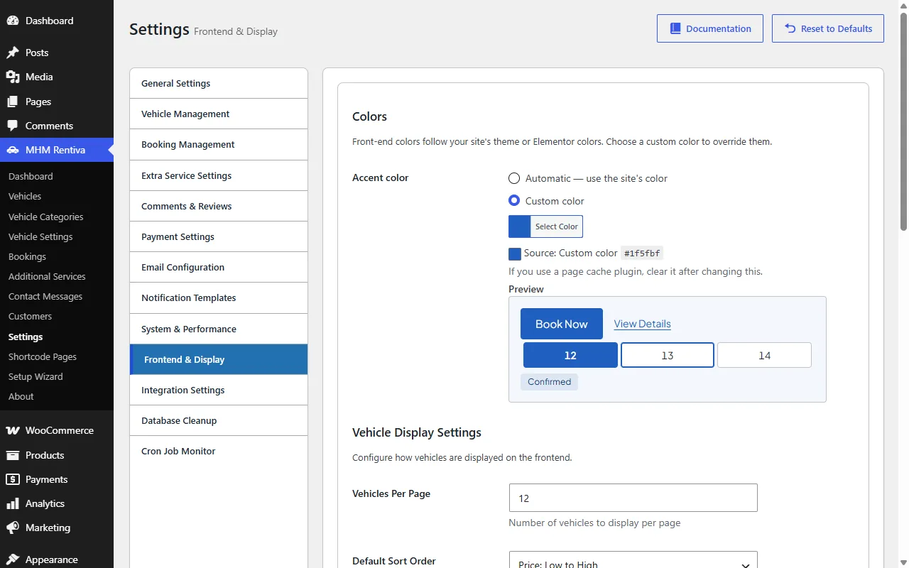

  

La pestaña Página pública y visualización es un área de administración completa en la que personalizas la apariencia del plugin de cara al usuario, las etiquetas de los botones, los mensajes de aviso y las URL de las páginas. Accede a ella en **MHM Rentiva > Ajustes > Página pública y visualización**.

---

## 🎨 Colores

La sección **Colores** es la primera de la pestaña. Define el único color de acento (principal) que el plugin usa en tu sitio: botones principales, enlaces, días seleccionados del calendario y el suave fondo tintado de las pantallas de reserva. La parte pública de Rentiva también usa la fuente Plus Jakarta Sans, servida desde los propios archivos del plugin (sin solicitudes a Google), y esquinas de 4 px en tarjetas, botones y cuadros de reserva.

En **Color de acento** eliges un modo:

- **Automático — usar el color del sitio:** Rentiva lee el color de tu sitio. Comprueba estas fuentes en orden y usa el primer color real que encuentra:
  1. **Ajuste del tema:** el color principal de un tema compatible (temas de Thembay, Avanam, listeo, politic, upstudy y Astra). Si nunca lo has cambiado, se usa el valor predeterminado del propio tema y la línea de origen indica "predeterminado del tema".
  2. **Color global de Elementor:** el color global **Accent** y, después, **Primary**. Los colores de fábrica de Elementor se ignoran, así que solo cuenta un color que hayas definido tú.
  3. **Paleta de colores del tema (theme.json):** el color de botón de un tema de bloques y, después, los colores de paleta `primary` y `accent`.
  4. **Predeterminado de Rentiva:** un azul (`#2271b1`) cuando ninguna de las fuentes anteriores proporciona un color.
- **Color personalizado:** elige tu propio color con el selector de color. Anula el resultado automático.

Debajo del selector verás:

- **Origen:** de qué fuente procede el color actual, con una muestra y el código hexadecimal, por ejemplo "Origen: ajuste del tema (Astra)".
- **Vista previa:** una pequeña muestra (botón, enlace, tres días del calendario, etiqueta "Confirmado") que se vuelve a pintar a medida que cambias el color.
- **Dos avisos de legibilidad**, que solo se muestran cuando es necesario:
  - "Este color es demasiado claro para el texto de la página..." El acento se mantiene como relleno de los botones, pero los enlaces y el texto usan un tono más oscuro para que sigan siendo legibles. El tono al pasar el cursor se calcula automáticamente; con un acento muy oscuro se aclara en lugar de oscurecerse.
  - "Este color claro es difícil de distinguir de un fondo blanco."

:::tip Vacía la caché de páginas
Los colores se escriben en la página. Si usas un plugin de caché de páginas o tu alojamiento almacena las páginas en caché, vacía esa caché después de cambiar el color, tal como te recuerda la propia sección.
:::

:::info Cambiado en 6.4.0
Ahora los colores siguen automáticamente a tu sitio. En versiones anteriores, la parte pública usaba siempre un azul fijo.
:::

### Para desarrolladores
Tres filtros permiten que un tema o un plugin personalizado intervengan. `mhmrentiva_accent_color` recibe el color hexadecimal y el id de la fuente y devuelve el color final (tiene la última palabra, incluso en el modo Personalizado, y entonces la línea de origen indica "filtro de desarrollador"). `mhmrentiva_accent_sources` cambia la lista ordenada de fuentes automáticas y `mhmrentiva_theme_adapters` añade compatibilidad con otro tema.

---

## 🖼️ Ajustes básicos de visualización de vehículos

Controla la jerarquía visual en las páginas de listado de vehículos:

- **Vehículos por página:** el número máximo de vehículos que se listan en una sola página (p. ej., 12).
- **Orden predeterminado:** el criterio con el que se ordena la página de listado en la primera carga (precio ascendente, año descendente, etc.).

:::note Ajustes eliminados (v4.22.1)
Los ajustes **Mostrar imágenes del vehículo** (`mhmrentiva_vehicle_show_images`), **Mostrar características** (`mhmrentiva_vehicle_show_features`) y **Mostrar disponibilidad** (`mhmrentiva_vehicle_show_availability`) presentes en versiones anteriores se eliminaron en la v4.22.1 porque no se usaban en el código. Estos controles de visualización ahora se gestionan directamente mediante parámetros de shortcode (`show_features`, `show_badges`, etc.).
:::

---

## ✍️ Etiquetas y textos personalizados

Cambia en segundos cualquier texto de botón o de formulario del plugin para adaptarlo a tu idioma o al tono de tu marca. Esta sección tiene estructura de acordeón:

- **Botones generales:** etiquetas de botones como "Alquilar ahora", "Ver detalles", "Hacer una reserva".
- **Mensajes de notificación:** avisos instantáneos como "Añadido a favoritos", "Debes estar conectado", "Procesando…".
- **Etiquetas del formulario:** nombres de campos del formulario de reserva como "Nombre", "Apellidos", "Teléfono".
- **Pago y validación:** mensajes críticos del sistema como "Calculando…", "Pago realizado correctamente", "Selección de fecha no válida".

---

*Ajustes > pestaña Página pública y visualización, grupos de etiquetas y ajustes de visualización*

---

## 🔗 Enlaces permanentes y estructura de URL de las páginas

Define manualmente las rutas de las páginas que son fundamentales para que el plugin funcione correctamente:

- **URL del formulario de reserva:** la dirección completa de la página que contiene el shortcode `[rentiva_booking_form]`.
- **Página de acceso y registro:** las páginas personalizadas de acceso y registro a las que se redirige a los clientes.

:::tip Detección automática
Si dejas estos campos vacíos, el sistema analizará automáticamente la base de datos para encontrar las páginas que contienen los shortcodes correspondientes. Sin embargo, si tienes una estructura de páginas personalizada, se recomienda introducir aquí la URL completa.
:::

---

### Resumen de la sección
- **Personaliza todos los botones** para adaptarlos al idioma de tu público objetivo y ofrecer una mejor experiencia de usuario.
- **Alinea el diseño visual** de las páginas de listado con el diseño de tu sitio.
- **Define las URL de las páginas** para garantizar que el proceso de reserva funcione sin interrupciones.

### Registro de cambios
| Fecha | Versión | Nota |
| :--- | :--- | :--- |
| 18.11.2026 | 6.4.0 | Se añade la sección Colores (color automático del sitio, color personalizado, avisos, filtros). |
| 23.04.2026 | 4.27.2 | Se añade la traducción al inglés. |
| 27.03.2026 | 4.22.1 | Se añade una nota sobre la eliminación de los ajustes de control de visualización no utilizados (`show_images`, `show_features`, `show_availability`). |
| 19.03.2026 | 4.21.2 | Se crea la documentación de Página pública y visualización con todos los grupos de etiquetas y la configuración de URL. |
