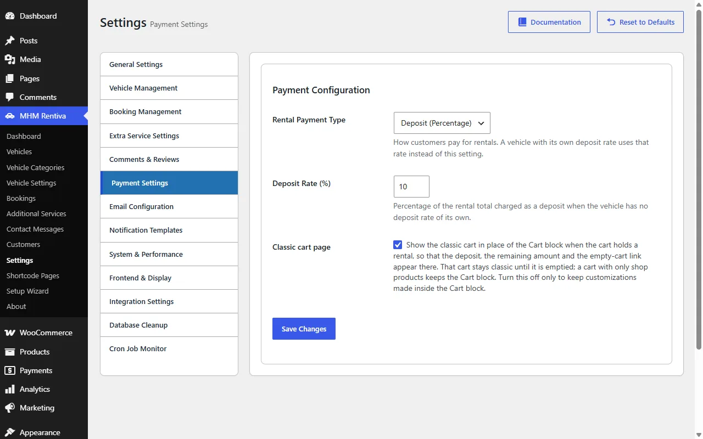

  

MHM Rentiva basa sus operaciones financieras en **WooCommerce**, la plataforma de comercio electrónico más popular del mundo. Esto significa que puedes usar cientos de pasarelas de pago (Stripe, PayPal, iyzico, etc.) sin ningún desarrollo adicional.

---

## 💳 Escenarios del flujo de pago

El sistema gestiona los pagos a través de dos canales principales:

### 1. Pagos en la parte pública (cliente)
Todas las transacciones de alquiler que realizan los clientes en tu web pasan por el carrito de **WooCommerce**.
- **Proceso:** El cliente selecciona un vehículo > establece las fechas > hace clic en «Alquilar ahora» > el producto se añade al carrito > se introducen los datos de la tarjeta en la página de pago.
- **Nota importante:** Cuando el cliente completa el pago, el pedido de WooCommerce pasa a «En proceso» o «Completado»; en consecuencia, la reserva de Rentiva se marca automáticamente como «Confirmado».
- **Invitados:** Un visitante que no ha iniciado sesión puede reservar sin cuenta. El formulario de reserva no pide nada más; el nombre, el correo electrónico y el teléfono de los datos de facturación de la página de pago se guardan en la reserva.

### 2. Aspecto del carrito y de la página de pago

Las páginas del carrito y de pago muestran los pasos de la reserva y un resumen del alquiler (vehículo, fechas, desglose del precio) encima del formulario de WooCommerce. Los importes se etiquetan según lo que paga el cliente:

| Dónde | Etiqueta | Significado |
| :--- | :--- | :--- |
| Carrito y página de pago | **A pagar ahora** | El importe que se cobra ahora (el anticipo o el precio completo). |
| Resumen de la reserva | **A pagar en la recogida** | El importe restante que se paga cuando se entrega el vehículo. |
| Página de agradecimiento | **Anticipo pagado** / **Anticipo por enviar** | La fila del anticipo refleja el estado del dinero: pago recibido o transferencia bancaria aún pendiente de enviar. |

### 3. Página de carrito clásica

Cuando el carrito contiene un alquiler, Rentiva muestra las páginas de carrito y de pago **clásicas** de WooCommerce aunque tus páginas usen el bloque Carrito o Finalizar compra, para que se muestren los pasos de la reserva, el anticipo y el importe restante. Un carrito que solo contiene productos de la tienda mantiene el bloque Carrito, y un pedido sin reserva sigue usando el bloque Finalizar compra.

- **Ajuste:** MHM Rentiva > Ajustes > pestaña Pago > **Página de carrito clásica** (activado por defecto). Desactívalo solo si has personalizado el propio bloque Carrito.
- El carrito clásico se mantiene hasta que se vacía ese carrito.
- Si tu página de carrito o de pago usa un bloque, un administrador ve un aviso en las pantallas de Rentiva y en la página Plugins que lo explica. Haz clic en **Entendido, no volver a mostrar** para ocultarlo; la elección se guarda para cada administrador.
- Con el ajuste desactivado, el bloque Finalizar compra puede seguir mostrando todos los métodos de pago para un alquiler, pero un método que no está permitido para alquileres (ver más abajo) se rechaza al elegirlo.

### 4. El pago contra reembolso no se ofrece para alquileres

El método **Contra reembolso** de WooCommerce nunca se ofrece para un alquiler: un anticipo pagado en la puerta no es un anticipo, y lo que queda se paga de todos modos en la recogida. Esto se aplica a cualquier carrito que contenga una reserva, incluido un carrito mixto (un pedido tiene un único método de pago). El ajuste de contra reembolso de tu tienda no se modifica, así que los pedidos solo de la tienda lo mantienen.

- Si el contra reembolso es el único método activado, el cliente ve: «El pago contra reembolso no se ofrece para alquileres y todavía no hay ningún otro método de pago configurado. Ponte en contacto con nosotros para completar tu reserva.» Activa otro método (tarjeta, transferencia bancaria) en WooCommerce > Ajustes > Pagos.
- Si aun así se elige el método (por ejemplo, en el bloque Finalizar compra con el ajuste de carrito clásico desactivado), se rechaza con «El pago contra reembolso no está disponible para una reserva. Elige otro método de pago.» y no se crea ninguna reserva.

### 5. Oferta de cuenta para invitados

Mientras haya un alquiler en el carrito, un invitado ve la casilla «¿Crear una cuenta?» de WooCommerce en la página de pago, aunque el ajuste de tu tienda para crear cuentas al finalizar la compra esté desactivado. Ese ajuste de la tienda no se modifica y los demás carritos lo siguen. Un invitado que crea una cuenta ve la reserva en **Mi cuenta**; un invitado que no la crea no tiene página Mi cuenta, así que la página de agradecimiento y los correos electrónicos son donde ve la reserva.

### 6. Elegir de nuevo el mismo vehículo

Si el mismo vehículo se envía de nuevo al carrito con fechas que se solapan (por ejemplo, el cliente pulsa el botón Atrás del navegador y vuelve a hacer clic en «Alquilar ahora»), la nueva elección **sustituye** a la línea anterior en lugar de añadirse junto a ella. El cliente ve: «Tu carrito ya contenía "Vehículo" para fechas que se solapan. Ahora contiene tu última elección (fecha - fecha).» El importe no se duplica. Un vehículo distinto, o fechas consecutivas (un alquiler se devuelve cuando se recoge el siguiente), se mantienen como líneas separadas.

Si aun así un carrito acaba conteniendo el mismo vehículo dos veces para fechas que se solapan, la página de pago no culpa a otro cliente; indica: «Tu carrito contiene "Vehículo" más de una vez para fechas que se solapan. Elimina la línea sobrante para continuar.»

Cuando dos clientes compiten por las mismas fechas, el que pierde ve un único mensaje indicando que el vehículo ya no está disponible para esas fechas. En la página del carrito se elimina la línea y se muestra ese motivo.

### 7. Pagos en la administración y fuera de línea
Se usan para las reservas creadas manualmente desde el panel de administración.
- **Cobro en efectivo:** Si cobras en efectivo al entregar el vehículo, puedes marcarlo como «Pago fuera de línea» desde los detalles de la reserva.
- **Transferencia bancaria:** Funciona integrada con el método «BACS» (transferencia bancaria) de WooCommerce. Tras un pedido por transferencia, la página de agradecimiento muestra una tarjeta **Tu transferencia** con el número de pedido como referencia, el importe que hay que enviar (el total del pedido tal como lo cobra WooCommerce, incluidos impuestos, cupones y cargos) y el importe a pagar en la recogida. Un cliente que ha iniciado sesión sube el comprobante de la transferencia desde la reserva en Mi cuenta (**Subir comprobante**); a un invitado se le pide que envíe el comprobante por correo electrónico, con el número de pedido, a la dirección de correo de la tienda. La reserva se confirma en cuanto apruebas el pago.
- **Pedidos sin pagar:** Un pedido que no tiene ninguna reserva detrás (por ejemplo, una página de pago que se interrumpió) no se puede pagar, así que no puede llegar dinero sin una reserva.

---

## 💰 Sistema de anticipos

MHM Rentiva incluye una lógica avanzada de anticipos (pago por adelantado).
- **Configuración:** Establece el anticipo por vehículo o para todo el sitio en MHM Rentiva > Ajustes > pestaña Pago: **Tipo de pago del alquiler** (*Pago completo obligatorio* o *Anticipo (porcentaje)*) y **Porcentaje de anticipo (%)**. Un vehículo con su propio porcentaje de anticipo usa ese porcentaje en su lugar. El anticipo predeterminado para todo el sitio es del 10 %.
- **Cómo funciona:** Si el coste total del alquiler del vehículo es 1000 y el anticipo está configurado en el 20 %, solo se refleja 200 en el carrito de WooCommerce. Los 800 restantes aparecen como **A pagar en la recogida**.

:::tip Nota para desarrolladores
Para los cálculos del anticipo se usa la clase `DepositCalculator::calculate_deposit()`. Esta clase también tiene en cuenta los servicios adicionales y los impuestos.
:::

---

## 🛠️ Métodos de pago compatibles

Todos los plugins compatibles con WooCommerce funcionan con Rentiva. Los más utilizados:
- **Globales:** Stripe, PayPal, Square.
- **Locales (Turquía):** iyzico, PayTR, Param.

---

*MHM Rentiva > Ajustes > pestaña Pago — pantalla del anticipo y otros ajustes*

---

---

### Resumen de la sección
- **WooCommerce es obligatorio** para los pagos en la parte pública.
- Los alquileres usan las páginas de carrito y de pago clásicas; el **contra reembolso** no se ofrece para alquileres.
- La función **Anticipo** te permite cobrar pagos por adelantado.
- Hay compatibilidad con pagos **Fuera de línea** para las reservas creadas manualmente.

### Registro de cambios
| Fecha | Versión | Nota |
| :--- | :--- | :--- |
| 18.11.2026 | 6.4.0 | Se han añadido el ajuste de página de carrito clásica, las etiquetas de la página de pago, la regla del contra reembolso, la oferta de cuenta para invitados y la tarjeta de transferencia bancaria. |
| 23.04.2026 | 4.27.2 | Se ha añadido la traducción al inglés. |
| 18.03.2026 | 4.21.2 | Contenido actualizado al modelo híbrido. |
| 26.02.2026 | 4.21.0 | Versión inicial creada. |
