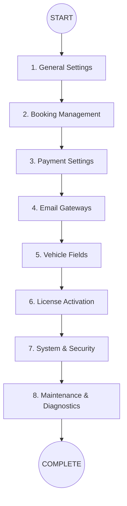

import Link from '@docusaurus/Link';

  

# ⚙️ Hoja de ruta de la configuración principal

Tras instalar el plugin, los ajustes deben configurarse siguiendo un orden lógico para que los procesos operativos funcionen sin problemas. Esta sección recoge los pasos de configuración principales que constituyen el «corazón» del sistema.

:::tip GUÍA DE CONFIGURACIÓN
Sigue las tarjetas por categorías que aparecen a continuación para configurar el sistema por completo. Cada tarjeta ofrece acceso rápido al grupo de ajustes correspondiente.
:::

---

  

    

      <h3 className="cardTitle">🏢 1. Ajustes generales</h3>
      
Define la información de la empresa, la moneda y los modos de funcionamiento principales.

      <Link className="button button--secondary button--block" to="/docs/core-configuration/settings">Ajustes generales</Link>
    

  

  

    

      <h3 className="cardTitle">📅 2. Reserva</h3>
      
Duraciones del alquiler, porcentajes de anticipo y comportamiento de las reservas.

      <Link className="button button--secondary button--block" to="/docs/core-configuration/booking-settings">Reserva</Link>
    

  

  

    

      <h3 className="cardTitle">💳 3. Pagos</h3>
      
Configura las pasarelas de pago de WooCommerce y las reglas de cobro.

      <Link className="button button--secondary button--block" to="/docs/core-configuration/payments">Ajustes de pago</Link>
    

  

  

    

      <h3 className="cardTitle">📧 4. Notificaciones</h3>
      
Plantillas de correo electrónico, ajustes SMTP y notificaciones automáticas.

      <Link className="button button--secondary button--block" to="/docs/core-configuration/emails">Ajustes de correo electrónico</Link>
    

  

  

    

      <h3 className="cardTitle">🏎️ 5. Campos del vehículo</h3>
      
Datos técnicos (tipo de combustible, transmisión, etc.) y definiciones de características del vehículo.

      <Link className="button button--secondary button--block" to="/docs/core-configuration/vehicle-settings">Ajustes de vehículos</Link>
    

  

  

    

      <h3 className="cardTitle">🔑 6. Licencia</h3>
      
Activa tu clave para desbloquear las funciones Pro.

      <Link className="button button--secondary button--block" to="/docs/core-configuration/license">Gestión de licencias</Link>
    

  

  

    

      <h3 className="cardTitle">⚡ 7. Sistema y rendimiento</h3>
      
Caché, reglas de seguridad y comprobaciones del estado del sistema.

      <Link className="button button--secondary button--block" to="/docs/core-configuration/system-performance">Sistema y velocidad</Link>
    

  

  

    

      <h3 className="cardTitle">🛠️ 8. Mantenimiento y herramientas</h3>
      
Limpieza de la base de datos, supervisión de cron y herramientas de diagnóstico.

      <Link className="button button--secondary button--block" to="/docs/core-configuration/maintenance">Página de mantenimiento</Link>
    

  

---

## 📈 Diagrama del flujo de configuración

---

### Resumen de la sección
- Configurar los ajustes en el orden correcto evita conflictos en el sistema.
- Se recomienda validar el sistema al final con las herramientas de **Mantenimiento y diagnóstico**.

## Registro de cambios
| Fecha | Versión | Nota |
|---|---|---|
| 23.04.2026 | 4.27.2 | Se ha añadido la traducción al inglés. |
| 19.03.2026 | 4.21.2 | Se ha creado la hoja de ruta de la configuración principal con diseño de tarjetas premium. |
