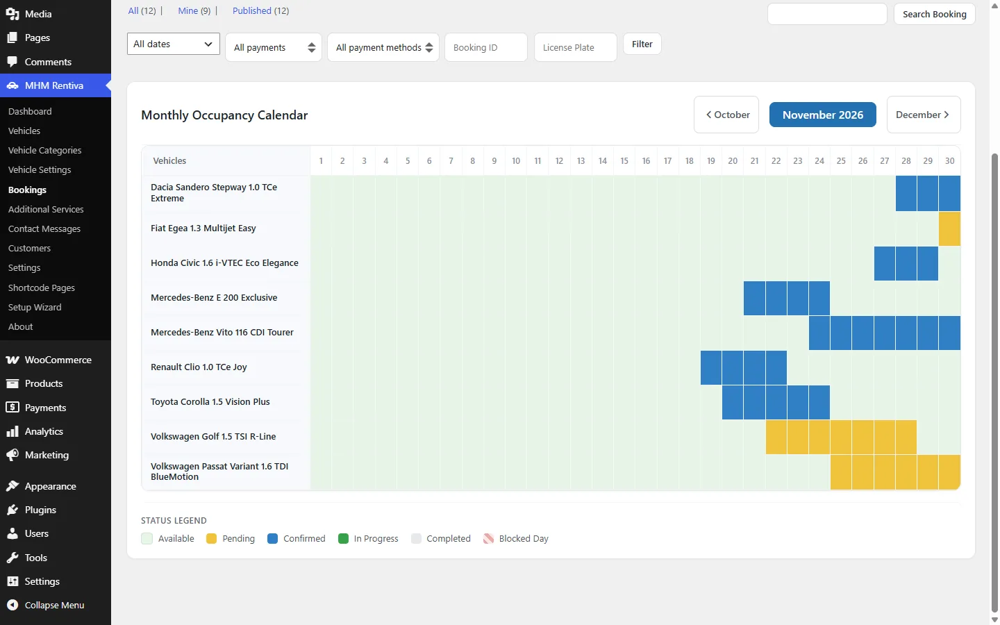
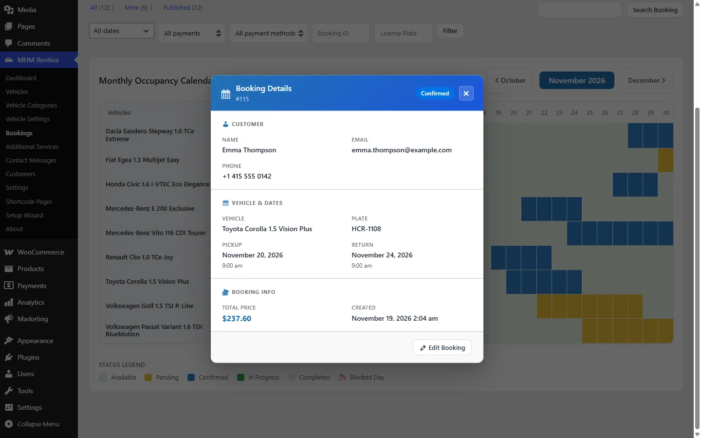

  

Las reservas son el núcleo operativo y financiero del sistema MHM Rentiva. Usa **MHM Rentiva > Reservas** para supervisar todo el movimiento de reservas, crear nuevos registros y gestionar los flujos financieros.

Para las páginas de carrito y de pago que ve el cliente (las etiquetas «Pagar ahora» y de anticipo, las cuentas de invitado, por qué no se puede pagar un pedido sin pagar), consulta [Pagos](../02-core-configuration/payments.md).

---

## 📊 Lista de reservas y filtros

En la parte superior de la página, cuatro tarjetas muestran el estado actual de tu flota:
- **Total de reservas:** Todas las reservas que no están en la papelera, con cuántas se han creado este mes.
- **Pendiente:** Reservas que aún esperan aprobación o pago, con cuántas se han creado esta semana.
- **Completado:** Alquileres que han finalizado, con cuántos este mes.
- **Valor de las reservas de este mes:** El precio reservado (no el dinero cobrado) de las reservas confirmadas, en curso y completadas creadas este mes, y la variación respecto al mes anterior.

Debajo de las tarjetas, una fila de chips de estado filtra la lista: **Todos**, **Pendiente**, **Confirmado**, **En curso**, **Completado** y **Cancelado** se muestran siempre, cada uno con su recuento. Los demás estados (por ejemplo, Reembolsado) solo aparecen cuando al menos una reserva lo tiene.

Junto a los chips, los desplegables **Todos los pagos** y **Todos los métodos de pago**, además de los campos **ID de reserva** y **Matrícula**, acotan aún más la lista.
- El filtro de pago ofrece los mismos estados que muestra la columna **Pago**: No pagado, Pendiente, Pagado, Parcialmente pagado, Parcialmente reembolsado, Reembolsado, Cancelado, etc. Solo se listan los estados que tiene al menos una reserva.
- **Pagado** no devuelve las reservas con anticipo que aún tienen un saldo pendiente; esas están en **Parcialmente pagado**.
- El filtro de pago se combina con el chip de estado y también funciona en la vista de la papelera.

**Columnas de la lista:** Cliente, ID de reserva, Vehículo, Fechas, Total, Importe del anticipo, Importe restante, Pago, Estado y Tipo de reserva. Una pequeña **M** junto al tipo indica una reserva introducida a mano. En la columna Pago, la insignia muestra No pagado o Pendiente (amarillo), Pagado (verde), Parcialmente pagado (azul) o Reembolsado / Fallido / Cancelado (rojo).

En una reserva **Pendiente**, la fila tiene un enlace **Aprobar** que la confirma sin abrir la reserva.

### Vista de calendario

El conmutador **Lista** / **Calendario** situado encima de la tabla muestra las mismas reservas como un calendario de flota: una fila por vehículo y una columna por día del mes seleccionado. Usa las flechas del mes para pasar de un mes a otro; los chips de estado y los filtros también se aplican al calendario.

**Colores de las celdas (leyenda):**
- ● **Pendiente**
- ● **Confirmado**
- ● **En curso**
- ● **Completado** (gris claro)
- Rayas diagonales rojas: **Día bloqueado** (un día cerrado en la pantalla de edición del vehículo)
- Blanco: **Disponible**

Las reservas canceladas y reembolsadas no ocupan ningún vehículo, por lo que no se pintan. Si eliges el chip **Cancelado** en el calendario, la página te indica que cambies a la vista de lista.

Haz clic en una celda pintada para abrir un resumen con el cliente, el vehículo, la matrícula, las horas de recogida y devolución, el precio total y un botón **Editar reserva**. Cuando varias reservas coinciden en el mismo día, se listan todas.

---

## ➕ Nueva reserva

Usa **Añadir nueva reserva** para introducir solicitudes recibidas por teléfono o en persona. La cabecera de la página dice «← Reservas · Nuevo registro · añadido por un administrador». El formulario tiene estas secciones:

1.  **Vehículo y cliente:** Selecciona el vehículo y, a continuación, un cliente existente, o elige **+ Crear nuevo cliente** y rellena el nombre, los apellidos, el correo electrónico y el teléfono.
2.  **Fechas y duración:** Fecha y hora de recogida y de devolución. La devolución debe ser posterior a la recogida.
3.  **Servicios adicionales:** Marca los servicios adicionales que ha pedido el cliente y establece las cantidades. Un servicio con precio por día se muestra multiplicado por el número de días de alquiler.
4.  **Pago y notas:** Elige el **Tipo de pago** (**Pago completo** o **Anticipo**; Anticipo está preseleccionado), el **Método de pago** (**Fuera de línea** está preseleccionado, o **En línea**), el **Estado** (**Pendiente** o **Confirmado**; Confirmado está preseleccionado) y las notas que quieras. Con **En línea**, una nota indica que el enlace de pago se envía por separado.

Haz clic en **Calcular precio**. El panel de precio muestra el total del vehículo, los servicios adicionales y el total general; con anticipo, también muestra las líneas **Anticipo** y **Restante**. A continuación, haz clic en **Crear reserva**. No hay campo para el número de ocupantes.

**País y provincia de un cliente nuevo.** La tarjeta de nuevo cliente tiene los campos opcionales **País** y provincia. La lista de países procede de WooCommerce (los países a los que vende tu tienda, con el país de la propia tienda preseleccionado). Para un país con lista de provincias, eliges de ella; para un país sin ella, escribes la región; para un país que no usa provincias, o cuyo proceso de pago oculta el campo de provincia (por ejemplo, Chipre, Bosnia y Herzegovina, Botsuana), el campo no se muestra. Los valores se guardan en el país y la provincia de facturación de WooCommerce del cliente.

**Cuenta de cliente.** Cuando se crea aquí un cliente nuevo, este recibe un correo electrónico para establecer su propia contraseña, y el mensaje de éxito lo indica.

### Reservas que se pagan fuera del sitio

Una reserva que introduces a mano con el método de pago **Fuera de línea** (efectivo o tarjeta en la recogida, una transferencia que compruebas tú mismo) no tiene plazo de pago. No se cancela automáticamente cuando vence el plazo de pago o pasa el día de recogida, y al cliente no se le envía el correo electrónico de «plazo de pago vencido». Una reserva introducida a mano con el método **En línea**, y cualquier reserva hecha en el sitio web, conserva su plazo de pago (**Plazo de pago (minutos)** en **Ajustes › Reserva**, usado junto con **Activar cancelación automática**).

:::info Cambiado en 6.4.0
Antes, el barrido automático cancelaba las reservas fuera de línea introducidas a mano. Al actualizar, las más antiguas que se habían cancelado de esa forma vuelven a ocupar su vehículo. Si otro cliente ha reservado esas fechas mientras tanto, la reserva se deja como está y aparece en **Registros** un aviso enlazado a esa reserva.
:::

---

## 📝 Editar reserva (estructura de la pantalla)

Abre una reserva desde la lista para editarla. La cabecera dice «← Reservas · Datos del cliente, del vehículo y del pago». La disposición predeterminada es:

**Columna derecha**
- **Estado de la reserva:** un breve resumen (vehículo, días, total), el botón **Cancelar reserva** con la nota «Al cancelar se inicia el reembolso del importe pagado y se envía una notificación al cliente.», y los habituales botones **Actualizar** y **Mover a la papelera**.
- **Cuenta del cliente:** el nombre y el correo electrónico del cliente, un enlace **Ver perfil del cliente** y una línea **País / provincia** (el país y la provincia de facturación de WooCommerce del cliente). Si no hay ninguna cuenta vinculada y la reserva tiene un correo electrónico, **Crear cuenta de cliente** crea una y el cliente recibe un correo electrónico para establecer su contraseña. El cuadro también muestra la línea **Contrato de alquiler**: **Aceptado** con la fecha y la versión del texto, o «Sin aceptación (reserva del administrador)» para una reserva que has introducido a mano.
- **Recibo de pago:** solo se muestra cuando el cliente ha subido un comprobante de transferencia bancaria. Consulta [Comprobante del cliente](#customer-receipt).
- **Reembolso:** el estado del reembolso y las acciones de reembolso. Consulta [Cancelación y reembolso](#cancellation-and-refund).
- **Enviar correo electrónico al cliente:** consulta [Enviar correo electrónico al cliente](#send-email-to-customer).

**Columna izquierda**
- **Editar los datos de la reserva:** referencia y tipo de reserva, vehículo, fecha y hora de recogida y devolución, estado, servicios adicionales con sus cantidades y notas especiales. No hay campo para el número de ocupantes (se conserva el valor ya guardado).
- **Gestión de pagos:** importes, estado del pago, plazos, historial de pagos, historial de la reserva y añadir notas (más abajo).

Los cuadros se pueden arrastrar y la disposición se recuerda para cada usuario; el orden anterior se aplica hasta que los reorganices.

**Insignias de estado del pago** en el cuadro Gestión de pagos: Pagado es verde; Parcialmente pagado, Pendiente y Pendiente de verificación son amarillos; No pagado, Fallido y Cancelado son rojos; Reembolsado y Parcialmente reembolsado son azules.

### El vehículo está en la papelera

Si el vehículo de la reserva se ha movido a la papelera o ya no está publicado, la lista de vehículos lo sigue mostrando como seleccionado con «— En la papelera» junto a su nombre, y una nota debajo indica que los clientes ya no pueden abrir su página y que puedes restaurarlo desde la lista de vehículos o elegir otro vehículo. Al elegir otro vehículo, la nota se oculta.

### Fechas y días cerrados

La fecha y hora de devolución deben ser posteriores a la recogida. Si no lo son, el navegador impide guardar y, si aun así llega al servidor un intervalo incorrecto, no se guarda y las fechas no cambian. Si el vehículo tiene días cerrados en ese periodo, la reserva se guarda y un aviso los indica.

### Comprobante del cliente {#customer-receipt}

Cuando el cliente ha subido un comprobante de transferencia bancaria, el cuadro **Recibo de pago** muestra el archivo (**Ver / Descargar**), su estado (Enviado, Aprobado o Rechazado), una **Nota del administrador** y los botones **Aprobar recibo** y **Rechazar recibo**.

---

## 🔄 Cuándo se recalcula el precio

**Actualizar** recalcula el precio solo cuando ha cambiado algo que le afecta: el vehículo, la fecha u hora de recogida o devolución, o los servicios adicionales y sus cantidades. Si solo cambias el estado o una nota de una reserva pagada, su total y sus líneas de servicios adicionales se quedan como están.

Cuando el precio sí cambia:
- **Se conserva el importe ya cobrado.** Si amplías una reserva pagada o la encareces, pasa a ser una reserva con anticipo: lo pagado es el anticipo, la diferencia es el **Importe restante**, y lo cobras con **Procesar importe restante** o enviando un enlace de pago.
- **No se guarda un total nuevo inferior a lo cobrado.** El vehículo, las fechas y los servicios adicionales se quedan como estaban guardados (las notas y los demás campos sí se guardan) y un mensaje te indica que canceles la reserva, reembolses el pago y crees una reserva nueva.
- **El total no se puede cambiar** mientras exista un enlace de pago del importe restante para la reserva, cuando una reserva reembolsada pasaría a tener un total mayor, cuando la reserva se pagó en más de una moneda o en una moneda distinta de la de la tienda, o cuando se pagó en un pedido que también contiene otras reservas o productos. El mensaje indica qué caso se aplica; para cambiar el precio en estos casos, cancela la reserva y crea una nueva.

En una reserva con anticipo que no se ha pagado en absoluto (sin ningún pago cobrado ni pedido de WooCommerce), un anticipo porcentual sigue al nuevo total con el porcentaje con el que se hizo la reserva: un anticipo del 10 % sigue siendo el 10 % del nuevo total, y el importe restante se calcula en consecuencia. El porcentaje de anticipo actual de los ajustes no se aplica a una reserva existente. Un anticipo de importe fijo, una reserva vinculada a un pedido o una reserva con un pago conservan su anticipo tal cual; solo el importe restante sigue al nuevo total.

---

## 💰 Anticipo y pago restante

El cuadro **Gestión de pagos** muestra el **Tipo de pago** (Anticipo o Pago completo), el **Método de pago** (En línea o Fuera de línea), el **Importe total**, el **Importe del anticipo**, el **Importe restante**, los **Días de alquiler** y el **Tipo de anticipo**, seguidos del estado del pago, la **Política de cancelación** (el plazo y si la reserva todavía se puede cancelar) y el **Plazo de pago**.

Una reserva con anticipo cuyo anticipo está pagado pero que aún tiene un saldo pendiente muestra **Parcialmente pagado** en el cuadro y en la lista. Una reserva hecha antes de que existiera el sistema de anticipos muestra una nota indicando que la información del anticipo no está disponible.

**Botones:**
- **Marcar pago recibido:** para una reserva Pendiente o Confirmada que aún no se ha pagado (por ejemplo, una transferencia bancaria que ya has comprobado). Marca el pago como recibido y confirma la reserva.
- **Procesar importe restante:** para una reserva con anticipo cuyo anticipo está pagado y queda un saldo. Registra el saldo como cobrado; la reserva pasa a Confirmado, o a Completado si el alquiler ya ha terminado.
- **Enviar enlace de pago:** envía al cliente por correo electrónico un enlace de pago del importe restante. No se ofrece cuando el anticipo se pagó fuera de WooCommerce; en ese caso usa **Procesar importe restante**.

### El cliente paga el importe restante

En una reserva con anticipo, el cliente puede hacer clic en **Pagar el importe restante** en **Mi cuenta**, en el detalle de la reserva. Se crea un pequeño pedido de WooCommerce por el importe pendiente y el cliente lo paga con cualquier método de pago activo en tu sitio. Si el anticipo se pagó fuera del sitio web, la página indica en su lugar que te pondrás en contacto con el cliente para cobrar el saldo.

- Solo el enlace de pago actual de la reserva admite pagos. Un enlace antiguo indica que el importe ya no está vigente y que el cliente debe pedir uno nuevo. Una tarjeta rechazada se puede volver a intentar con el mismo enlace.
- Si el pedido del importe restante falla o se cancela, la reserva no se cancela. Si más adelante se cancela un pedido del importe restante ya pagado, el dinero se queda en ese pedido; reembolsarlo o restaurarlo depende de ti.
- Si llega un pago por un importe que ya no está vigente, el importe restante no se pone a cero. En la pantalla de edición de la reserva se mantiene un aviso con el número de pedido, el importe cobrado y el importe restante hasta que hagas clic en **Lo he comprobado**; corrige el saldo a mano.

:::info Cambiado en 6.4.0
Un enlace de pago del importe restante creado antes de la actualización puede rechazarse en el pago por diferencias de impuestos o de moneda. En ese caso, el cliente debe pedir un enlace nuevo.
:::

---

## 🧾 Historial de la reserva

El cuadro **Gestión de pagos** termina con el **Historial de la reserva**.

- **Añadir nota:** escribe una nota, elige el **Tipo** (**Nota** o **Contacto con el cliente**) y haz clic en **Añadir nota**. Una nota vacía se rechaza sin bloquear **Actualizar**, y el resultado se muestra dentro del cuadro. Rentiva escribe por sí mismo las filas de estado, de pago y del sistema.
- **Historial:** lo más reciente primero, cada fila con su tipo (Nota, Cambio de estado, Actualización del pago, Contacto con el cliente, Sistema), su fecha y el nombre de «Por». Las filas escritas por los procesos automáticos muestran **Sistema**. Solo se muestran desplegadas las cinco últimas; el resto queda tras «+ N entradas más».
- Cada cambio de pago es una fila, por ejemplo «Pago: Pendiente → Parcialmente pagado». La aprobación del anticipo, el pago restante, un pedido de WooCommerce, un reembolso, una cancelación automática, un recálculo del precio al **Actualizar** y un cambio del tipo de pago escriben todos una fila de este tipo.
- Otras filas: el cierre de la transferencia manual de un reembolso, el motivo cuando no corresponde ningún reembolso, un correo electrónico enviado al cliente, y la creación o el envío por correo electrónico del enlace de pago del importe restante.
- Las notas se incluyen en la exportación de datos personales del cliente. La cronología de Mi cuenta del cliente no muestra las filas de pago.

---

## ❌ Cancelación y reembolso {#cancellation-and-refund}

**Cancelar reserva** en el cuadro **Estado de la reserva** cancela una reserva Pendiente o Confirmada. Inicia el reembolso de lo pagado y envía una notificación al cliente y al administrador. Un alquiler que ya ha empezado no se puede cancelar aquí.

Elegir **Cancelado** en la lista **Estado** y pulsar **Actualizar** hace exactamente lo mismo. Los demás cambios hechos en el formulario al mismo tiempo no se guardan, y la pantalla lo indica («edita primero la reserva y luego cancélala»). Un usuario sin permisos sobre el dinero no ve **Cancelado** en la lista de estados.

**Plazo de cancelación.** El plazo se cuenta hacia atrás desde la recogida (**Ajustes › Reserva › Plazo de cancelación (horas)**). Un cliente no puede cancelar después de ese plazo. La cancelación por parte del administrador ignora el plazo y reembolsa todo el saldo reembolsable. En el cuadro Gestión de pagos, las frases «Esta reserva se puede cancelar.» y «El plazo de cancelación ha vencido.» solo aparecen en las reservas abiertas; las canceladas, completadas y reembolsadas solo conservan las líneas del plazo.

**Cuadro de reembolso.** Su primera línea es **Estado del reembolso:** (por ejemplo, Reembolso en curso, Pendiente de transferencia manual, Transferencia manual confirmada, Reembolsado a través de la pasarela de pago, No correspondía ningún reembolso).
- **Tramitar reembolso** aparece en una reserva cancelada con saldo reembolsable; completa el reembolso o lo vuelve a intentar. Si parte del dinero ya se ha devuelto, ofrece el resto.
- Una reserva de WooCommerce pagada que no está cancelada muestra «Se puede reembolsar desde la pantalla del pedido de WooCommerce.».
- Para el dinero cobrado fuera de línea, el cuadro muestra **Canal**, **Pagado**, **Ya reembolsado** e **Importe restante reembolsable**.

**Transferencia manual (efectivo, transferencia bancaria).** Cuando el reembolso se devuelve a mano, el estado indica **Pendiente de transferencia manual**. Una vez entregado el dinero, escribe si quieres una **Referencia del pago (opcional)** y haz clic en **Confirmar transferencia manual**. El historial de la reserva lo registra y, si se introduce una referencia, el cliente recibe un correo electrónico indicando que el reembolso se ha transferido con esa referencia. En un reembolso devuelto a mano, el cliente recibe el correo electrónico de Rentiva «el reembolso se te transferirá manualmente» y no el correo electrónico «pedido reembolsado» de WooCommerce; cuando el correo electrónico de Rentiva está desactivado o no hay dirección, se mantiene el de WooCommerce. Un reembolso devuelto a través de la pasarela de pago conserva el correo electrónico de WooCommerce.

**Requiere revisión.** Cuando una cancelación automática encuentra un pedido pagado y no se ha movido dinero, el estado indica **Requiere revisión**. **Cancelar e iniciar el reembolso** cancela e inicia el reembolso. **No corresponde ningún reembolso** cierra la revisión; debes escribir el motivo en **¿Por qué no corresponde ningún reembolso?**, y queda registrado en el historial. Si la reserva ya está cancelada, reembolsa primero el pedido pagado desde la pantalla del pedido de WooCommerce.

**Reembolso desde la pantalla del pedido de WooCommerce.** Si allí se reembolsa un pedido por completo:
- Una reserva que no ha empezado (Pendiente, Pendiente de pago, Confirmado) se cancela y sus fechas quedan libres; el estado del pago pasa a Reembolsado.
- Un alquiler completado queda como **Reembolsado**.
- Un alquiler en curso conserva sus fechas, porque el vehículo lo tiene el cliente; lo cierras tú mismo.
- El cliente recibe un único correo electrónico de reembolso, sin un correo electrónico aparte de «reserva cancelada».

---

## ✉️ Enviar correo electrónico al cliente {#send-email-to-customer}

El cuadro **Enviar correo electrónico al cliente** muestra el nombre y el correo electrónico del cliente y, a continuación:
1.  **Tipo de correo electrónico:** **Confirmación de la reserva**, **Recordatorio de la reserva**, **Cancelación de la reserva** o **Mensaje personalizado**.
2.  **Asunto** y **Mensaje:** al elegir un tipo, ambos se rellenan con la plantilla correspondiente de **Ajustes → Plantillas de correo electrónico**; puedes editarlos antes de enviar (si vuelves a cambiar el tipo, se te pregunta antes de sustituir tus cambios). **Mensaje personalizado** empieza vacío y necesita tanto un asunto como un mensaje.
3.  **Enviar correo electrónico.**

El tipo **Cancelación de la reserva** rellena el asunto y el mensaje, y envía. Si el cliente ha desactivado las notificaciones automáticas, el cuadro lo indica; un correo electrónico que envíes desde aquí se envía igualmente. Cada correo electrónico enviado se anota en el historial de la reserva.

---

## 🆔 ID mostrado

Las listas y los widgets de reservas muestran el número de pedido de WooCommerce cuando la integración con WooCommerce está activa; de lo contrario, muestran el número propio de la reserva. Así, el número que ve el cliente coincide con el del panel de administración.

---

### Resumen de la sección
- Filtra la **lista** por estado, pago, método, ID de reserva o matrícula, o cambia al **Calendario**.
- **Nueva reserva** registra solicitudes telefónicas y presenciales; las reservas fuera de línea que introduces nunca se cancelan automáticamente.
- **Actualizar** recalcula el precio solo cuando cambia un dato que afecta al precio y nunca rebaja el importe cobrado.
- Controla los anticipos y saldos en **Gestión de pagos**; usa **Procesar importe restante** o **Enviar enlace de pago**.
- **Cancelar reserva** y **Cancelado + Actualizar** hacen lo mismo e inician el reembolso.
- El **Historial de la reserva** registra cada cambio de pago, de estado y de correo electrónico.

### Registro de cambios
| Fecha | Versión | Nota |
| :--- | :--- | :--- |
| 18.11.2026 | 6.4.0 | Tarjetas, filtros y calendario de flota de la lista de reservas; estructura de las pantallas de nueva reserva y de edición; cuadro Gestión de pagos con historial; reglas de recálculo del precio; cancelación y reembolso desde la pantalla de edición; confirmación de la transferencia manual; las reservas manuales fuera de línea ya no se cancelan automáticamente. |
| 23.04.2026 | 4.27.2 | Documentación sincronizada con la versión actual del plugin. |
| 27.03.2026 | 4.23.0 | Documentadas la información horaria de la ventana emergente del calendario, el ID mostrado y los hooks de estado. |
| 19.03.2026 | 4.21.2 | Lista de reservas, calendario, introducción manual y gestión de pagos reescritos según la interfaz real. |
| 18.03.2026 | 4.21.0 | Versión inicial creada. |
