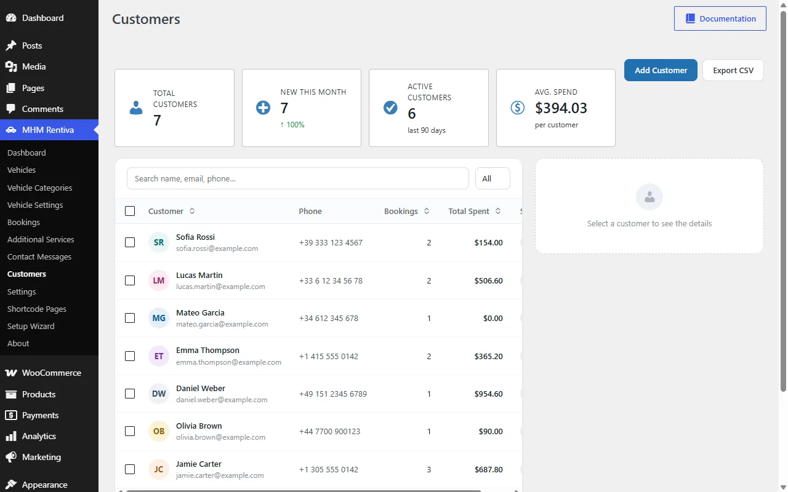

  

:::info SPA de React (desde la v4.39.0)
La página de clientes se migró por completo a una **SPA de React** respaldada por la API REST en la v4.39.0. Se eliminaron los archivos heredados `CustomersListTable.php`, `CustomersListPage.php`, `customers.js` y los archivos CSS relacionados. Ahora la página carga al instante con búsqueda en vivo, columnas ordenables, un panel de detalles deslizante y borrado masivo, todo sin recargar la página.
:::

La gestión de clientes es la sección central para crear una base de clientes fieles y hacer un seguimiento del historial de reservas. Accede a la base de datos completa de clientes desde **MHM Rentiva > Clientes**.

---

## 📊 Analíticas de clientes (métricas superiores)

En la parte superior de la página, cuatro tarjetas muestran el crecimiento y la actividad de tu base de clientes:

:::info Sin límite de clientes
Lite no tiene límite en el número de clientes, por lo que en esta pantalla no aparece ningún aviso de límite.
:::

- **Total de clientes:** el número de todos los clientes del sistema.
- **Nuevos este mes:** el número de clientes que se registraron en los últimos 30 días.
- **Clientes activos:** clientes con una reserva en los últimos 90 días.
- **Gasto medio:** el importe medio gastado por cliente.

---

---

## 👥 Lista de clientes y resumen financiero

La tabla de clientes te permite medir el valor (LTV, valor de vida del cliente) que cada usuario aporta a tu negocio:

Las columnas son **Cliente** (nombre y correo electrónico), **Teléfono**, **Reservas**, **Total gastado** y **Estado** (VIP, Nuevo o Activo). Usa el filtro **Todos / Activos / Nuevos / VIP** situado encima de la tabla para acotar la lista.

- **Reservas:** número total de operaciones de alquiler/transferencia completadas por el cliente.
- **Total gastado:** ingresos totales generados por todas las operaciones del cliente (con el símbolo de la moneda).

---

## ➕ Añadir un nuevo cliente

La pantalla de registro manual de clientes está simplificada para agilizar la operativa. Haz clic en **"Añadir cliente"** para introducir los siguientes datos:

- **Nombre del cliente:** (obligatorio)
- **Correo electrónico:** (obligatorio): el identificador único en el sistema.
- **Teléfono:** para fines de comunicación.
- **Dirección:** información básica de la dirección para la facturación o para identificar el punto de entrega.

---

## 🖱️ Panel deslizante de detalles del cliente (v4.39.0+)

Haz clic en cualquier fila de la tabla de clientes para abrir un **panel de detalles deslizante** sin recargar la página:

- **Nombre, correo electrónico, teléfono, dirección**
- **Fecha de registro**
- **Total de reservas** y **Total gastado**
- Fechas de **primera / última reserva**
- Enlaces rápidos: **Editar cliente**, **Ver reservas**

Pulsa **Escape** o haz clic fuera del panel para cerrarlo.

---

## 🔍 Búsqueda en vivo y ordenación de columnas (v4.39.0+)

- **Búsqueda en vivo:** debounce de 300 ms, sin recargar la página.
- **Columnas ordenables:** **Cliente**, **Reservas** y **Total gastado**. Usa el botón de la cabecera de la columna: el primer clic ordena de mayor a menor (descendente) y un segundo clic en la misma columna invierte el orden. La columna ordenada se anuncia a los lectores de pantalla.
- **Seleccionar todo:** la casilla de seleccionar todo muestra una marca discontinua (mixta) cuando solo hay algunas filas seleccionadas, y las filas seleccionadas se resaltan en azul claro. Al cambiar la ordenación se borra la selección.
- **Borrado masivo:** selecciona filas mediante las casillas y haz clic en "Borrar seleccionados". Una confirmación del navegador evita borrados accidentales.
- **Exportación CSV:** descarga todos los clientes (por páginas) o solo los ID seleccionados. La acción se procesa en el servidor mediante admin-post.php.

---

## Componentes de React (v4.39.0+)

| Componente | Finalidad |
| :--- | :--- |
| `StatsCards` | Cuatro tarjetas de KPI con degradado en la parte superior de la página |
| `SearchBar` | Campo de búsqueda en vivo con debounce |
| `FilterBar` | Controles de filtro de estado / segmento |
| `CustomerTable` | Tabla paginada y ordenable |
| `CustomerPanel` | Panel de detalles deslizante |
| `Pagination` | Controles de navegación entre páginas |

**Endpoints REST:**
- `GET /wp-json/mhm-rentiva/v1/customers`: paginación, búsqueda, ordenación
- `GET /wp-json/mhm-rentiva/v1/customers/{id}`: detalle
- `DELETE /wp-json/mhm-rentiva/v1/customers/bulk`: borrado masivo

Todos los endpoints requieren la capacidad `manage_options`.

---

### Resumen de la sección
- Supervisa el crecimiento de clientes con las **tarjetas de analíticas**.
- Identifica a tus clientes VIP con la columna **Total gastado**.
- Consulta al instante los detalles del cliente con el **panel deslizante** (sin recargar la página).
- Asocia todas las reservas con los clientes mediante la **base de datos central**.

### Registro de cambios
| Fecha | Versión | Nota |
| :--- | :--- | :--- |
| 18.11.2026 | 6.4.0 | Documentada la ordenación de la tabla de clientes desde la cabecera de la columna con anuncio para lectores de pantalla, la marca mixta de seleccionar todo y el resaltado de las filas seleccionadas; tarjetas, columnas y filtro corregidos según la pantalla actual. |
| 09.11.2026 | 6.3.1 | Corrección: se eliminó el cuadro "Aviso de límite de Lite". Lite no tiene límite de clientes y no muestra ningún aviso de límite. |
| 11.05.2026 | 4.39.0 | Migración completa a SPA de React. Búsqueda en vivo, columnas ordenables, panel deslizante, borrado masivo, exportación CSV. Se eliminaron la tabla de lista PHP heredada y jQuery. |
| 23.04.2026 | 4.27.2 | Documentación sincronizada con la versión actual del plugin. |
| 27.03.2026 | 4.23.0 | Documentada la posición del aviso de Lite (debajo de las tarjetas de KPI). |
| 19.03.2026 | 4.21.2 | Lista de clientes, tarjetas de analíticas y formulario de registro actualizados según la interfaz real. |
| 26.02.2026 | 4.21.0 | Versión inicial creada. |
