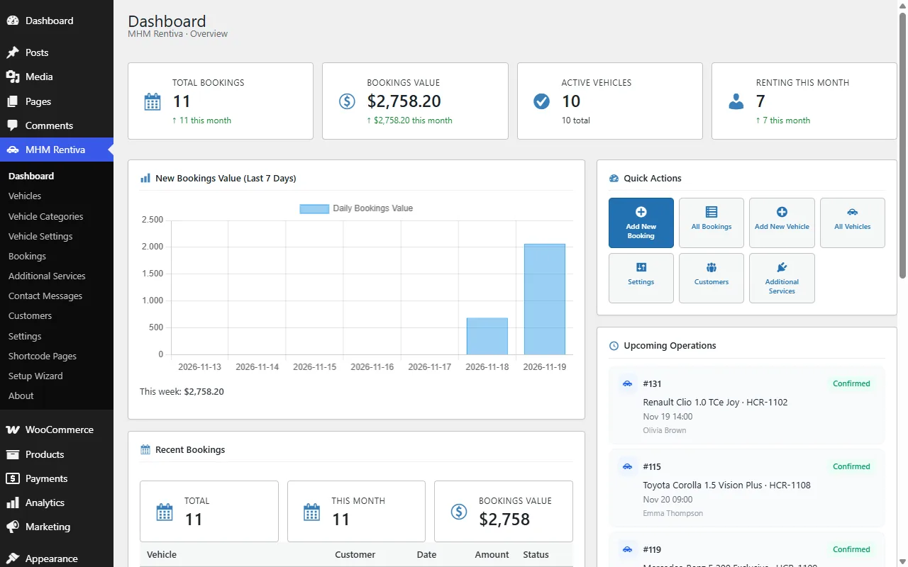

  

El Escritorio te muestra tu negocio de un vistazo: las cifras de reservas, lo que aún está pendiente de cobro, los próximos siete días y accesos directos rápidos. Accede a él desde **MHM Rentiva > Escritorio**. El título de la página es «Escritorio» con el subtítulo «MHM Rentiva · Resumen».

---

## 📊 Tarjetas de resumen

En la parte superior hay cuatro tarjetas. Muestran las cifras históricas junto con la cifra de este mes y la variación respecto al mes anterior:

- **Total de reservas:** todas las reservas excepto las canceladas y las reembolsadas, con el recuento de este mes.
- **Valor de las reservas:** el precio de las reservas confirmadas, en curso y completadas. Es el importe reservado, no el dinero cobrado; lo que aún está pendiente de cobro aparece en el recuadro **Pagos**.
- **Vehículos activos:** los vehículos que están activos actualmente, sobre el total.
- **Alquileres de este mes:** el número de clientes distintos que han hecho una reserva este mes (no se cuentan las reservas canceladas ni las reembolsadas).

:::info Cambiado en la 6.4.0
Las reservas canceladas y reembolsadas ya no se cuentan en **Total de reservas**, en el recuento de este mes ni en **Alquileres de este mes**; aparecen en el recuadro **Estados de las reservas**. La tarjeta «Ingresos totales» ahora es **Valor de las reservas**, y se ha eliminado el selector «Últimos 30 días» de la esquina superior derecha, que no funcionaba.
:::

---

## 📈 Gráficos y listas

- **Valor de nuevas reservas (últimos 7 días):** un gráfico de barras con el importe reservado por día durante los últimos siete días, con el total bajo **Esta semana**. Los días se cuentan según la fecha en que se creó la reserva, no la fecha del alquiler.
- **Reservas recientes:** las últimas reservas, empezando por la creada más recientemente, con las columnas Vehículo, Cliente, Fecha, Importe y Estado, y paginación **← Anterior / Siguiente →**.
- **Próximas operaciones:** los alquileres (vehículo, matrícula, fechas de recogida → devolución, cliente y estado) y las transferencias (Pro) que empiezan en los próximos 7 días («No hay operaciones previstas para los próximos 7 días.» cuando no hay ninguno).
- **Estados de las reservas:** el número de reservas en cada estado, incluidas las canceladas y las reembolsadas.
- **Pagos:** dos cifras.
  - **Pago pendiente:** lo que las reservas aún deben, calculado del mismo modo que lo muestra la columna **Pago** de la lista de reservas: el saldo restante tras un anticipo, las reservas que no se han pagado en absoluto (incluidas las reservas offline) y las reservas en espera de pago. Las reservas canceladas, reembolsadas y pagadas por completo no deben nada.
  - **Anticipo (retenido):** los anticipos de las reservas confirmadas y en curso que se cobraron como anticipo.

---

## ⚡ Acciones rápidas

Accesos directos a **Añadir nueva reserva**, **Todas las reservas**, **Añadir nuevo vehículo**, **Todos los vehículos**, **Ajustes**, **Clientes** y **Servicios adicionales**. Rentiva Pro añade accesos directos a sus propias pantallas (Informes, Vendedores, Mensajes, Exportar); cada uno aparece solo cuando tu licencia incluye esa función.

---

## Lite y Pro

Todos los recuadros del escritorio funcionan en Lite. Ningún recuadro está reservado para Pro.

---

### Resumen de la sección
- Las tarjetas y los recuadros cuentan lo que se ha **reservado**; **Pago pendiente** muestra lo que aún se debe.
- Las reservas canceladas y reembolsadas quedan fuera de los totales y se muestran en **Estados de las reservas**.
- El escritorio es la primera pantalla que ves después de instalar el plugin.

### Registro de cambios
| Fecha | Versión | Nota |
| :--- | :--- | :--- |
| 18.11.2026 | 6.4.0 | Escritorio reescrito para la pantalla actual: tarjeta Valor de las reservas, las reservas canceladas ya no se cuentan, Pago pendiente incluye los saldos de anticipos y las reservas offline sin pagar, primero las reservas creadas más recientemente, eliminado el selector «Últimos 30 días». |
| 09.11.2026 | 6.3.1 | Corrección: el gráfico de ingresos y Próximas operaciones no son exclusivos de Pro; todos los widgets del escritorio funcionan en Lite. Se indican los accesos directos de acciones rápidas de Pro. |
| 10.05.2026 | 4.36.0 | Migración completa a una SPA de React. Eliminados los widgets PHP heredados. |
| 19.03.2026 | 4.6.3 | Guía del escritorio actualizada con métricas reales de la interfaz. |
