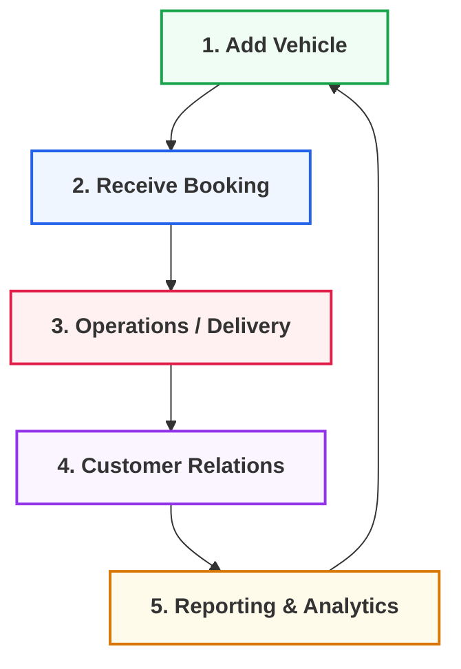

import Link from '@docusaurus/Link';

  

# 🚗 Hoja de ruta de funciones y uso

Para sacar el máximo partido a todo lo que ofrece MHM Rentiva, te recomendamos seguir el orden operativo que se indica a continuación.

:::tip GUÍA DE USO
Utiliza las tarjetas por categorías de abajo para gestionar tus operaciones diarias de alquiler, añadir vehículos y generar informes.
:::

---

  

    

      <h3 className="cardTitle">🏎️ 1. Vehículos e inventario</h3>
      
Añadir vehículos, gestión de categorías, precios y ajustes globales de vehículos.

      <Link className="button button--secondary button--block" to="/docs/features-usage/vehicles">Gestión de vehículos</Link>
    

  

  

    

      <h3 className="cardTitle">📅 2. Seguimiento de reservas</h3>
      
Gestiona las solicitudes entrantes, supervisa el calendario y revisa los detalles de las reservas.

      <Link className="button button--secondary button--block" to="/docs/features-usage/bookings">Reservas</Link>
    

  

  

    

      <h3 className="cardTitle">✨ 3. Servicios adicionales y VIP</h3>
      
Servicios adicionales como sillas de bebé y seguros, además de la definición de rutas de transferencia VIP.

      <Link className="button button--secondary button--block" to="/docs/features-usage/additional-services-usage">Servicios adicionales</Link>
    

  

  

    

      <h3 className="cardTitle">💬 4. Clientes y comunicación</h3>
      
Gestión del portal de clientes, programa de fidelización y sistema de mensajería interna.

      <Link className="button button--secondary button--block" to="/docs/features-usage/customers">Gestión de clientes</Link>
    

  

  

    

      <h3 className="cardTitle">📊 5. Informes y análisis</h3>
      
Gráficos de rendimiento del negocio, informes de ingresos y exportación de datos.

      <Link className="button button--secondary button--block" to="/docs/features-usage/reports">Informes y exportación</Link>
    

  

---

## 📈 Ciclo operativo

---

### Resumen de la sección
- Esta sección abarca los flujos de trabajo para el uso diario del plugin.
- El ciclo operativo está diseñado para un negocio de alquiler sostenible.

## Registro de cambios
| Fecha | Versión | Nota |
|---|---|---|
| 23.04.2026 | 4.27.2 | Se ha añadido la traducción al inglés. |
| 21.03.2026 | 4.21.3 | Todos los enlaces de las tarjetas (Vehículos, Reservas, Servicios adicionales, etc.) se han corregido a rutas relativas. |
| 19.03.2026 | 4.21.2 | Se ha creado la hoja de ruta de funciones y uso con un diseño de tarjetas premium. |
