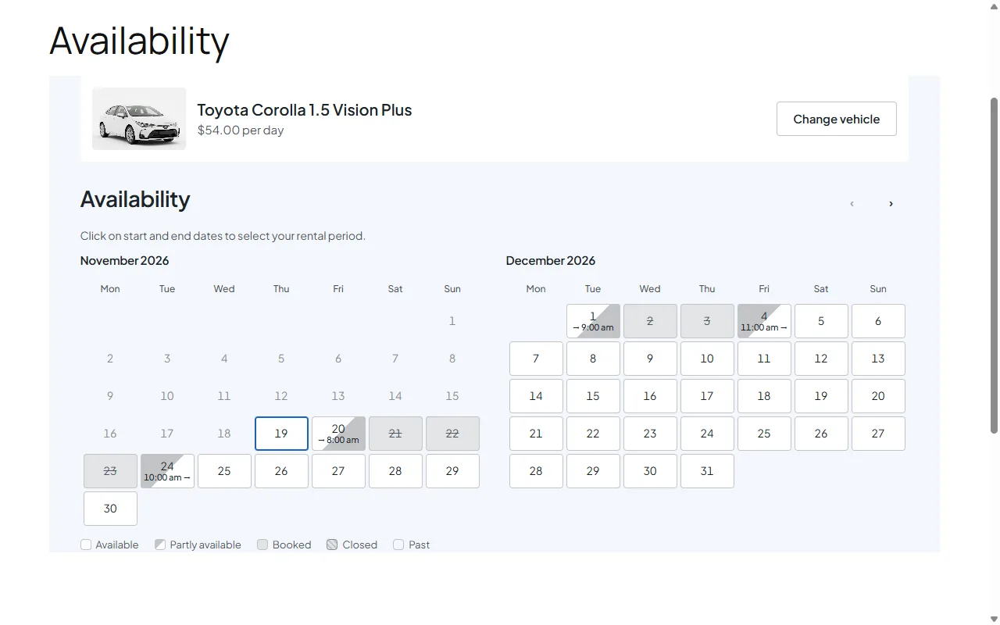

  

:::info Propósito
Esta página describe el módulo Calendario de disponibilidad como referencia estándar, y abarca tanto los aspectos técnicos como los operativos.
:::

# 🚗 Calendario de disponibilidad

## Contenido
- Uso
- Características
- Notas para desarrolladores

El módulo Calendario de disponibilidad está diseñado para gestionar y mostrar a los visitantes la disponibilidad de **reservas** en la plataforma Rentiva.

## Uso



Para añadir este módulo a cualquier página o entrada, usa el siguiente shortcode:

```shortcode
[rentiva_availability_calendar vehicle_id=""]
```

También puedes insertarlo visualmente desde el editor de bloques de Gutenberg seleccionando **"MHM Rentiva → Calendario de disponibilidad"**.

### Parámetros

Los siguientes parámetros están disponibles dentro del shortcode:

| Parámetro | Valor predeterminado | Descripción |
| :--- | :--- | :--- |
| `vehicle_id` | `(empty)` | Controla el comportamiento del filtro de **características** del módulo. |
| `show_pricing` | `apply_filters(mhmrentiva_availability_calendar_show_pricing` | Controla el comportamiento **general** de visualización del módulo. |
| `show_booking_button` | `apply_filters(` | Controla el comportamiento **general** de visualización del módulo. |
| `theme` | `apply_filters(mhmrentiva_availability_calendar_theme` | Controla el comportamiento **general** de visualización del módulo. |
| `months_ahead` | `apply_filters(mhmrentiva_availability_calendar_months_ahead` | Controla el comportamiento **general** de visualización del módulo. |
| `months_to_show` | `apply_filters(mhmrentiva_availability_calendar_months_to_show` | Controla el comportamiento **general** de visualización del módulo. |
| `start_month` | `(empty)` | Controla el comportamiento **general** de visualización del módulo. |
| `show_weekends` | `apply_filters(mhmrentiva_availability_calendar_show_weekends` | Controla el comportamiento **general** de visualización del módulo. |
| `show_past_dates` | `apply_filters(mhmrentiva_availability_calendar_show_past_dates` | Controla el comportamiento **general** de visualización del módulo. |
| `class` | `(empty)` | Controla el comportamiento **general** de diseño del módulo. |


## Características

### 📱 Diseño adaptable
- **Móvil:** Diseño de una sola columna.
- **Tableta (menos de 782px):** Vista optimizada.
- **Escritorio:** Vista completa con el número de columnas o el ancho configurados.

### 🚀 Orientado al rendimiento
- **Caché inteligente:** El sistema optimiza y almacena en caché las consultas a la base de datos.
- **Carga condicional:** Los recursos estáticos solo se cargan en las páginas donde se usa el módulo.

## Cómo leer el calendario

| Día | Significado |
| :--- | :--- |
| Disponible | Libre todo el día. |
| Parcialmente disponible | Una reserva termina o empieza ese día. Un día de devolución muestra "11:00 →" (hora de devolución más el tiempo de margen, redondeada hacia arriba a la media hora); un día de recogida muestra "→ 09:00" (hora de recogida menos el margen, redondeada hacia abajo). La celda aparece pintada a medias; en un móvil se muestra la hora abreviada. |
| Reservado | Ocupado por una reserva. |
| Cerrado (tachado) | Has cerrado el día manualmente. Ya no se muestra como "Reservado". |

La leyenda bajo el calendario muestra Disponible, Parcialmente disponible, Reservado, Cerrado y Pasado.

Si un cliente elige un día de devolución como inicio, la hora de recogida pasa a esa hora, el panel lo indica ("El ... el vehículo está libre desde las ...; se ha ajustado la hora.") y el enlace de reserva incluye la hora. Un día marcado con "→ 09:00" solo puede ser un día de devolución; si la hora de devolución elegida es posterior, el calendario avisa ("El ... el vehículo está libre hasta las ... Elige un día de devolución anterior.").

### "No se ha encontrado el vehículo."
Si el `vehicle_id` del shortcode apunta a un vehículo que ya no existe o que no se puede alquilar, el calendario muestra **No se ha encontrado el vehículo.** Comprueba el ID en el shortcode.

:::info Caché de página después de actualizar a la 6.4.0
Después de actualizar, vacía la caché de página (la de tu alojamiento, LiteSpeed Cache, WP Rocket, etc.). Una página almacenada en caché con la 6.3.x conserva el marcado antiguo del formulario de reserva y del calendario, y los nuevos scripts no pueden ejecutarse en ella. La caché breve propia de Rentiva se actualiza sola. Consulta [Rendimiento y caché](../../06-faq/performance-cache.md).
:::

## Notas para desarrolladores

- **Estructura HTML:** Todos los contenedores empiezan con la clase `.mhm-rentiva-availability-calendar-wrapper`.
- **Personalización:** Las variables CSS (`--mhm-color-primary`, etc.) se heredan del archivo global `css-variables.css`.

## Resumen de la sección
- La página Calendario de disponibilidad se ha adaptado a la estructura estándar de la documentación con encabezados de referencia coherentes.

## Registro de cambios
| Fecha | Versión | Nota |
|---|---|---|
| 18.11.2026 | 6.4.0 | Días parcialmente disponibles y cerrados, indicaciones de hora, "No se ha encontrado el vehículo." y nota sobre la caché de página. |
| 11.10.2026 | 6.2.0 | Se han eliminado `show_seasonal_prices`, `show_discounts`, `start_date` y `integrate_pricing`: la 6.2.0 ya no los lee. |
| 23.04.2026 | 4.27.2 | Se ha añadido la traducción al inglés. |
| 19.03.2026 | 4.21.0-docs | Página ordenada alfabéticamente y marcador de posición de imagen añadido. |
