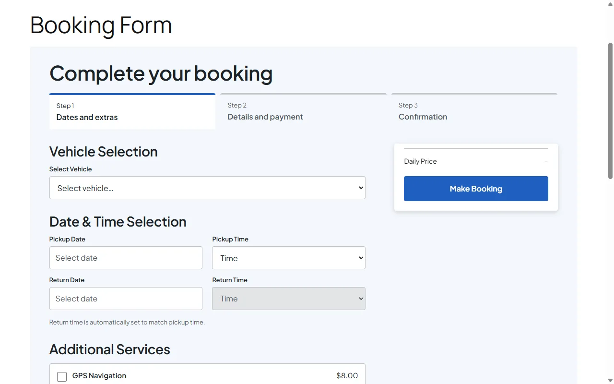

  

:::info Propósito
Esta página describe el módulo Formulario de reserva como referencia estándar y abarca tanto los aspectos técnicos como los operativos.
:::

# 🚗 Formulario de reserva

## Contenido
- Uso
- Características
- Notas para desarrolladores

El módulo Formulario de reserva está diseñado para gestionar y presentar a los visitantes los procesos de **reserva** en la plataforma Rentiva.

## Uso



Para añadir este módulo a cualquier página o entrada, usa el siguiente shortcode:

```shortcode
[rentiva_booking_form vehicle_id=""]
```

También puedes insertarlo de forma visual desde el editor de bloques de Gutenberg seleccionando **"MHM Rentiva → Formulario de reserva"**.

### Parámetros

Los siguientes parámetros están disponibles dentro del shortcode:

| Parámetro | Valor predeterminado | Descripción |
| :--- | :--- | :--- |
| `vehicle_id` | `(empty)` | Controla el comportamiento del filtro de **características** del módulo. |
| `start_date` | `(empty)` | Controla el comportamiento de visualización **general** del módulo. |
| `end_date` | `(empty)` | Controla el comportamiento del **flujo de trabajo** del módulo. |
| `show_vehicle_selector` | `1` | Controla el comportamiento de visualización **general** del módulo. |
| `default_days` | `(from settings)` | Controla el comportamiento del **flujo de trabajo** del módulo. |
| `show_addons` | `1` | Interruptor de visibilidad. `1` (activado) o `0` (desactivado). |
| `class` | `(empty)` | Controla el comportamiento de diseño **general** del módulo. |
| `redirect_url` | `(empty)` | Controla el comportamiento del **flujo de trabajo** del módulo. |
| `enable_deposit` | `1` | Interruptor de visibilidad. `1` (activado) o `0` (desactivado). |
| `form_title` | `(empty)` | Controla el comportamiento del **contenido** del módulo. |
| `show_vehicle_info` | `1` | Interruptor de visibilidad. `1` (activado) o `0` (desactivado). |
| `show_time_select` | `1` | Interruptor de visibilidad. `1` (activado) o `0` (desactivado). |


## Características

### 📱 Diseño adaptable
- **Móvil:** diseño de una sola columna.
- **Tableta (menos de 782px):** vista optimizada.
- **Escritorio:** vista completa con el número de columnas o el ancho configurados.

### 🚀 Orientado al rendimiento
- **Caché inteligente:** el sistema optimiza y almacena en caché las consultas a la base de datos.
- **Carga condicional:** los recursos estáticos solo se cargan en las páginas donde se usa el módulo.

## Conviene saber

### Contrato de alquiler
Si activas **Exigir contrato de alquiler** (consulta [Ajustes de reserva](../../02-core-configuration/booking-settings.md)), el formulario muestra una sección **Contrato de alquiler** debajo de los servicios adicionales: un cuadro de texto desplazable y una casilla **He leído y acepto el contrato de alquiler.** Un cliente que no la marque verá "Para completar tu reserva, acepta el contrato de alquiler." y la reserva se rechazará, tanto en el navegador como de nuevo en el servidor. La fecha y la hora de la aceptación y la versión del texto se guardan con la reserva.

Si editas el texto mientras un cliente ya tiene la página abierta (o una copia de ella en caché), su envío se rechaza con "El contrato de alquiler ha cambiado. Recarga la página y revísalo antes de reservar." y el cliente revisa el nuevo texto. El contrato no se muestra en las reservas de transferencia.

### Fechas de devolución y de recogida
- Si la devolución es anterior a la recogida (o coincide con ella), el formulario indica "La fecha de devolución debe ser posterior a la fecha de recogida." y mantiene bloqueado **Realizar reserva** hasta que se corrijan las fechas.
- Un cliente no puede calcular el precio ni reservar con una hora de recogida que ya ha pasado: "La hora de recogida ya ha pasado. Elige una fecha u hora posterior." Un administrador sigue pudiendo introducir manualmente una reserva pasada.

### Cuando el vehículo está ocupado
Si el vehículo elegido ya está reservado para esas fechas, el formulario indica "El vehículo seleccionado no está disponible, pero podemos sugerirte vehículos similares:" y muestra los vehículos libres para las mismas fechas, cada uno con un botón **Seleccionar este vehículo** que conserva las fechas.

:::info Caché de página tras actualizar a la 6.4.0
Vacía la caché de página una vez después de actualizar. Consulta [Rendimiento y caché](../../06-faq/performance-cache.md).
:::

## Notas para desarrolladores

- **Estructura HTML:** todos los contenedores empiezan con la clase `.mhm-rentiva-booking-form-wrapper`.
- **Personalización:** las variables CSS (`--mhm-color-primary`, etc.) se heredan del archivo global `css-variables.css`.

## Resumen de la sección
- La página Formulario de reserva se ha adaptado a la estructura estándar de la documentación, con encabezados de referencia coherentes.

## Registro de cambios
| Fecha | Versión | Nota |
|---|---|---|
| 18.11.2026 | 6.4.0 | Se documentan el contrato de alquiler, las comprobaciones de fechas y las sugerencias de vehículos similares. |
| 11.10.2026 | 6.2.0 | Se eliminan `min_days`, `max_days`, `show_payment_options` y `default_payment`: la 6.2.0 ya no los lee; los ajustes globales siguen aplicándose. |
| 23.04.2026 | 4.27.2 | Se añade la traducción al inglés. |
| 19.03.2026 | 4.21.0-docs | Página ordenada alfabéticamente y marcador de posición de imagen añadido. |
