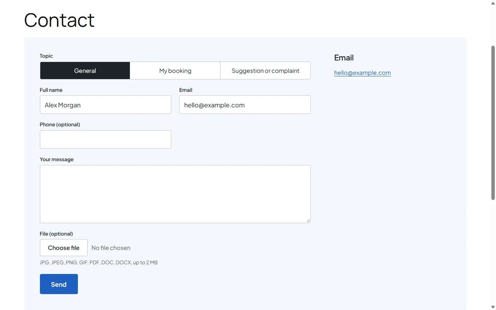

  

:::info Propósito
Esta página describe el módulo Formulario de contacto como referencia estándar y abarca tanto los aspectos técnicos como los operativos.
:::

# 🚗 Formulario de contacto

## Contenido
- Uso
- Parámetros
- Protección contra spam
- Leer los mensajes
- Notas para desarrolladores

El formulario de contacto permite a los visitantes escribirte desde tu sitio. Cada mensaje se guarda en **MHM Rentiva > Mensajes de contacto** y se te envía por correo electrónico.

## Uso



Para añadir este módulo a cualquier página o entrada, usa el siguiente shortcode:

```shortcode
[rentiva_contact]
```

También puedes insertarlo visualmente desde el editor de bloques de Gutenberg seleccionando **"MHM Rentiva → Formulario de contacto"**. El asistente de configuración crea por ti una página con el formulario de contacto.

### Parámetros

| Parámetro | Valor predeterminado | Descripción |
| :--- | :--- | :--- |
| `type` | `general` | Tipo de formulario: `general`, `booking`, `support` o `feedback`. |
| `show_topic_selector` | `1` | Permite al visitante elegir el asunto. Establécelo en `0` para mantener `type` fijo. |
| `title` | vacío | Título personalizado. |
| `description` | vacío | Descripción personalizada. |
| `show_phone` | `1` | Muestra el campo de teléfono. |
| `show_company` | `0` | Muestra el campo de empresa. |
| `show_vehicle_selector` | `0` | Muestra un selector de vehículo (para consultas de reserva). |
| `show_priority` | `0` | Muestra el selector de prioridad (para solicitudes de soporte). |
| `show_attachment` | `1` | Muestra el campo para adjuntar archivos. |
| `show_booking_id_field` | `0` | Muestra el campo del número de reserva. |
| `show_company_info` | `1` | Muestra el cuadro de información de contacto (se rellena en **Ajustes > General > Información de marca y contacto**). |
| `redirect_url` | vacío | Página que se abre tras un envío correcto (solo del mismo sitio). |
| `success_message` | vacío | Sustituye el texto de éxito predeterminado. |
| `email_to` | vacío | Envía los mensajes de este formulario a otra dirección en lugar de al destinatario predeterminado. |
| `auto_reply` | `1` | Envía al visitante una respuesta automática. |
| `theme` | `default` | `default`, `compact` o `detailed`. |
| `class` | vacío | Clase CSS adicional. |

## Protección contra spam

El formulario no necesita configuración y no le pide al visitante que resuelva nada. Un mensaje que parece spam se guarda con el estado **Spam** y no se envía ningún correo electrónico ni respuesta automática; el visitante ve la respuesta normal de "recibido", así que un bot no averigua nada. Un mensaje se considera spam cuando:

- se ha rellenado un campo trampa oculto;
- se envía demasiado pronto después de abrir la página;
- coincide con tu lista de WordPress **Ajustes > Comentarios > Claves de comentarios no permitidas**;
- contiene más enlaces de los permitidos;
- el mismo mensaje ha llegado desde la misma dirección en los últimos 10 minutos;
- Akismet, si está instalado y tiene una clave, lo marca como spam.

Hay dos límites que se establecen en **MHM Rentiva > Ajustes > General > Información de marca y contacto**:

- **Segundos mínimos antes del envío** (3 por defecto; 0 lo desactiva): un formulario o una nueva valoración que se envía antes de este tiempo desde que se abrió la página se considera un bot.
- **Máximo de enlaces en un mensaje** (3 por defecto): un mensaje con más enlaces que este número va a Spam. Con 0, cualquier enlace lo envía a Spam.

La misma sección contiene **Consentimiento del aviso de privacidad**: cuando está activado, los remitentes deben marcar una casilla de aviso de privacidad antes de enviar.

## Leer los mensajes

Abre **MHM Rentiva > Mensajes de contacto**. Los mensajes aparecen como Nuevo, Leído o Respondido; los mensajes interceptados están en el filtro **Spam**, con el motivo indicado en cada uno. Si un mensaje no es spam, usa **No es spam** y se convertirá en un mensaje nuevo normal (en ese momento no se envía ningún correo electrónico). El filtro de tipo ofrece los mismos tipos que el formulario; Soporte técnico solo aparece cuando existe un mensaje de ese tipo. Un mensaje enviado por un cliente con la sesión iniciada sobre una de sus propias reservas muestra la reserva seleccionada.

## Características

### 📱 Diseño adaptable
- **Móvil:** diseño de una sola columna.
- **Tablet (menos de 782px):** vista optimizada.
- **Escritorio:** vista completa con el número de columnas o el ancho configurados.

### 🚀 Orientado al rendimiento
- **Carga condicional:** los recursos estáticos solo se cargan en las páginas donde se usa el módulo.
- El formulario lleva un token de seguridad, por lo que no se guarda en la caché de páginas HTML.

## Notas para desarrolladores

- **Estructura HTML:** todos los contenedores empiezan con la clase `.mhm-rentiva-contact-wrapper`.
- **Personalización:** las variables CSS (`--mhm-color-primary`, etc.) se heredan del archivo global `css-variables.css`.
- **Filtros:** `mhmrentiva_contact_min_seconds`, `mhmrentiva_contact_max_links`, `mhmrentiva_contact_spam_reason` y `mhmrentiva_contact_attachment_max_bytes`.

## Resumen de la sección
- El formulario está protegido contra el spam desde el primer momento; revisa el filtro **Spam** si parece que falta algún mensaje.

## Registro de cambios
| Fecha | Versión | Nota |
|---|---|---|
| 18.11.2026 | 6.4.0 | Protección contra spam, opción de consentimiento de privacidad, filtro de spam y enlace a la reserva en Mensajes de contacto; tabla de parámetros completada. |
| 23.04.2026 | 4.27.2 | Añadida la traducción al inglés. |
| 19.03.2026 | 4.21.0-docs | Página ordenada alfabéticamente y marcador de posición de imagen añadido. |
