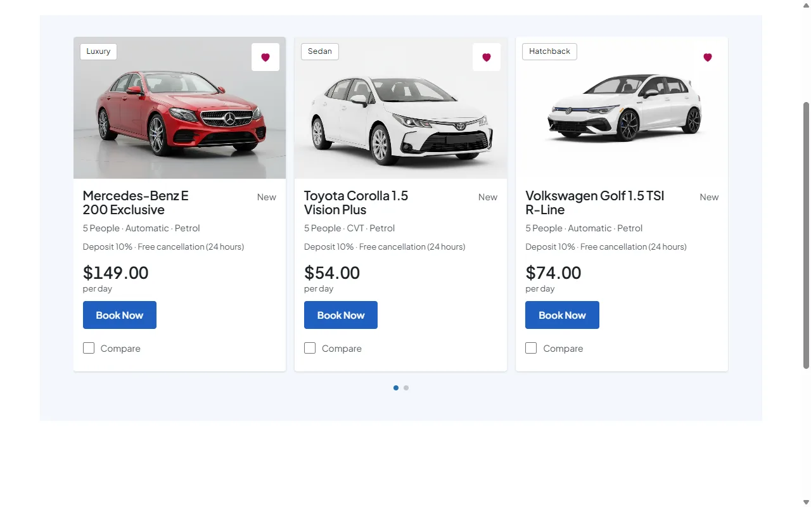

  

:::info Propósito
Esta página describe el módulo Vehículos destacados como referencia estándar y abarca tanto los aspectos técnicos como los operativos.
:::

# 🚗 Vehículos destacados

## Contenido
- Uso
- Características
- Notas para desarrolladores

El módulo Vehículos destacados está diseñado para gestionar y presentar a los visitantes los listados de **vehículo** en la plataforma Rentiva.

## Uso



Para añadir este módulo a cualquier página o entrada, usa el siguiente shortcode:

```shortcode
[rentiva_featured_vehicles limit="6"]
```

También puedes insertarlo visualmente desde el editor de bloques de Gutenberg seleccionando **"MHM Rentiva → Vehículos destacados"**.

### Parámetros

Los siguientes parámetros están disponibles dentro del shortcode:

| Parámetro | Valor predeterminado | Descripción |
| :--- | :--- | :--- |
| `ids` | `(empty)` | Lista de ID separados por comas (p. ej., `12,15,44`). |
| `category` | `(empty)` | Controla el comportamiento del filtro de **características** del módulo. |
| `limit` | `6` | Número máximo de elementos que se muestran. |
| `layout` | `grid` | Controla el comportamiento **general** del diseño del módulo. |
| `columns` | `3` | Controla el comportamiento **general** del diseño del módulo. |
| `autoplay` | `1` | Interruptor de visibilidad. `1` (activado) o `0` (desactivado). |
| `interval` | `5000` | Controla el comportamiento del **diseño** del módulo. |
| `orderby` | `date` | Controla el comportamiento **general** de ordenación del módulo. |
| `order` | `DESC` | Controla la dirección **general** de ordenación del módulo. |
| `show_price` | `1` | Controla el comportamiento **general** de visualización del módulo. |
| `show_rating` | `1` | Controla el comportamiento **general** de visualización del módulo. |
| `show_category` | `1` | Controla el comportamiento **general** de visualización del módulo. |
| `show_booking_button` | `1` | Muestra el botón de reserva en cada tarjeta. `1` (activado) o `0` (desactivado). Sustituye a `show_book_button`, que la versión 6.2.0 ya no lee. |
| `show_features` | `1` | Controla el comportamiento **general** de visualización del módulo. |
| `max_features` | `5` | Controla el comportamiento del filtro de **características** del módulo. |
| `show_brand` | `0` | Interruptor de visibilidad. `1` (activado) o `0` (desactivado). |
| `show_compare_button` | `1` | Controla el comportamiento **general** de visualización del módulo. |
| `show_favorite_button` | `1` | Controla el comportamiento **general** de visualización del módulo. |
| `image_size` | `medium_large` | Controla el comportamiento del **diseño** del módulo. |
| `filter_brands` | `(empty)` | Controla el comportamiento de la consulta de **datos** del módulo. |
| `filter_categories` | `(empty)` | Controla el comportamiento del filtro de **características** del módulo. |


## Características

### 📱 Diseño adaptable
- **Móvil:** diseño de una sola columna.
- **Tableta (menos de 782px):** vista optimizada.
- **Escritorio:** vista completa con el número de columnas o el ancho configurados.

### 🚀 Orientado al rendimiento
- **Caché inteligente:** el sistema optimiza y almacena en caché las consultas a la base de datos.
- **Carga condicional:** los recursos estáticos solo se cargan en las páginas donde se usa el módulo.

## Detalles de la tarjeta del vehículo

- **Servicios obligatorios en el total:** cuando la página se abre con fechas (por ejemplo, desde una búsqueda), cada tarjeta muestra el total del periodo. Si has marcado algunos servicios adicionales como obligatorios, una línea debajo del total los indica, por ejemplo "Servicio obligatorio incluido: Seguro a todo riesgo 25" (si hay varios servicios, se enumeran separados por comas con un único importe combinado; un servicio por día se multiplica por el número de días). Una tarjeta sin fechas muestra el precio diario y no incluye esa línea.
- **Disposición del precio y el botón:** el propio ancho de la tarjeta determina la disposición. En una tarjeta estrecha (por ejemplo, los vehículos destacados de la página de inicio o una página de vehículos de tres columnas), el precio aparece encima del botón **Realizar reserva**; en una tarjeta ancha (por ejemplo, los resultados de búsqueda con fechas), aparecen uno al lado del otro. Las tarjetas de una misma fila siempre tienen el mismo aspecto.
- **Formato de números:** el kilometraje y la cilindrada siguen el idioma de la página: en inglés "18,500 km" y "1.6 L", en turco "18.500 km" y "1,6 L".

## Notas para desarrolladores

- **Estructura HTML:** todos los contenedores empiezan con la clase `.mhm-rentiva-featured-vehicles-wrapper`.
- **Personalización:** las variables CSS (`--mhm-color-primary`, etc.) se heredan del archivo global `css-variables.css`.

## Resumen de la sección
- La página Vehículos destacados se ha adaptado a la estructura estándar de la documentación con encabezados de referencia coherentes.

## Registro de cambios
| Fecha | Versión | Nota |
|---|---|---|
| 18.11.2026 | 6.4.0 | Detalles de la tarjeta del vehículo: línea de servicios obligatorios, disposición del precio y el botón, formato de números. |
| 11.10.2026 | 6.2.0 | Se han eliminado `title`, `show_book_button`, `show_availability`, `show_badges` y `price_format`: la versión 6.2.0 ya no los lee. Se ha documentado `show_booking_button` (sustituye a `show_book_button`). |
| 23.04.2026 | 4.27.2 | Se ha añadido la traducción al inglés. |
| 19.03.2026 | 4.21.0-docs | Página ordenada alfabéticamente y marcador de posición de imagen añadido. |
