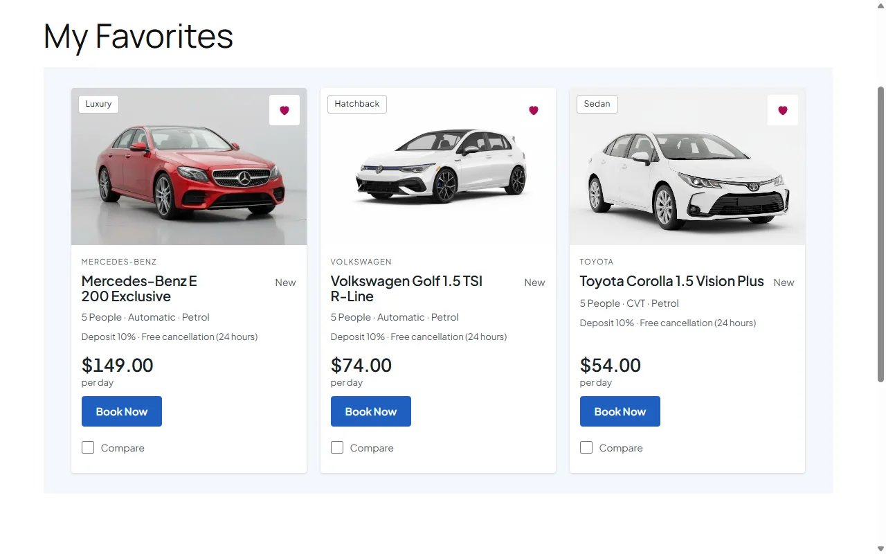

  

:::info Propósito
Esta página describe el módulo Favoritos de la cuenta como referencia estándar, abarcando tanto los aspectos técnicos como los operativos.
:::

# 🚗 Favoritos de la cuenta

## Contenido
- Uso
- Características
- Notas para desarrolladores

El módulo Favoritos de la cuenta está diseñado para gestionar y mostrar a los visitantes los favoritos de la **cuenta** en la plataforma Rentiva.

## Uso



Para añadir este módulo a cualquier página o entrada, usa el siguiente shortcode:

```shortcode
[rentiva_my_favorites limit="12"]
```

También puedes insertarlo de forma visual desde el editor de bloques de Gutenberg seleccionando **"MHM Rentiva → Account Favorites"**.

### Parámetros

Los siguientes parámetros están disponibles dentro del shortcode:

| Parámetro | Valor predeterminado | Descripción |
| :--- | :--- | :--- |
| `limit` | `12` | Número máximo de elementos que se mostrarán. |
| `columns` | `3` | Controla el comportamiento **general** de la disposición del módulo. |
| `orderby` | `date` | Controla el comportamiento **general** de ordenación del módulo. |
| `order` | `DESC` | Controla la dirección **general** de ordenación del módulo. |
| `show_image` | `1` | Interruptor de visibilidad. `1` (activado) o `0` (desactivado). |
| `show_title` | `1` | Controla el comportamiento **general** de visualización del módulo. |
| `show_price` | `1` | Controla el comportamiento **general** de visualización del módulo. |
| `show_features` | `1` | Controla el comportamiento **general** de visualización del módulo. |
| `show_rating` | `1` | Controla el comportamiento **general** de visualización del módulo. |
| `show_booking_button` | `1` | Controla el comportamiento **general** de visualización del módulo. |
| `show_favorite_button` | `1` | Controla el comportamiento **general** de visualización del módulo. |
| `layout` | `grid` | Controla el comportamiento **general** de la disposición del módulo. |
| `no_results_text` | `__(You have no favorite vehicles yet.` | Controla el comportamiento del **contenido** del módulo. |


## Características

### 📱 Diseño adaptable
- **Móvil:** Disposición en una sola columna.
- **Tableta (menos de 782px):** Vista optimizada.
- **Escritorio:** Vista completa con el número de columnas o el ancho configurados.

### 🚀 Orientado al rendimiento
- **Caché inteligente:** El sistema optimiza y almacena en caché las consultas a la base de datos.
- **Carga condicional:** Los recursos estáticos solo se cargan en las páginas en las que se usa el módulo.

## Detalles de la tarjeta de vehículo

Los favoritos usan la misma tarjeta de vehículo que la cuadrícula de vehículos. El precio y el botón **Realizar reserva** se adaptan al ancho de la tarjeta (apilados en una tarjeta estrecha, uno al lado del otro en una ancha), y el kilometraje y la cilindrada siguen el idioma de la página ("18,500 km" en inglés, "18.500 km" en turco).

## Notas para desarrolladores

- **Estructura HTML:** Todos los contenedores empiezan con la clase `.mhm-rentiva-my-favorites-wrapper`.
- **Personalización:** Las variables CSS (`--mhm-color-primary`, etc.) se heredan del archivo global `css-variables.css`.

## Resumen de la sección
- La página Favoritos de la cuenta se ha adaptado a la estructura de documentación estándar con encabezados de referencia coherentes.

## Registro de cambios
| Fecha | Versión | Nota |
|---|---|---|
| 18.11.2026 | 6.4.0 | Se documentan la disposición de la tarjeta y el formato de los números. |
| 11.10.2026 | 6.2.0 | Se han eliminado `show_badges`, `show_remove_button` y `show_added_date`: la versión 6.2.0 ya no los lee. |
| 23.04.2026 | 4.27.2 | Se ha añadido la traducción al inglés. |
| 19.03.2026 | 4.21.0-docs | Página ordenada alfabéticamente y marcador de posición de imagen añadido. |
