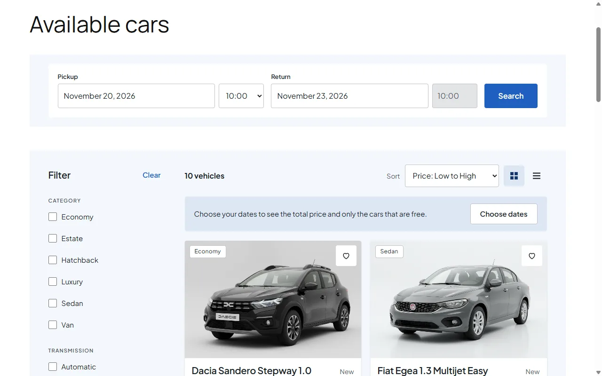

  

:::info Propósito
Esta página describe el módulo Resultados de búsqueda como referencia estándar y abarca tanto los aspectos técnicos como los operativos.
:::

# 🚗 Resultados de búsqueda

## Contenido
- Uso
- Características
- Notas para desarrolladores

El módulo Resultados de búsqueda está diseñado para gestionar y mostrar a los visitantes los resultados de búsqueda de **vehículos** en la plataforma Rentiva.

## Uso



Para añadir este módulo a cualquier página o entrada, usa el siguiente shortcode:

```shortcode
[rentiva_search_results layout="grid"]
```

También puedes insertarlo de forma visual desde el editor de bloques de Gutenberg seleccionando **"MHM Rentiva → Search Results"**.

### Parámetros

Los siguientes parámetros están disponibles dentro del shortcode:

| Parámetro | Valor predeterminado | Descripción |
| :--- | :--- | :--- |
| `layout` | `grid` | Controla el comportamiento **general** del diseño del módulo. |
| `show_filters` | `1` | Controla el comportamiento **general** de visualización del módulo. |
| `results_per_page` | `12` | Controla el comportamiento **general** de visualización del módulo. |
| `show_pagination` | `1` | Controla el comportamiento **general** de visualización del módulo. |
| `show_sorting` | `1` | Controla el comportamiento **general** de visualización del módulo. |
| `show_view_toggle` | `1` | Controla el comportamiento **general** de visualización del módulo. |
| `show_favorite_button` | `1` | Controla el comportamiento **general** de visualización del módulo. |
| `show_compare_button` | `1` | Controla el comportamiento **general** de visualización del módulo. |
| `show_booking_button` | `1` | Controla el comportamiento **general** de visualización del módulo. |
| `show_price` | `1` | Controla el comportamiento **general** de visualización del módulo. |
| `show_title` | `1` | Controla el comportamiento **general** de visualización del módulo. |
| `show_features` | `1` | Controla el comportamiento **general** de visualización del módulo. |
| `show_rating` | `1` | Controla el comportamiento **general** de visualización del módulo. |
| `show_badges` | `1` | Controla el comportamiento **general** de visualización del módulo. |
| `default_sort` | `price_asc` | El primer criterio de ordenación: `relevance`, `price_asc`, `price_desc`, `name_asc`, `name_desc` o `year_desc`. Sustituye a `order` y `orderby`, que la versión 6.2.0 ya no lee. |
| `class` | `(empty)` | Controla el comportamiento **general** del diseño del módulo. |


## Características

### 📱 Diseño adaptable
- **Móvil:** diseño de una sola columna.
- **Tableta (menos de 782px):** vista optimizada.
- **Escritorio:** vista completa con el número de columnas o el ancho configurados.

### 🚀 Orientado al rendimiento
- **Caché inteligente:** el sistema optimiza y almacena en caché las consultas a la base de datos.
- **Carga condicional:** los recursos estáticos solo se cargan en las páginas donde se usa el módulo.

## Filtros de la barra lateral

### Filtro de ubicación (selección múltiple)

A partir de la versión 4.22.1, el filtro de ubicación usa **casillas de verificación** en lugar de botones de opción. Esto permite a los usuarios seleccionar varias ubicaciones a la vez. Las ubicaciones seleccionadas se consultan con una cláusula SQL `IN()`.

- Selección única: al seleccionar una ubicación, solo se muestran los vehículos de esa ubicación.
- Selección múltiple: al seleccionar varias ubicaciones, se muestran los vehículos disponibles en cualquiera de las ubicaciones seleccionadas.

## Tarjetas de vehículos y problemas con las fechas

- **Servicios obligatorios en el total:** cuando la página se abre con fechas (por ejemplo, desde una búsqueda), cada tarjeta muestra el total del periodo. Si has marcado algunos servicios adicionales como obligatorios, una línea bajo el total los nombra, por ejemplo "Servicio obligatorio incluido: Seguro a todo riesgo 25" (si hay varios servicios, se enumeran separados por comas con un único importe combinado; un servicio por día se multiplica por el número de días). Una tarjeta sin fechas muestra el precio diario y no incluye esa línea.
- **Disposición del precio y el botón:** el ancho de la propia tarjeta determina la disposición. En una tarjeta estrecha (por ejemplo, los vehículos destacados de la página de inicio o una página de vehículos de tres columnas), el precio aparece encima del botón **Realizar reserva**; en una tarjeta ancha (por ejemplo, los resultados de búsqueda con fechas), aparecen uno al lado del otro. Las tarjetas de una misma fila siempre tienen el mismo aspecto.
- **Formato de números:** el kilometraje y la cilindrada siguen el idioma de la página: en inglés "18,500 km" y "1.6 L"; en turco "18.500 km" y "1,6 L".

- **Problemas con las fechas:** si las fechas no se pueden reservar (devolución anterior a la recogida, o una hora de recogida que ya ha pasado), la página lo indica en un aviso encima de la lista ("La fecha de devolución debe ser posterior a la fecha de recogida." o "La hora de recogida ya ha pasado. Elige una fecha u hora posterior.") con un enlace **Cambiar fechas**. No indica "no hay vehículos disponibles"; en el caso de una fecha pasada, los vehículos se muestran sin fechas.
- **Varios idiomas:** en un sitio con Polylang o WPML, la barra lateral de filtros muestra los nombres de combustible, transmisión y categoría en el idioma de cada visitante. Consulta [Problemas frecuentes](../../06-faq/common-issues.md).

## Notas para desarrolladores

- **Estructura HTML:** todos los contenedores empiezan con la clase `.mhm-rentiva-search-results-wrapper`.
- **Personalización:** las variables CSS (`--mhm-color-primary`, etc.) se heredan del archivo global `css-variables.css`.
- **Consulta de disponibilidad:** `QueryHelper::get_availability_subquery()` está protegida frente a parámetros de fecha vacíos. `strtotime('')` devuelve en PHP la marca de tiempo de hoy en lugar de `false`; esto se corrigió en la versión 4.22.1. Cuando se pasa una fecha vacía, el filtro de disponibilidad se desactiva.
- **Consulta de ubicación:** `QueryHelper::get_location_subquery()` acepta tanto un único ID de ubicación (`int`) como varios (`array`).

## Resumen de la sección
- La página Resultados de búsqueda se ha adaptado a la estructura de documentación estándar con encabezados de referencia coherentes.

## Registro de cambios
| Fecha | Versión | Nota |
|---|---|---|
| 18.11.2026 | 6.4.0 | Línea de servicios obligatorios, disposición de las tarjetas, aviso de problemas con las fechas y nombres de filtros multilingües. |
| 11.10.2026 | 6.2.0 | Se documentan los valores de `default_sort`; sustituye a `order` / `orderby`, que la versión 6.2.0 ya no lee. |
| 23.04.2026 | 4.27.2 | Se añade la traducción al inglés. |
| 27.03.2026 | 4.22.1 | El filtro de ubicación pasa de botones de opción a casillas de verificación (selección múltiple). La consulta de disponibilidad se protege frente a fechas vacías. Se añade información sobre QueryHelper a las Notas para desarrolladores. |
| 19.03.2026 | 4.21.0-docs | Página ordenada alfabéticamente y marcador de posición de imagen añadido. |
