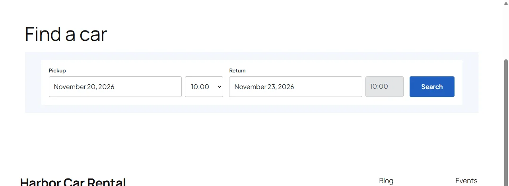

  

:::info Propósito
Esta página describe el módulo de búsqueda unificada como referencia estándar y abarca tanto los aspectos técnicos como los operativos.
:::

# 🚗 Búsqueda unificada

## Contenido
- Uso
- Características
- Notas para desarrolladores

El módulo de búsqueda unificada está diseñado para gestionar y presentar a los visitantes los procesos de búsqueda de **vehículos** en la plataforma Rentiva.

## Uso



Para añadir este módulo a cualquier página o entrada, utiliza el siguiente shortcode:

```shortcode
[rentiva_unified_search default_tab="default"]
```

También puedes insertarlo visualmente desde el editor de bloques de Gutenberg seleccionando **"MHM Rentiva → Unified Search"**.

### Parámetros

Los siguientes parámetros están disponibles dentro del shortcode:

| Parámetro | Predeterminado | Descripción |
| :--- | :--- | :--- |
| `default_tab` | `default` | Controla el comportamiento del **flujo de trabajo** del módulo. |
| `default_tab_alias` | `defaultTab` | Controla el comportamiento del filtro de **características** del módulo. |
| `show_rental_tab` | `default` | Interruptor de visibilidad. `1` (activado) o `0` (desactivado). |
| `show_transfer_tab` | `default` | Interruptor de visibilidad. `1` (activado) o `0` (desactivado). |
| `show_location_select` | `default` | Interruptor de visibilidad. `1` (activado) o `0` (desactivado). |
| `show_time_select` | `default` | Interruptor de visibilidad. `1` (activado) o `0` (desactivado). |
| `show_date_picker` | `default` | Interruptor de visibilidad. `1` (activado) o `0` (desactivado). |
| `show_dropoff_location` | `default` | Interruptor de visibilidad. `1` (activado) o `0` (desactivado). |
| `show_pax` | `default` | Interruptor de visibilidad. `1` (activado) o `0` (desactivado). |
| `show_luggage` | `default` | Interruptor de visibilidad. `1` (activado) o `0` (desactivado). |
| `service_type` | `both` | Controla el comportamiento del filtro de **características** del módulo. |
| `redirect_page` | `default` | Controla el comportamiento del **flujo de trabajo** del módulo. |
| `search_layout` | `horizontal` | `horizontal` o `vertical` (apila los campos). Sustituye a `layout`, que la versión 6.2.0 ya no lee. |
| `style` | `glass` | Controla el comportamiento del **diseño** del módulo. |
| `location_required` | `0` | Controla si la selección de ubicación es obligatoria. `1` (obligatoria) o `0` (opcional). |
| `class` | `(empty)` | Controla el comportamiento **general** del diseño del módulo. |

### Comportamiento de los campos obligatorios

El comportamiento de los campos obligatorios en el formulario de búsqueda varía según la pestaña:

- **Pestaña de alquiler:** la obligatoriedad de los campos es condicional y depende del ajuste global `mhmrentiva_fields_required`. El valor predeterminado es `0` (no obligatorio).
- **Pestaña de transferencia:** los campos de transferencia (`origin_id`, `destination_id`, `date`, `luggage_count`, `luggage_large`) son siempre obligatorios (`required` fijado en el código). Como la transferencia es un servicio basado en rutas, estos campos no pueden dejarse vacíos.

:::tip Gestión de ajustes
El valor de `mhmrentiva_fields_required` se puede cambiar en **MHM Rentiva > Ajustes**. Este ajuste solo afecta a la pestaña de alquiler; en la pestaña de transferencia los campos son siempre obligatorios.
:::

## Características

### 📱 Diseño adaptable
- **Móvil:** diseño de una sola columna.
- **Tableta (menos de 782px):** vista optimizada.
- **Escritorio:** vista completa con el número de columnas o el ancho configurados.

### 🚀 Orientado al rendimiento
- **Caché inteligente:** el sistema optimiza y almacena en caché las consultas a la base de datos.
- **Carga condicional:** los recursos estáticos solo se ponen en cola en las páginas donde se utiliza el módulo.

## Fechas que no se pueden reservar

Si un visitante elige una fecha de devolución anterior a la de recogida, o una hora de recogida que ya ha pasado, la página de resultados explica el problema y ofrece **Cambiar fechas** en lugar de indicar que no hay vehículos disponibles.

## Notas para desarrolladores

- **Estructura HTML:** todos los contenedores empiezan con la clase `.mhm-rentiva-unified-search-wrapper`.
- **Personalización:** las variables CSS (`--mhm-color-primary`, etc.) se heredan del archivo global `css-variables.css`.

## Resumen de la sección
- La página de búsqueda unificada se ha adaptado a la estructura estándar de la documentación con encabezados de referencia coherentes.

## Registro de cambios
| Fecha | Versión | Nota |
|---|---|---|
| 18.11.2026 | 6.4.0 | Añadida una nota sobre las fechas que no se pueden reservar. |
| 11.10.2026 | 6.2.0 | Eliminados `filter_categories` y `layout`: la versión 6.2.0 ya no los lee. Usa `search_layout="vertical"` en lugar de `layout`. |
| 23.04.2026 | 4.27.2 | Añadida la traducción al inglés. |
| 27.03.2026 | 4.22.1 | Añadido el parámetro `location_required`. Documentado el comportamiento de los campos obligatorios (fields_required): en el alquiler es condicional y en la transferencia siempre es obligatorio. |
| 19.03.2026 | 4.21.0-docs | Página ordenada alfabéticamente y añadido un marcador de posición para la imagen. |
