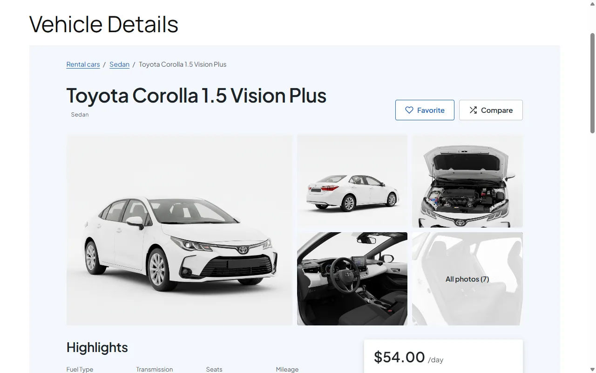

  

:::info Propósito
Esta página describe el módulo Detalles del vehículo como referencia estándar y abarca tanto los aspectos técnicos como los operativos.
:::

# 🚗 Detalles del vehículo

## Contenido
- Uso
- Funcionalidades
- Notas para desarrolladores

El módulo Detalles del vehículo está diseñado para gestionar y mostrar a los visitantes la información detallada del **vehículo** en la plataforma Rentiva.

## Uso



Para añadir este módulo a cualquier página o entrada, usa el siguiente shortcode:

```shortcode
[rentiva_vehicle_details vehicle_id=""]
```

También puedes insertarlo visualmente desde el editor de bloques de Gutenberg seleccionando **"MHM Rentiva → Detalles del vehículo"**.

### Parámetros

Dentro del shortcode están disponibles los siguientes parámetros:

| Parámetro | Valor predeterminado | Descripción |
| :--- | :--- | :--- |
| `vehicle_id` | `(empty)` | Controla el comportamiento del filtro de **funcionalidades** del módulo. |
| `show_gallery` | `1` | Interruptor de visibilidad. `1` (activado) o `0` (desactivado). |
| `show_features` | `1` | Controla el comportamiento de visualización **general** del módulo. |
| `show_pricing` | `1` | Controla el comportamiento de visualización **general** del módulo. |
| `show_booking` | `1` | Interruptor de visibilidad. `1` (activado) o `0` (desactivado). |
| `show_calendar` | `1` | Interruptor de visibilidad. `1` (activado) o `0` (desactivado). |
| `show_price` | `1` | Controla el comportamiento de visualización **general** del módulo. |
| `show_booking_button` | `1` | Controla el comportamiento de visualización **general** del módulo. |
| `show_favorite_button` | `1` | Controla el comportamiento de visualización **general** del módulo. |
| `show_compare_button` | `1` | Controla el comportamiento de visualización **general** del módulo. |
| `class` | `(empty)` | Controla el comportamiento de diseño **general** del módulo. |


## Funcionalidades

### 📱 Diseño adaptable
- **Móvil:** diseño de una sola columna.
- **Tableta (menos de 782px):** vista optimizada.
- **Escritorio:** vista completa con el número de columnas o el ancho configurados.

### 🚀 Orientado al rendimiento
- **Caché inteligente:** el sistema optimiza y almacena en caché las consultas a la base de datos.
- **Carga condicional:** los recursos estáticos solo se cargan en las páginas donde se usa el módulo.

## Conviene saber

- **Fechas ocupadas:** si la página se abre con fechas que ya están reservadas (por ejemplo, desde una búsqueda), la tarjeta de reserva muestra el precio diario en lugar de un total o un anticipo y, en "Vehículos alternativos", sugiere hasta dos vehículos similares que están libres en esas fechas. Cada uno tiene un botón **Seleccionar este vehículo** que abre la página de ese vehículo con las mismas fechas. Cuando el cliente cambia las fechas, la disponibilidad y el precio se actualizan al instante.
- **Fechas pasadas o no válidas:** no se calcula el precio si la hora de recogida ya ha pasado o si la devolución es anterior a la recogida; la tarjeta muestra el motivo ("La hora de recogida ya ha pasado. Elige una fecha u hora posterior." / "La fecha de devolución debe ser posterior a la fecha de recogida.").
- **Teléfono:** la leyenda de disponibilidad (Seleccionado, Parcialmente disponible, Reservado, Cerrado) pasa a una segunda línea en lugar de desbordarse.
- **Formato de números:** el kilometraje y la cilindrada siguen el idioma de la página ("18,500 km" y "1.6 L" en inglés, "18.500 km" y "1,6 L" en turco).
- **Varios idiomas:** en un sitio con Polylang o WPML, el mensaje de disponibilidad aparece en el idioma de cada visitante.

## Notas para desarrolladores

- **Estructura HTML:** todos los contenedores empiezan con la clase `.mhm-rentiva-vehicle-details-wrapper`.
- **Personalización:** las variables CSS (`--mhm-color-primary`, etc.) se heredan del archivo global `css-variables.css`.

## Resumen de la sección
- La página Detalles del vehículo se ha adaptado a la estructura de documentación estándar con encabezados de referencia coherentes.

## Registro de cambios
| Fecha | Versión | Nota |
|---|---|---|
| 18.11.2026 | 6.4.0 | Sugerencias para fechas ocupadas, mensajes de fechas, formato de números y mensaje de disponibilidad multilingüe. |
| 23.04.2026 | 4.27.2 | Se ha añadido la traducción al inglés. |
| 19.03.2026 | 4.21.0-docs | Página ordenada alfabéticamente y marcador de posición de imagen añadido. |
