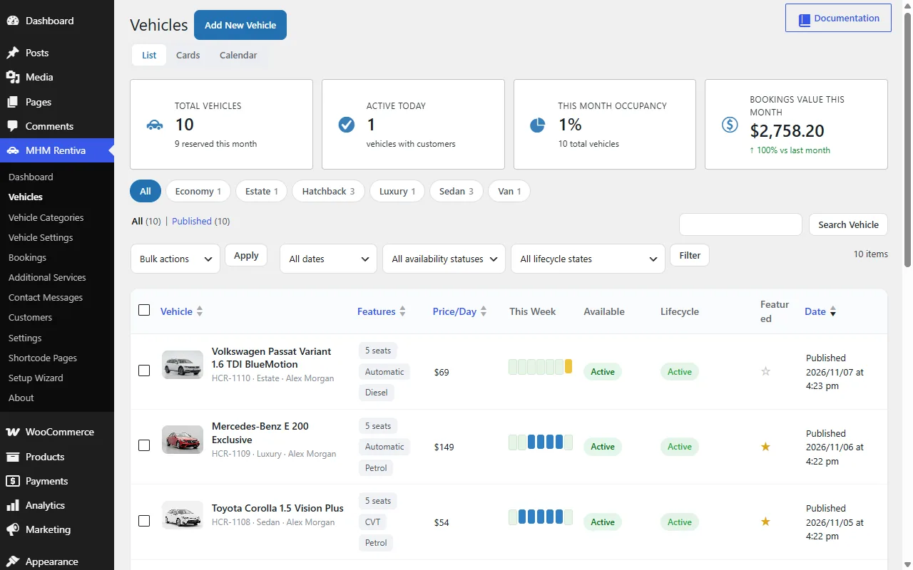

  

Los vehículos son los componentes fundamentales del sistema MHM Rentiva. **MHM Rentiva > Vehículos** es la pantalla principal de gestión, donde se listan todos los vehículos de tu flota, se hace el seguimiento de sus estados y se dan de alta vehículos nuevos.

---

## Lista de vehículos y acciones rápidas

La lista de vehículos ofrece una visión general de tu flota. Encima de ella hay cuatro tarjetas: **Total de vehículos** (con cuántos están reservados este mes), **Activos hoy** (vehículos que están actualmente con clientes), **Ocupación de este mes** y **Valor de reservas este mes** (comparado con el mes anterior). El selector **Lista / Tarjetas / Calendario** cambia la forma en que se muestra la flota.

- **Columnas de la lista:** Vehículo (foto, título y, debajo, matrícula, categoría y nombre del autor), Ubicación (solo cuando la función de ubicaciones está activa), Características (plazas, transmisión y combustible), Precio/día, Esta semana (una franja de disponibilidad de 7 días), Disponible, Ciclo de vida y Destacado.
- **Edición rápida:** Usa la acción de fila **"Edición rápida"** para actualizar la matrícula, el precio, la disponibilidad y los demás campos rápidos sin recargar la página.
- **Filtrado:** Filtra los vehículos por categoría, estado de disponibilidad, ubicación (cuando está activa) o estado del ciclo de vida (Activo, En pausa, Caducado, Retirado o Archivado).
- **Valor de reservas:** La tarjeta "Valor de reservas este mes" suma el precio de las reservas confirmadas, en curso y completadas de este mes. Es el importe reservado, no el dinero cobrado, y no se cuentan las reservas canceladas ni reembolsadas.

---

## Añadir y editar vehículos

La pantalla de edición del vehículo tiene un enlace **"← Vehículos"** y el nombre del vehículo bajo el título de la página. La columna principal contiene, de arriba abajo, las cajas **Galería del vehículo**, **Detalles del vehículo** y **Fechas bloqueadas**. La columna lateral contiene **Publicar**, **Destacado**, **Categorías de vehículos** e **Imagen del vehículo**, seguidas de las cajas (Pro) **Estado del ciclo de vida**, **Documentos del vehículo** y **Ajustes de traslados (módulo VIP)**. Si arrastras las cajas para ordenarlas a tu gusto, se conserva tu orden.

Al añadir un vehículo nuevo o editar uno existente, se recomienda rellenar todos los campos de la caja **"Detalles del vehículo"**. Los campos que aparecen ahí se configuran en **Ajustes del vehículo** (consulta [Ajustes del vehículo](./vehicle-settings.md)).

Puedes arrastrar los detalles, las características y el equipamiento al orden que quieras; el orden se guarda con **Actualizar**, por separado para cada vehículo.

### 1. Datos técnicos básicos
- **Disponibilidad:** Si el vehículo está activo o inactivo en el sistema.
- **Ubicación:** A qué oficina o zona de vendedor pertenece el vehículo.
- **Precio y finanzas:** Tarifa diaria de alquiler e importe del anticipo.
- **Datos de identificación:** Matrícula, Marca, Modelo y Año del modelo.
- **Capacidad:** Número de plazas y Número de puertas.
- **Mecánica:** Tipo de transmisión (Automática/Manual), Tipo de combustible (Gasolina, Diésel, Híbrido, Eléctrico, GLP, GNC o Hidrógeno) y Cilindrada del motor.

---

## Características y equipamiento

Para cada vehículo hay disponibles dos listas de verificación principales que los clientes pueden usar para filtrar:

### Características del vehículo
Aire acondicionado, Dirección asistida, ABS, Airbags, Cierre centralizado, Elevalunas/retrovisores eléctricos, Faros antiniebla, Control de crucero, Bluetooth, Navegador, Techo solar y Asientos calefactados.

### Equipamiento del vehículo
Rueda de repuesto, Botiquín de primeros auxilios, Extintor, Triángulo de emergencia, Funda para coche, Silla infantil, Localizador GPS, Cámara de salpicadero y Kit de limpieza.

---

## Ajustes de traslados (módulo VIP) (Pro)

> La caja Ajustes de traslados forma parte de **MHM Rentiva Pro**.

MHM Rentiva Pro admite operaciones de transferencia VIP además de los alquileres estándar. Configura los siguientes ajustes en la caja **Ajustes de traslados (módulo VIP)** de la columna lateral del vehículo:

- **Tipo de servicio:** Solo alquiler, Solo transferencia o Ambos.
- **Capacidad de pasajeros:** Número máximo de pasajeros.
- **Límites de equipaje:** Capacidad máxima de equipaje grande y pequeño (para el cálculo por puntos).
- **Multiplicador de precio:** Asigna un multiplicador de precio específico a determinados vehículos (p. ej., 1,2x para vehículos VIP).

---

## Gestión de la galería y las imágenes

- **Imagen del vehículo:** La foto de perfil principal que se muestra en los resultados de búsqueda.
- **Galería del vehículo:** Hasta 10 fotos que muestran los detalles interiores y exteriores del vehículo.

---

## Documentos del vehículo (v4.23.1)

El formulario de envío de vehículos (`[rentiva_vehicle_submit]`) contiene dos campos para subir documentos:

### Documento de matriculación del vehículo
El vendedor sube el documento de matriculación del vehículo mediante el formulario. El administrador lo revisa para verificarlo.

### Documento del seguro del vehículo
Añadido en la v4.23.1. Esta sección, que aparece justo después del documento de matriculación, permite subir el documento del seguro del vehículo.

- **Clave meta:** `_mhmrentiva_vehicle_insurance_doc`
- **Procesamiento:** Lo gestiona el controlador AJAX `VehicleSubmit.php` y se guarda en la biblioteca de medios de WordPress.
- **Historial:** Este campo estaba antes en el formulario de solicitud de vendedor. En la v4.23.1 se trasladó al formulario de envío de vehículos para poder subir un documento de seguro por cada vehículo.

---

## Fechas bloqueadas

Usa la caja **Fechas bloqueadas** para cerrar un vehículo en fechas concretas. Haz clic en los días del calendario para cerrarlos; los días cerrados se muestran en rojo y una insignia indica **"N días bloqueados"**. Cada día cerrado aparece en **Días bloqueados** con una nota opcional (**"Añadir nota… (opcional)"**), y **Quitar todo** vuelve a abrir todos los días de este vehículo. Los cambios se guardan con **Actualizar**.

- **Aplicar a todos los vehículos:** sustituye los días cerrados de todos los demás vehículos publicados por los días cerrados de este vehículo.
- **Quitar de todos los vehículos:** elimina solo los días cerrados de este vehículo de todos los demás vehículos publicados; sus otros días cerrados se mantienen.

(Pro) Los días cerrados por la penalización por cancelación de un vendedor no se copian ni se eliminan con estos botones; se levantan solos al cabo de 30 días. Las fechas que hayas cerrado a mano se conservan.

Ambos botones actúan sobre toda la flota, por lo que solo están disponibles para los usuarios que pueden editar contenido de otras personas (administradores).

Las notas pueden contener cualquier carácter, incluidas letras turcas y comillas.

### Bloqueo rápido desde el Calendario mensual de reservas (v4.61.0)

También puedes bloquear o abrir un solo día directamente desde el **Calendario mensual de reservas**, sin abrir el vehículo para editarlo:

- **Haz clic en un día vacío** para cerrarlo a nuevas reservas.
- **Haz clic en un día bloqueado** para volver a abrirlo.

Los días que ya tienen una reserva no cambian: mantienen su ventana emergente de reserva y no se pueden bloquear de esta forma.

---

## Mover un vehículo a la papelera y restaurarlo

Puedes mover un vehículo a la papelera desde la acción de fila, la acción en lote o la pantalla de edición. Un vehículo que todavía tiene reservas próximas no se rechaza: las reservas conservan el vehículo, pero los clientes ya no pueden abrir la página del vehículo. Por eso, cuando mueves a la papelera un vehículo así, la lista de Vehículos muestra un aviso con el número de reservas próximas, un enlace a cada reserva (las cinco primeras y después "y N más") y un botón **Restaurar vehículo**.

**Restaurar vehículo** (y **Restaurar** en la papelera) recupera el vehículo con el estado que tenía antes de moverlo a la papelera, de modo que un vehículo publicado vuelve a estar publicado y su página vuelve a abrirse.

---

## Ámbito de administración de AssetManager

Desde la v4.22.0, `AssetManager::enqueue_admin_assets()` solo se ejecuta en las páginas de administración de Rentiva (protegido por `is_rentiva_admin_page()`). En la v4.22.1 se añadieron también a la protección los tipos de contenido `mhmrentiva_vehicle`, `mhmrentiva_booking` y `mhmrentiva_addon`. Esto garantiza que las variables CSS (`css-variables.css`) se carguen correctamente y que las tarjetas de KPI no se rompan.

---

### Resumen de la sección
- Los vehículos se guardan como **CPT** (tipo de contenido personalizado) y cada vehículo tiene su propio conjunto de campos meta.
- Gana rapidez operativa con la **Edición rápida**.
- Gestiona las capacidades de transferencia y los multiplicadores de precio con el **módulo VIP**.
- **Fechas bloqueadas** ahora usa una carga JSON para la función "Aplicar a todos".

### Registro de cambios
| Fecha | Versión | Nota |
| :--- | :--- | :--- |
| 18.11.2026 | 6.4.0 | Documentadas las tarjetas y columnas de la lista de vehículos, el nuevo diseño de la pantalla de edición del vehículo, la caja Fechas bloqueadas y el aviso de papelera con Restaurar vehículo. |
| 29.06.2026 | 4.61.0 | Documentadas la columna "Añadido por" (vendedor/operador) de la lista de vehículos y el bloqueo rápido de días desde el Calendario mensual de reservas. |
| 23.04.2026 | 4.27.2 | Documentación sincronizada con la versión actual del plugin. |
| 28.03.2026 | 4.23.1 | Añadida la sección para subir el documento del seguro del vehículo. Selección de ciudad convertida a SelectWoo. |
| 27.03.2026 | 4.23.0 | Documentadas la corrección de "Aplicar a todos" en Fechas bloqueadas y la protección de administración de AssetManager. |
| 19.03.2026 | 4.21.2 | Detalles del vehículo, características, equipamiento y módulo VIP actualizados según la interfaz real. |
| 26.02.2026 | 4.21.0 | Creada la versión inicial. |
