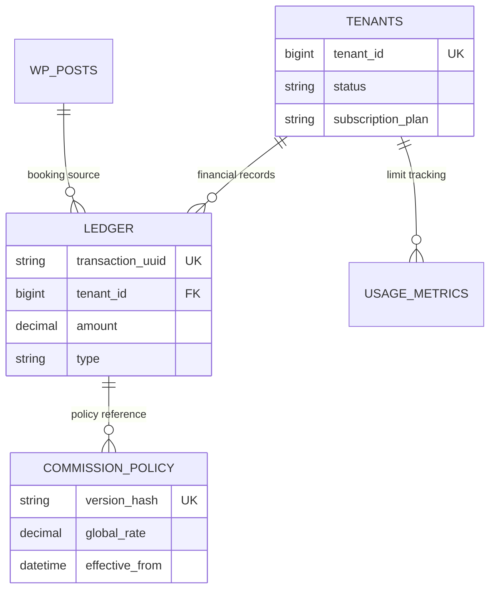

  

:::info Propósito
Esta página explica la arquitectura híbrida de base de datos de MHM Rentiva (núcleo de WP + tablas personalizadas nativas), los esquemas de las tablas y los estándares de integridad de datos.
:::

# 🗄️ Arquitectura de la base de datos

MHM Rentiva utiliza una arquitectura híbrida que combina el sistema de **metadatos de entradas/usuarios de WordPress** con **tablas personalizadas de alto rendimiento** para cumplir sus requisitos de rendimiento e integridad de datos.

## 📊 Tablas personalizadas

Para los registros financieros y las operaciones SaaS, el plugin prescinde de las tablas estándar de WordPress y utiliza directamente las siguientes tablas optimizadas para SQL:

| Nombre de la tabla | Propósito | Columnas críticas |
| :--- | :--- | :--- |
| `wp_mhmrentiva_ledger` | Libro de contabilidad financiero inmutable. | `transaction_uuid`, `amount`, `tenant_id` |
| `wp_mhmrentiva_commission_policy` | Registros versionados de las políticas de comisión. | `version_hash`, `global_rate`, `effective_from` |
| `wp_mhmrentiva_tenants` | Registros multiinquilino y cuotas. | `tenant_id`, `status`, `subscription_plan` |
| `wp_mhmrentiva_usage_metrics` | Límites de uso SaaS y seguimiento de métricas. | `metric_type`, `metric_value`, `cycle_start` |

### 🏗️ Principios de integridad de datos
- **Inmutabilidad:** los registros de la tabla `ledger` nunca se actualizan ni se eliminan. Las correcciones se realizan creando un nuevo asiento de compensación.
- **Aislamiento de inquilinos:** la columna `tenant_id` está presente en todas las tablas personalizadas. Los datos se aíslan lógicamente a nivel de base de datos.
- **Registro de auditoría:** las políticas de comisión se firman con un `version_hash` (SHA-256) para crear un registro de auditoría financiera.

---

## 🔑 Estándares de claves meta

Los datos operativos (atributos de los vehículos, preferencias de los clientes, etc.) se almacenan en las tablas meta de WordPress usando la siguiente convención de prefijos:
`_mhmrentiva_[category]_[field_name]`

| Categoría | Clave de ejemplo |
| :--- | :--- |
| **Vehículo** | `_mhmrentiva_vehicle_license_plate` |
| **Reserva** | `_mhmrentiva_booking_payout_status` |
| **Cliente** | `_mhmrentiva_customer_banned` |

---

## 🧬 Relaciones entre tablas (ER)

---

## Tablas de transferencia

El módulo de transferencia utiliza dos tablas personalizadas:

| Nombre de la tabla | Propósito | Columnas críticas |
| :--- | :--- | :--- |
| `wp_rentiva_transfer_locations` | Puntos de transferencia (aeropuerto, hotel, puerto, etc.) | `name`, `type`, `city`, `lat`, `lng` |
| `wp_rentiva_transfer_routes` | Definiciones de rutas entre dos ubicaciones | `origin_id`, `destination_id`, `base_price`, `min_price`, `max_price`, `distance_km` |

### Cambios de DatabaseMigrator v3.4.0
- Se ha añadido la columna `city` VARCHAR(100) a la tabla `rentiva_transfer_locations` (para el filtrado por ciudad en el marketplace de vendedores).
- Se ha añadido la columna `max_price` DECIMAL(10,2) a la tabla `rentiva_transfer_routes` (límite superior del rango de precios del vendedor).

---

## Mantenimiento y desarrollo

- **Migraciones:** el esquema de la base de datos se define en `src/Core/Database/Migrations/`. Las clases `MultiTenantMigration` y `LedgerMigration` realizan actualizaciones seguras usando `dbDelta`.
- **Herramienta de auditoría:** la coherencia de la base de datos puede verificarse con los comandos CLI `wp mhm-rentiva audit`.

---

## Lista de tablas del desinstalador

Las siguientes tablas se eliminan al desinstalar el plugin:

| Tabla | Categoría |
|---|---|
| `wp_mhmrentiva_ledger` | Financiera |
| `wp_mhmrentiva_commission_policy` | Financiera |
| `wp_mhmrentiva_tenants` | SaaS |
| `wp_mhmrentiva_usage_metrics` | SaaS |
| `wp_mhmrentiva_notification_queue` | Sistema |
| `wp_mhmrentiva_payment_log` | Sistema |
| `wp_mhmrentiva_sessions` | Sistema |
| `wp_rentiva_transfer_locations` | Transferencia |
| `wp_rentiva_transfer_routes` | Transferencia |

También se eliminan las tablas heredadas `mhm_rentiva_transfer_*`, si existen.

## Resumen de la sección
- Los datos financieros críticos se gestionan mediante SQL en **tablas personalizadas**.
- Las tablas de transferencia dan soporte al marketplace de vendedores con las columnas `city` y `max_price`.
- Los datos flexibles se almacenan en el sistema **WP Meta**.
- La estructura **multiinquilino** propaga el parámetro `tenant_id` por todas las capas.
- El desinstalador elimina 9 tablas personalizadas más las tablas heredadas que haya.

## Registro de cambios
| Fecha | Versión | Nota |
|---|---|---|
| 23.04.2026 | 4.27.2 | Se ha añadido la traducción al inglés. |
| 27.03.2026 | 4.23.0 | Se han añadido las tablas de transferencia (ubicaciones + rutas), los cambios de DatabaseMigrator v3.4.0 (city, max_price) y la lista de tablas del desinstalador (9 tablas + heredadas). |
| 19.03.2026 | 4.23.0 | Se ha reescrito la documentación de la base de datos para la arquitectura SaaS y financiera. |
