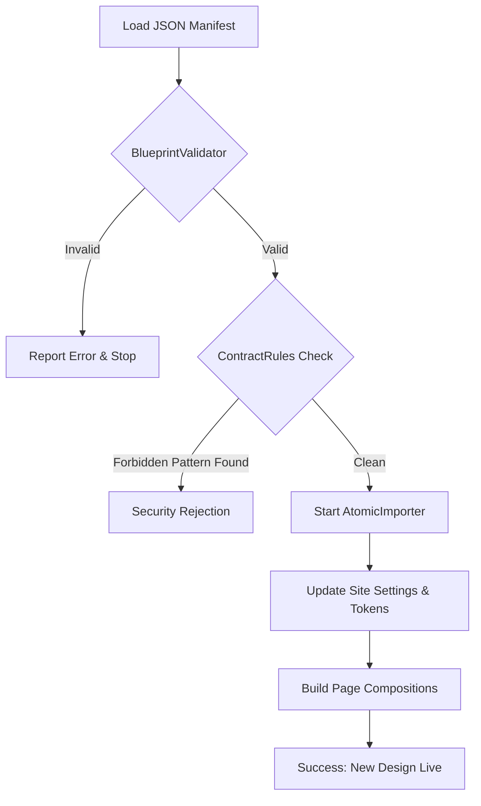

  

:::info Propósito
Esta página explica cómo se importan en el sistema los manifiestos de diseño (JSON), las fases de validación y el proceso de importación atómica.
:::

# 🏗️ Canal de importación de diseños

MHM Rentiva utiliza un sistema de diseño independiente del tema. Este sistema funciona procesando archivos JSON llamados **manifiestos de diseño** (Layout Manifests). El proceso pasa por un canal de validación de varias capas para evitar que un diseño defectuoso rompa el sistema.

## 🛠️ Componentes principales

El sistema se coordina mediante las siguientes clases:

| Componente | Función |
| :--- | :--- |
| `BlueprintValidator` | Comprueba la corrección estructural y lógica del archivo JSON del manifiesto. |
| `AtomicImporter` | Aplica los cambios dentro de una única transacción de base de datos. |
| `ContractRules` | Define reglas estrictas que el diseño debe cumplir (p. ej., la prohibición de clases de Tailwind). |
| `LayoutRollbackService` | Revierte el sistema al diseño estable anterior en caso de error. |

---

## 🔄 Flujo de trabajo (secuencia del canal)

Cuando se sube un archivo de diseño, pasa por las siguientes fases:

---

## 🛡️ Reglas de seguridad y validación

### 1. Validación estructural (`BlueprintValidator`)
Las siguientes claves raíz deben estar presentes en el archivo de manifiesto:
- `version`: versión del manifiesto (se admite v1.x).
- `pages`: diseños de página y definiciones de slug.
- `tokens`: variables de color, tipografía y espaciado.
- `components`: lista de componentes utilizados.

### 2. Análisis de patrones prohibidos (`ContractRules`)
La arquitectura actual prohíbe el uso de clases de **Tailwind CSS** o de definiciones de estilo en línea pesadas dentro de los manifiestos, para evitar fugas de CSS y problemas de rendimiento. Cuando `BlueprintValidator` detecta estos patrones, cancela la operación automáticamente.

---

## 💾 Operaciones atómicas y reversión

La operación de importación funciona según un principio **atómico** (todo o nada).
- Si se produce un error en la página 9 de un manifiesto de 10 páginas, las 8 páginas ya actualizadas también se revierten a su estado anterior.
- Esto lo gestiona `LayoutRollbackService` y preserva la integridad de la base de datos.

---

## 🛠️ Notas para desarrolladores

- **Versión del manifiesto:** actualmente solo se admiten diseños basados en `1.0.0`.
- **Caché:** tras una importación correcta, la caché de objetos de la plataforma (Redis/Memcached) se vacía automáticamente.
- **Registro:** todas las operaciones de importación pueden seguirse a través de `AdvancedLogger` mediante el canal `layout_ingestion`.

## Resumen de la sección
- El canal funciona según el principio **«Primero validar, después escribir»**.
- Los errores de diseño se detectan en el momento de la importación, no en tiempo de ejecución.
- En caso de fallo, el sistema vuelve automáticamente a la versión estable anterior.

## Registro de cambios
| Fecha | Versión | Nota |
|---|---|---|
| 23.04.2026 | 4.27.2 | Se ha añadido la traducción al inglés. |
| 19.03.2026 | 4.21.2 | Página normalizada a la arquitectura v1.9 y a las reglas actuales del validador. |
