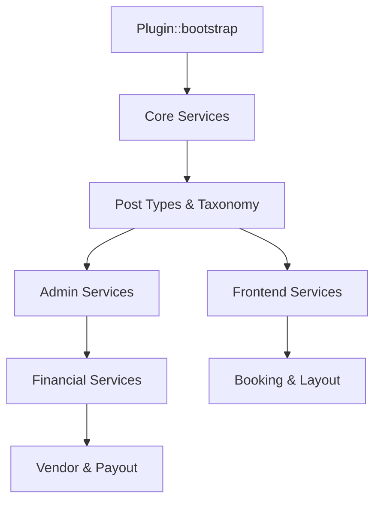

  

:::info Propósito
Este documento reúne, como referencia técnica, los límites de responsabilidad, el flujo de datos y la jerarquía de dependencias entre servicios de los módulos de Rentiva.
:::

# 🧱 Arquitectura de módulos de MHM Rentiva

MHM Rentiva está construido con un enfoque de **"Monolito modular"**. Cada módulo está diseñado como un "Servicio" o "Gestor" autónomo, pero todo el sistema se coordina a través de la clase raíz `MHMRentiva\Plugin` (Service Graph).

## 🚀 Service Graph y arranque

Por rendimiento y previsibilidad, el plugin sigue un orden estricto de inicialización de servicios. El método `Plugin::initialize_services()` gestiona esta jerarquía.

### 📊 Jerarquía entre módulos

---

## 📂 Categorías de módulos y responsabilidades

| Categoría | Espacio de nombres | Responsabilidad |
| :--- | :--- | :--- |
| **Núcleo** | `MHMRentiva\Core` | Base de datos (migraciones), seguridad (gobernanza), comprobaciones de licencia (licencias). |
| **Administración** | `MHMRentiva\Admin` | Interfaces de administración, tablas de listado (ListTables), páginas de ajustes. |
| **Finanzas** | `MHMRentiva\Core\Financial` | Asientos del libro mayor, políticas de comisión, gestión de pagos al proveedor. |
| **Diseño** | `MHMRentiva\Layout` | Validación del manifiesto, importación atómica, gestión de tokens de diseño. |
| **API** | `MHMRentiva\Api` | Endpoints de la API REST, gestores de webhooks y salidas JSON. |

---

## 🛠️ Principios arquitectónicos fundamentales

### 1. Singleton y acceso estático
Las clases del núcleo (p. ej., `Plugin.php`) utilizan el patrón Singleton. Esto evita que los servicios se inicialicen más de una vez por petición, lo que optimiza el uso de memoria.

### 2. Inyección de dependencias (acoplamiento débil)
Los módulos no están fuertemente acoplados entre sí. Que un módulo se ejecute o no se determina dinámicamente mediante comprobaciones de `is_class_available()` y la puerta de licencia.

### 3. Arquitectura basada en eventos (hooks)
El sistema es ampliable a través del ecosistema de `add_action` y `add_filter` de WordPress. Por ejemplo, cuando se completa una reserva (`mhmrentiva_booking_completed`), los registros financieros (libro mayor) se activan automáticamente.

---

## 🛡️ Seguridad y cumplimiento

Cada módulo debe seguir estos protocolos de seguridad:
- **Saneamiento:** todas las entradas se limpian mediante clases auxiliares como `Sanitizer::text_field_safe()`.
- **Nonce y capacidades:** las comprobaciones de `current_user_can()` y `check_admin_referer()` son estándar en todas las peticiones del lado de administración.
- **Registros de auditoría:** toda operación financiera o arquitectónica crítica se registra mediante `AdvancedLogger`.

## Resumen de la sección
- El sistema se basa en un grafo de servicios (Service Graph).
- El módulo **Núcleo** es la base inferior que sostiene todo el sistema.
- La comunicación entre módulos se realiza mediante hooks (basada en eventos) o llamadas a servicios centrales.

## Registro de cambios
| Fecha | Versión | Nota |
|---|---|---|
| 23.04.2026 | 4.27.2 | Documentación traducida al inglés. |
| 19.03.2026 | 4.21.2 | Página actualizada con detalles sobre Service Graph y el monolito modular. |
