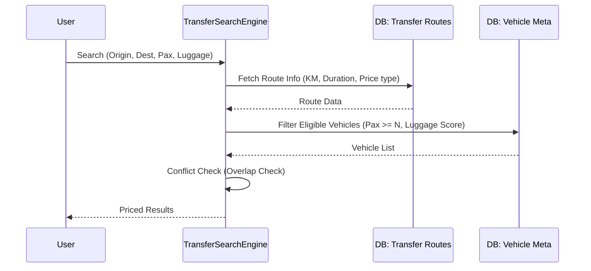

  

:::info Función Pro
Esta página documenta una funcionalidad del complemento **MHM Rentiva Pro**. No forma parte de la edición gratuita
Lite de WordPress.org y requiere tener Pro instalado junto con Lite, además de una licencia válida.
Consulta [Ediciones — Lite frente a Pro](/docs/) para ver la división completa, o consigue Pro en [wpalemi.com/rentiva](https://wpalemi.com/rentiva/).
:::

:::info Propósito
Esta página explica las clases principales del módulo de transferencias, el motor de precios basado en rutas y el flujo de datos.
:::

# 🚕 Arquitectura de transferencias de MHM Rentiva

El módulo de transferencias es un subsistema construido sobre un motor de búsqueda y precios basado en «Hora + Ubicación», independiente del módulo de alquiler de vehículos.

## 🛠️ Componentes principales (mapa de clases)

Las operaciones de transferencia se gestionan mediante las siguientes clases principales:

| Clase | Función |
| :--- | :--- |
| `TransferSearchEngine` | El motor principal que aplica el filtrado de vehículos por ruta, los precios del vendedor y los filtros de puntuación de equipaje. |
| `LocationProvider` | Servicio de consulta de ubicaciones; admite el filtrado por ciudad mediante el método `get_by_city()`. |
| `TransferShortcodes` | Gestiona los formularios de búsqueda y los listados de resultados en la parte pública (`[rentiva_transfer_search]`). |
| `TransferCartIntegration` | Integra el servicio de transferencia seleccionado en el carrito de WooCommerce. |
| `TransferBookingHandler` | Guarda los detalles de la transferencia (ID de ruta, km, duración) en la reserva tras finalizar la compra. |

---

## 🔄 Flujo de datos y proceso de búsqueda

Cuando se realiza una búsqueda de transferencias, el sistema sigue estos pasos:

---

## 🔍 Lógica de precios y capacidad

### 1. Precios basados en rutas
Los precios de las transferencias se calculan según las reglas de la tabla `wp_rentiva_transfer_routes`:
- **Fijo:** Se aplica directamente el `base_price` definido.
- **Distancia:** Se utiliza la fórmula `base_price * distance_km`. Opcionalmente, se puede añadir un mínimo `min_price`.
- **Multiplicador:** Un multiplicador por vehículo (`_mhmrentiva_transfer_price_multiplier`) permite aumentar automáticamente el precio de los vehículos VIP.

### 1a. Precios del vendedor (v4.23.0)
En la integración con el marketplace de vendedores, los precios funcionan así:
- El administrador establece un rango de `min_price` y `max_price` para cada ruta.
- El vendedor asigna un precio por ruta a su propio vehículo (meta JSON `_mhmrentiva_transfer_route_prices`).
- `TransferSearchEngine` comprueba primero el precio del vendedor; si no existe, recurre al `base_price` de la ruta.
- Si el precio del vendedor está fuera del rango del administrador, se considera no válido.

### 2. Cálculo de la puntuación de equipaje
El sistema calcula la capacidad de equipaje de un vehículo mediante el siguiente modelo matemático:
`Luggage Score = (Small Bags * 1) + (Large Bags * 2.5)`
Durante la búsqueda, si la carga de equipaje solicitada supera el valor `_mhmrentiva_transfer_max_luggage_score` del vehículo, este se excluye.

---

## 🛡️ Hooks y acciones críticos

- **Búsqueda AJAX:** `mhmrentiva_transfer_search_results` — Devuelve los resultados de búsqueda.
- **Añadir al carrito:** `rentiva_transfer_add_to_cart` — Envía los datos de la transferencia con campos meta al carrito.
- **Creación del pedido:** `woocommerce_checkout_create_order_line_item` — Convierte los detalles de la ruta en un registro de pedido permanente.

## Filtrado por ciudad (v4.23.0)

El método `LocationProvider::get_by_city()` consulta las ubicaciones de la ciudad en la que está registrado el vendedor. Esta estructura se utiliza de la siguiente manera:

1. En el formulario de envío de vehículos del vendedor (`VehicleSubmit.php`), solo se muestran las ubicaciones y rutas de la propia ciudad del vendedor.
2. En el panel de administración, `VehicleTransferMetaBox` muestra la información de la ciudad del vendedor.

---

## Estructura de meta del vehículo

El módulo de transferencias utiliza las siguientes claves meta:

| Clave meta | Tipo | Descripción |
|---|---|---|
| `_mhmrentiva_transfer_locations` | array | ID de las ubicaciones que cubre el vehículo |
| `_mhmrentiva_transfer_routes` | array | ID de las rutas que cubre el vehículo |
| `_mhmrentiva_transfer_route_prices` | JSON | Precios del vendedor por ruta (`{route_id: price}`) |

---

## Resumen de la sección
- El módulo de transferencias es un motor de precios independiente basado en rutas.
- **Precios del vendedor:** El administrador establece el rango `min_price`/`max_price`; los vendedores fijan su propio precio.
- **Filtrado por ciudad:** Con `LocationProvider::get_by_city()`, los vendedores solo ven las rutas de su propia ciudad.
- La **puntuación de equipaje** y la **capacidad de pasajeros** son los filtros de datos más críticos.
- Los conflictos de reservas se comprueban mediante `Util::has_overlap()`, compartido con el sistema principal.

## Registro de cambios
| Fecha | Versión | Nota |
|---|---|---|
| 23.04.2026 | 4.27.2 | Se ha añadido la traducción al inglés. |
| 27.03.2026 | 4.23.0 | Se han añadido los precios del vendedor, `LocationProvider::get_by_city()`, el filtrado por ciudad y las claves meta del vehículo. |
| 19.03.2026 | 4.21.2 | Arquitectura de transferencias actualizada con detalles de precios basados en rutas y gestión del equipaje. |
