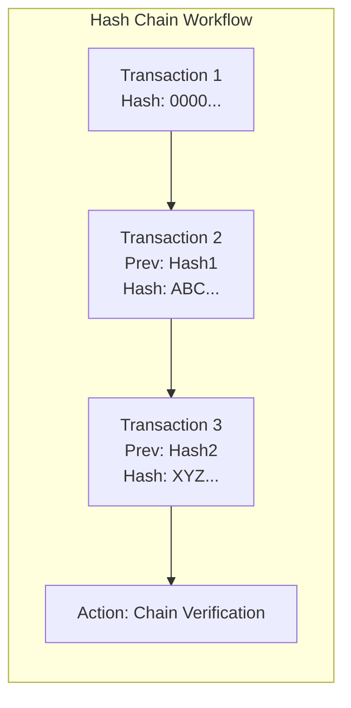

  

:::info Función Pro
Esta página documenta una funcionalidad del complemento **MHM Rentiva Pro**. No forma parte de la edición gratuita
Lite de WordPress.org y requiere tener Pro instalado junto a Lite, además de una licencia válida.
Consulta [Ediciones: Lite frente a Pro](/docs/) para ver la división completa, o consigue Pro en [wpalemi.com/rentiva](https://wpalemi.com/rentiva/).
:::

:::info Propósito
Esta página describe los modelos de firma digital, gestión de claves e integridad de los datos (Hash-Chain) que se utilizan en los procesos de auditoría financiera.
:::

# 🔐 Criptografía de auditoría e integridad

MHM Rentiva utiliza estándares criptográficos de nivel militar para garantizar que los informes financieros y los datos exportados no han sido manipulados.

## 🛠️ Componentes técnicos

La capa de seguridad criptográfica se gestiona mediante los siguientes servicios:

| Servicio | Responsabilidad | Algoritmo |
| :--- | :--- | :--- |
| `ExportSignatureService` | Firma los archivos exportados (CSV/JSON). | **Ed25519** (separada) |
| `KeyPairManager` | Gestiona los pares de claves del sistema (privada/pública). | Basado en **Libsodium** |
| `HashChainService` | Enlaza los eventos financieros en una secuencia encadenada. | **SHA-256** |

---

## ⚡ Modelo Hash-Chain (cadena de integridad)

Cada transacción financiera se registra haciendo referencia al valor hash de la transacción anterior. Esta estructura garantiza que, si se modifica aunque sea una sola fila de la base de datos, la cadena se rompe y la manipulación se detecta de inmediato.

---

## 🖋️ Flujo de firma de archivos (Ed25519)

Cuando se genera un informe de auditoría (Audit Export), se ejecuta el siguiente proceso:

1.  **Preparación de la carga útil:** los datos se generan como CSV o JSON.
2.  **Generación del hash hexadecimal:** se calcula el hash del contenido del archivo con `SHA-256` (File Hash).
3.  **Firma digital:** este resumen se firma con la `Private Key` activa del sistema mediante el algoritmo Ed25519.
4.  **Clave de verificación:** la `Key ID` se incluye en el paquete de exportación junto con la firma.

:::important Verificación
Para verificar la firma solo se necesita la `Public Key`. Esto permite al auditor que recibe los datos demostrar que proceden del sistema MHM Rentiva y que no se han alterado durante el envío.
:::

---

## 🔑 Gestión de claves

- **Generación silenciosa:** las claves se generan en la primera instalación o manualmente mediante `KeyPairManager`.
- **Almacenamiento seguro:** la `Private Key` se almacena cifrada en la base de datos o puede leerse desde una variable de entorno (Env).
- **Rotación:** se recomienda rotar las claves periódicamente; las claves antiguas deben pasarse al estado «Archivo».

## Resumen de la sección
- El sistema utiliza **Ed25519** para una firma segura y de alto rendimiento.
- La estructura **Hash-Chain** hace imposible la manipulación retroactiva de los datos.
- Los datos financieros están protegidos tanto en la base de datos como durante la exportación.

## Registro de cambios
| Fecha | Versión | Nota |
|---|---|---|
| 23.04.2026 | 4.27.2 | Se ha añadido la traducción al inglés. |
| 19.03.2026 | 4.21.2 | Página actualizada con detalles de la arquitectura Ed25519 y Hash-Chain. |
