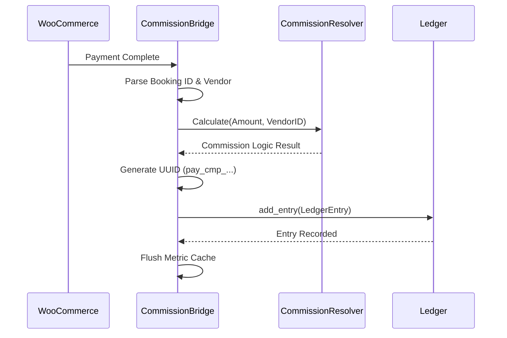

  

:::info Función Pro
Esta página documenta una funcionalidad del complemento **MHM Rentiva Pro**. No forma parte de la edición gratuita
Lite de WordPress.org y requiere tener Pro instalado junto a Lite, además de una licencia válida.
Consulta [Ediciones — Lite vs Pro](/docs/) para ver la división completa, o consigue Pro en [wpalemi.com/rentiva](https://wpalemi.com/rentiva/).
:::

:::info Propósito
Esta página describe cómo el componente `CommissionBridge` gestiona el flujo de datos entre los pedidos de WooCommerce y el núcleo financiero de Rentiva (Ledger).
:::

# 🌉 Puente de comisiones de WooCommerce

`CommissionBridge` actúa como traductor entre la capa de comercio electrónico (WooCommerce) y la capa de registro financiero (Ledger). Escucha los eventos de los pedidos y los convierte en asientos financieros del Ledger.

## 🚀 Eventos desencadenantes (hooks)

El puente funciona supervisando los siguientes eventos críticos de WooCommerce:

- **`woocommerce_payment_complete`**: se dispara cuando el pago se completa correctamente.
- **`woocommerce_order_status_completed`**: se dispara cuando un pedido se marca como completado, de forma manual o automática.
- **`woocommerce_order_refunded`**: se utiliza para crear un asiento inverso en las operaciones de reembolso.

---

## 🔄 Flujo de procesamiento financiero

Cuando se paga un pedido, el sistema sigue estos pasos:

---

## 🛠️ Características y lógica principales

### 1. Idempotencia (prevención de asientos duplicados)
Se genera un **UUID** único con el formato `pay_cmp_{order_id}_{booking_id}` para cada asiento. Aunque WooCommerce dispare el mismo evento varias veces, la clase `Ledger` evita los asientos duplicados gracias a este UUID.

### 2. Gestión de reembolsos y asientos inversos
Cuando se reembolsa un pedido (`on_order_refunded`), en lugar de eliminar el asiento existente, el sistema crea un nuevo **asiento de reembolso** con valores opuestos (saldo `-`). Esto es necesario para mantener la integridad del registro de auditoría financiera.

### 3. Sincronización de métricas
En cuanto se escribe un asiento financiero en el Ledger, se dispara `MetricCacheManager` para que los gráficos de rendimiento por vendedor y por vehículo se actualicen de inmediato.

---

## 📋 Correspondencia de datos

| Campo de WooCommerce | Campo del Ledger | Descripción |
| :--- | :--- | :--- |
| `order_id` | `parent_id` / `source_id` | Indica que el origen es un pedido de WC. |
| `order_total` | `gross_amount` | Importe total con impuestos incluidos. |
| `currency` | `currency` | Moneda del pedido. |
| `_mhmrentiva_booking_id` | `reference_id` | Referencia de la reserva de Rentiva. |

## Resumen de la sección
- `CommissionBridge` convierte los eventos de WooCommerce en estructuras de transacciones financieras.
- La **lógica de asientos inversos** evita la eliminación de datos.
- El uso de **UUID** garantiza la coherencia de los datos (idempotencia).

## Registro de cambios
| Fecha | Versión | Nota |
|---|---|---|
| 23.04.2026 | 4.27.2 | Se ha añadido la traducción al inglés. |
| 19.03.2026 | 4.21.2 | Página actualizada con la lógica de reembolsos y los detalles de idempotencia. |
