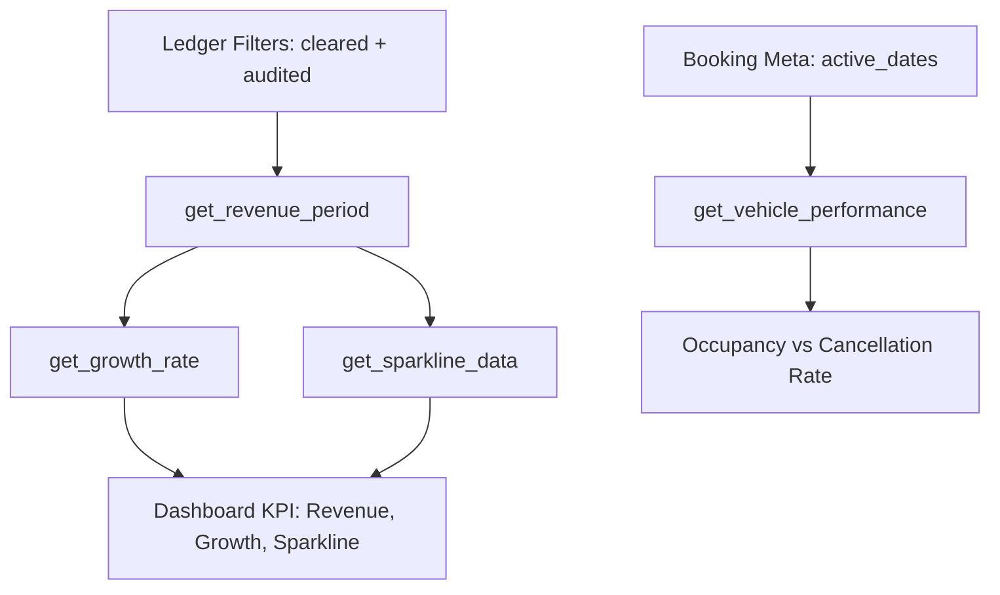

  

:::info Función Pro
Esta página documenta una funcionalidad del complemento **MHM Rentiva Pro**. No forma parte de la edición
gratuita Lite de WordPress.org y requiere tener Pro instalado junto a Lite, además de una licencia válida.
Consulta [Ediciones — Lite frente a Pro](/docs/) para ver la división completa, o consigue Pro en [wpalemi.com/rentiva](https://wpalemi.com/rentiva/).
:::

:::info Propósito
Esta página describe la lógica y las fuentes de datos en las que se basan las métricas financieras y operativas calculadas por `AnalyticsService`.
:::

# 📊 Métricas analíticas y financieras

MHM Rentiva utiliza exclusivamente la tabla `mhmrentiva_ledger` como **fuente única de verdad** para las métricas financieras. Las métricas operativas (tasa de ocupación, etc.) se combinan con los metadatos de las reservas.

## 🛠️ Principios básicos

- **Verdad basada solo en el libro mayor:** Los cálculos de ingresos provienen siempre de la tabla Ledger, nunca de la tabla de pedidos.
- **Normalización UTC:** Todas las ventanas temporales se normalizan a UTC y utilizan periodos que no se solapan.
- **Saneamiento:** Las consultas de métricas incluyen siempre los filtros `status = 'cleared'` y `type IN ('commission_credit', 'commission_refund')`.

---

## 📈 Métricas financieras

Indicadores financieros clave calculados por el sistema:

| Métrica | Método | Lógica de cálculo |
| :--- | :--- | :--- |
| **Ingresos netos** | `get_revenue_period()` | `Sum(commission_credit) - Sum(commission_refund)` |
| **Tasa de crecimiento** | `get_growth_rate()` | `((Current - Previous) / Previous) * 100` |
| **Reserva media** | `get_avg_booking_value()` | `Total_Net / Unique_Booking_Count` |
| **Sparkline** | `get_sparkline_data()` | Puntos de saldo normalizados por días. |

---

## ⚙️ Métricas operativas

Métricas utilizadas para el análisis del rendimiento por vehículo y por vendedor:

### 1. Tasa de ocupación
Se calcula mediante el método `get_vehicle_performance()`. Es la proporción entre los días en que el vehículo estuvo reservado (completed, confirmed, in_progress) y el número total de días de la ventana temporal especificada.

### 2. Tasa de cancelación
El porcentaje de registros `cancelled` y `refunded` sobre el total de reservas.

---

## 🔄 Flujo de cálculo de métricas

---

## 🛡️ Detalles críticos

- **NULL frente a 0.0:** En `get_growth_rate()`, si el periodo anterior no tiene datos, el resultado devuelve `NULL`. Así se distingue «sin cambios» (0.0) de «datos insuficientes» (NULL) en los informes financieros.
- **Relleno de la sparkline:** Para los días sin actividad, el sistema inserta automáticamente `0.0` para que los gráficos no tengan huecos.
- **Redondeo seguro para uso bancario:** Se utiliza `PHP_ROUND_HALF_UP` en todos los cálculos de porcentajes para mantener la precisión financiera.

## Resumen de la sección
- Las métricas financieras se basan únicamente en la tabla **Ledger**.
- Las métricas operativas están protegidas por controles de ventana temporal (intersección de ventanas).
- Todos los datos se generan con base en UTC y de forma coherente (idempotente).

## Registro de cambios
| Fecha | Versión | Nota |
|---|---|---|
| 23.04.2026 | 4.27.2 | Se ha añadido la traducción al inglés. |
| 19.03.2026 | 4.21.2 | Página actualizada para reflejar la estructura de métricas de Ledger y operativas de AnalyticsService. |
