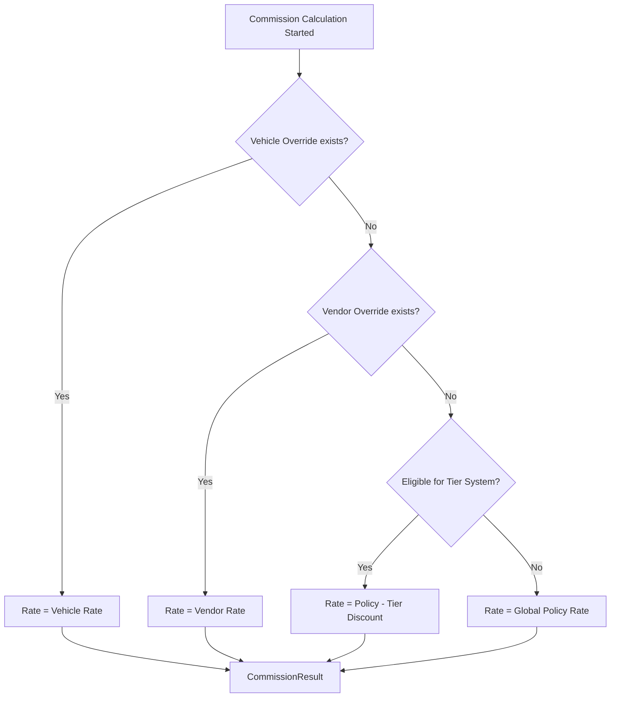

  

:::info Función Pro
Esta página documenta una funcionalidad del complemento **MHM Rentiva Pro**. No forma parte de la edición gratuita
Lite de WordPress.org y requiere tener Pro instalado junto a Lite, además de una licencia válida.
Consulta [Ediciones — Lite vs Pro](/docs/) para ver la división completa, o consigue Pro en [wpalemi.com/rentiva](https://wpalemi.com/rentiva/).
:::

:::info Propósito
Esta página documenta cómo se determinan las tasas de comisión, cómo funcionan las políticas versionadas (`PolicyService`) y cómo operan los incentivos por rendimiento (`TierService`).
:::

# 🏷️ Sistema de comisiones y políticas

MHM Rentiva utiliza una **jerarquía de resolución de comisiones** determinista y de varias capas para calcular las tasas de comisión. El sistema admite tanto reglas globales como acuerdos comerciales personalizados (anulaciones).

## 📉 Jerarquía de resolución

`CommissionResolver` determina qué tasa se aplica a una reserva mediante una comprobación en 4 niveles, del más específico al más general:

| Prioridad | Nivel | Meta / Origen | Descripción |
| :--- | :--- | :--- | :--- |
| **1** | **Anulación de Vehículo** | `_mhmrentiva_vendor_commission_rate` | Si se asigna una tasa específica al propio vehículo, esta tiene la máxima prioridad. |
| **2** | **Anulación de Vendedor** | `_mhmrentiva_vendor_commission_rate` | Si se asigna una tasa específica al usuario vendedor (y no existe una anulación de vehículo), se aplica esta. |
| **3** | **Incentivo de Nivel** | `TierService` | Se aplica un descuento adicional sobre la tasa global en función del rendimiento del vendedor en los últimos 30 días. |
| **4** | **Política global** | `CommissionPolicy` | Si ninguna otra regla coincide, se aplica la tasa de la política predeterminada del sistema. |

---

## 🌳 Árbol de decisión para la resolución de comisiones

---

## 📜 Versionado y auditoría de políticas

Cada tasa de comisión del sistema está vinculada a un objeto **Policy** (`MHMRentiva\Core\Financial\CommissionPolicy`).

- **Hash inmutable:** se genera un `version_hash` único en cada cambio de política.
- **Coherencia de auditoría:** cuando se crea una entrada en el libro mayor (Ledger), se registran en ella los valores actuales de `policy_id` y `version_hash`. Esto demuestra por qué se utilizó una tasa concreta incluso 2 años después.
- **Resolución basada en el tiempo:** el método `PolicyService::resolve_policy_at()` encuentra la política que estaba activa en el momento en que se creó la reserva. Las actualizaciones retroactivas no alteran los registros antiguos.

---

## 💎 Sistema de niveles e incentivos

`TierService` está diseñado para recompensar a los vendedores con un alto volumen de ventas:
- **Comprobación de ingresos netos:** se calcula a partir del saldo "Liquidado" de los últimos 30 días.
- **Descuento acumulativo:** el descuento de Nivel solo se aplica sobre la **Política global**. Los vendedores con un acuerdo personalizado (anulación) no pueden beneficiarse además del descuento de Nivel.

## Resumen de la sección
- Orden de resolución: **Vehículo > Vendedor > Nivel > Global**.
- Todas las decisiones se basan en políticas **deterministas** y **versionadas**.
- Con cada cálculo se captura una instantánea de la política para la auditoría financiera.

## Registro de cambios
| Fecha | Versión | Nota |
|---|---|---|
| 23.04.2026 | 4.27.2 | Se ha añadido la traducción al inglés. |
| 19.03.2026 | 4.21.2 | Página actualizada con la jerarquía de 4 niveles y la lógica del descuento de Nivel. |
