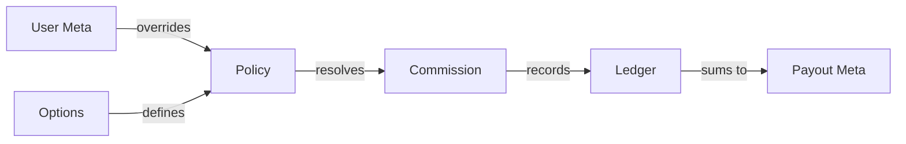

  

:::info Función Pro
Esta página documenta una funcionalidad del complemento **MHM Rentiva Pro**. No forma parte de la edición
Lite gratuita de WordPress.org y requiere tener Pro instalado junto con Lite, además de una licencia válida.
Consulta [Ediciones — Lite frente a Pro](/docs/) para ver la división completa, o consigue Pro en [wpalemi.com/rentiva](https://wpalemi.com/rentiva/).
:::

:::info Propósito
Esta página es la documentación de referencia estándar de todas las palabras clave, campos de base de datos y definiciones técnicas que se utilizan en el módulo financiero de MHM Rentiva.
:::

# 📖 Diccionario de datos financieros

Los datos financieros del ecosistema Rentiva se almacenan en tres capas principales: **Ajustes globales (Options)**, **Información de usuario (User Meta)** y **Detalles de transacciones (Payout/Booking Meta)**.

## ⚙️ Ajustes globales (Options)
Configuraciones financieras de todo el sistema almacenadas en la tabla `wp_options`:

| Clave | Tipo | Descripción |
| :--- | :--- | :--- |
| `mhmrentiva_min_payout_amount` | `float` | Saldo mínimo que debe tener un vendedor para solicitar un pago al proveedor. |
| `mhmrentiva_global_payout_freeze` | `bool` | Interruptor de emergencia que detiene todos los pagos a proveedores en todo el sistema. |
| `mhmrentiva_payout_webhook_secret`| `string` | Clave secreta firmada con HMAC que se utiliza para las notificaciones de pagos a proveedores. |
| `mhmrentiva_commission_tiers` | `json` | Valores umbral que determinan los porcentajes de descuento según el volumen de ventas. |

---

## 👤 Datos financieros del vendedor (User Meta)
Datos almacenados por vendedor en la tabla `wp_usermeta`:

| Clave | Tipo | Descripción |
| :--- | :--- | :--- |
| `_mhmrentiva_vendor_commission_rate` | `float` | Porcentaje de comisión fijo definido específicamente para este vendedor (anulación). |
| `_mhmrentiva_vendor_payout_freeze` | `bool` | Estado de bloqueo que impide que solo este vendedor reciba pagos al proveedor. |
| `_mhmrentiva_vendor_tier_id` | `string` | Nivel de rendimiento al que pertenece actualmente el vendedor. |

---

## 💰 Datos de pagos al proveedor (Post Meta)
Metadatos almacenados en el tipo de entrada `mhmrentiva_payout`:

| Clave | Tipo | Descripción |
| :--- | :--- | :--- |
| `_mhmrentiva_payout_amount` | `float` | Importe neto solicitado o pagado. |
| `_mhmrentiva_payout_status` | `string` | Estado: `pending`, `processing`, `completed`, `rejected`. |
| `_mhmrentiva_payout_external_ref` | `string` | Número de referencia del banco o de la pasarela de pago (Stripe, etc.). |
| `_mhmrentiva_payout_rejection_reason` | `string` | Texto explicativo introducido para las solicitudes rechazadas. |

---

## 🔑 Capacidades
Capacidades de WordPress necesarias para gestionar las operaciones financieras:

- **`mhmrentiva_approve_payout`**: permiso para aprobar solicitudes de pago al proveedor.
- **`mhmrentiva_freeze_payout`**: permiso para congelar/bloquear pagos a proveedores.
- **`mhmrentiva_view_financial_audit`**: permiso para ver los registros de auditoría y los detalles del libro mayor (Ledger).

---

## 🔄 Mapa de relaciones de datos

## Resumen de la sección
- Todas las claves financieras se almacenan con el prefijo `_mhmrentiva_` (meta privado).
- Las operaciones críticas (p. ej., `payout_status`) solo pueden modificarlas los usuarios autorizados (con las capacidades correspondientes).
- Para los campos de la tabla del libro mayor (Ledger), consulta la página [Modelo de libro mayor](./financial-ledger-model).

## Registro de cambios
| Fecha | Versión | Nota |
|---|---|---|
| 23.04.2026 | 4.27.2 | Se ha añadido la traducción al inglés. |
| 19.03.2026 | 4.21.2 | Página actualizada para reflejar las claves Meta y Option actuales del plugin. |
