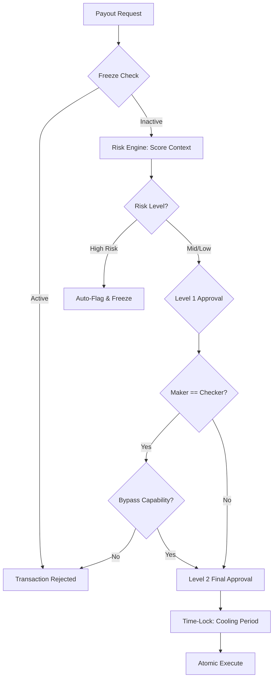

  

:::info Función Pro
Esta página documenta una funcionalidad del complemento **MHM Rentiva Pro**. No forma parte de la edición gratuita
Lite de WordPress.org y requiere tener Pro instalado junto a Lite, además de una licencia válida.
Consulta [Ediciones — Lite vs Pro](/docs/) para ver la división completa, u obtén Pro en [wpalemi.com/rentiva](https://wpalemi.com/rentiva/).
:::

:::info Objetivo
Esta página describe el análisis de riesgos, la jerarquía de aprobación y los mecanismos de auditoría del proceso financiero de pago al proveedor.
:::

# ⚖️ Controles de gobernanza

`GovernanceService` es una capa de gobernanza inteligente diseñada para garantizar la corrección y la seguridad de las transacciones financieras. Con independencia de la mecánica financiera, responde únicamente a la pregunta: «¿Quién puede aprobar qué y con qué riesgo?»

## 🛡️ Capas de seguridad principales

### 1. Controles de congelación
Antes de iniciar cualquier transacción, el sistema realiza una comprobación de congelación en dos fases:
- **Congelación global:** si el ajuste `mhmrentiva_global_payout_freeze` está activo, todos los pagos al proveedor se detienen de inmediato.
- **Congelación del vendedor:** se rechazan las solicitudes de los vendedores que tengan el meta `_mhmrentiva_vendor_payout_freeze`.

### 2. Motor de riesgos (análisis de riesgos determinista)
El sistema genera una puntuación de riesgo para cada solicitud de pago al proveedor según los siguientes criterios:
- **Antigüedad del vendedor:** los vendedores más recientes reciben una puntuación de riesgo más alta.
- **Tasa de cancelación:** los vendedores con una tasa elevada de reembolsos/cancelaciones se marcan para revisión.
- **Límite de importe:** los pagos al proveedor que superan determinados umbrales se marcan automáticamente como «Alto riesgo».

### 3. Maker-Checker (principio de doble aprobación)
Para evitar el fraude interno, ningún administrador puede aprobar por sí solo un pago al proveedor que haya iniciado o creado:
- **Maker:** la persona que creó la solicitud o realizó la revisión inicial.
- **Checker:** otra persona autorizada distinta que da la aprobación final.
- *Excepción:* solo los administradores sénior con la capacidad `mhmrentiva_override_maker_checker` pueden saltarse esta regla (y la acción queda registrada en el registro forense).

---

## 🔄 Flujo de trabajo de gobernanza

---

## 🏛️ Registro de auditoría

Todas las decisiones de gobernanza se almacenan de forma **inmutable** en la tabla `wp_mhmrentiva_payout_audit`:
- **Hash de IP:** el rastro de IP del actor se almacena como SHA-256 para preservar la privacidad.
- **Constantes de acción:** se registran acciones como `submit_payout`, `review_payout`, `finalize_payout` y `bypass_time_lock`.
- **Metadatos JSON:** en cada evento se registran la puntuación de riesgo actual, el estado del flujo de trabajo y los detalles contextuales.

---

## ⏳ Bloqueos temporales
Los pagos al proveedor de alto importe aprobados pasan a la fase `STATE_TIME_LOCKED`. Durante este periodo, los fondos quedan reservados, pero no se envían inmediatamente al canal de pago (webhook). Este «periodo de enfriamiento» es la última línea de defensa para revertir transacciones erróneas o sospechosas.

## Resumen de la sección
- Jerarquía de seguridad: **Congelación > Motor de riesgos > Maker-Checker > Bloqueo temporal**.
- Todas las decisiones son rastreables de forma permanente en la tabla **payout_audit**.
- `GovernanceService` evita el abuso del proceso, no los errores financieros.

## Registro de cambios
| Fecha | Versión | Nota |
|---|---|---|
| 23.04.2026 | 4.27.2 | Se ha añadido la traducción al inglés. |
| 19.03.2026 | 4.21.2 | Página actualizada para reflejar el motor de riesgos y la estructura Maker-Checker de GovernanceService. |
