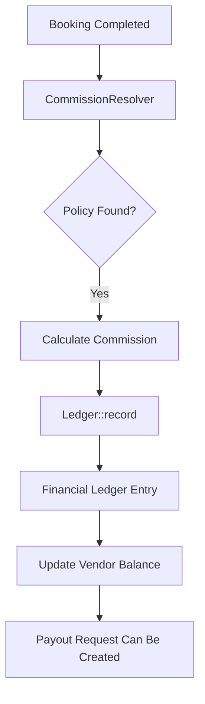

  

:::info Función Pro
Esta página documenta una funcionalidad del complemento **MHM Rentiva Pro**. No forma parte de la edición gratuita
Lite de WordPress.org y requiere tener Pro instalado junto a Lite, además de una licencia válida.
Consulta [Ediciones — Lite frente a Pro](/docs/) para ver la división completa, o consigue Pro en [wpalemi.com/rentiva](https://wpalemi.com/rentiva/).
:::

:::info Propósito
Esta página resume el núcleo financiero (Financial Core) de MHM Rentiva, la lógica de cálculo de comisiones y los estándares de seguridad de los datos.
:::

# 💰 Visión general del sistema financiero

El sistema financiero que constituye el núcleo de MHM Rentiva se basa en cálculos de alta precisión y en una estructura de datos auditable. El sistema registra cada transacción siguiendo un enfoque de **libro mayor inmutable (Immutable Ledger)**.

## 🏗️ Componentes principales

Las operaciones financieras se gestionan mediante los siguientes motores:

| Componente | Responsabilidad |
| :--- | :--- |
| `CommissionResolver` | Motor de decisión que determina la política de comisión más adecuada para una reserva. |
| `Ledger` | Servicio que escribe de forma atómica todos los movimientos monetarios en la tabla `wp_mhmrentiva_ledger`. |
| `PayoutService` | Capa que calcula las ganancias del vendedor y gestiona las solicitudes de liquidación. |
| `GovernanceService` | Supervisa los límites financieros, los controles de riesgo y las autorizaciones. |
| `PolicyRepository` | Almacena las políticas de comisión versionadas y los acuerdos empresariales. |

---

## 🔄 Flujo de datos financieros

Cuando se completa una reserva, el sistema financiero se activa en el siguiente orden:

---

## 📉 Jerarquía de resolución de comisiones (orden de decisión)

El sistema determina qué tarifa aplicar a una reserva según el siguiente orden de prioridad:

1.  **Por vehículo (Vehicle Override):** si se ha definido una tasa de comisión personalizada en los ajustes del vehículo, se utiliza esa.
2.  **Por vendedor (Vendor Override):** si existe un acuerdo personalizado para el vendedor, se aplica ese.
3.  **Sistema de niveles (Tier Discount):** puede aplicarse un descuento o un incremento en función del rendimiento del vendedor.
4.  **Política global (Global Policy):** si ninguna regla coincide, se aplica la tasa predeterminada de los ajustes globales del sistema.

---

## 🛡️ Principios de seguridad financiera (invariantes)

- **Inmutabilidad:** un registro de la tabla `ledger` nunca se elimina ni se somete a `UPDATE`. Las transacciones incorrectas se corrigen mediante un «asiento de compensación».
- **Operaciones atómicas:** el cálculo de la comisión y la escritura en el libro mayor (Ledger) se realizan como una única unidad (transacción atómica).
- **Registro de auditoría:** cada movimiento financiero queda firmado con el usuario que lo realiza y una marca de tiempo.
- **Idempotencia:** la creación de entradas de comisión duplicadas para la misma reserva se impide a nivel de aplicación.

## Resumen de la sección
- El sistema financiero funciona según el principio de **libro mayor primero (Ledger-first)**.
- Las decisiones se toman de forma jerárquica mediante el modular `CommissionResolver`.
- Todos los datos se almacenan cumpliendo los requisitos de auditoría financiera.

## Registro de cambios
| Fecha | Versión | Nota |
|---|---|---|
| 23.04.2026 | 4.27.2 | Se ha añadido la traducción al inglés. |
| 19.03.2026 | 4.21.2 | Visión financiera actualizada para reflejar la jerarquía de la v1.9 y la arquitectura del libro mayor (Ledger). |
