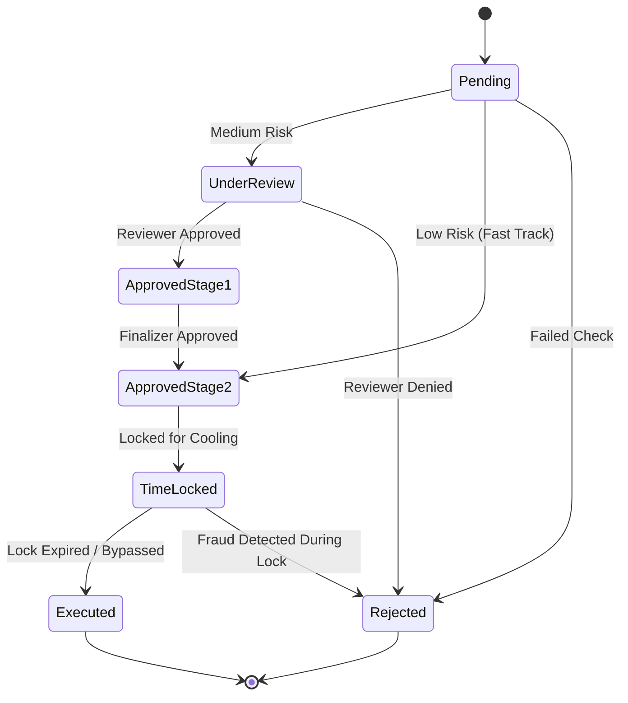

  

:::info Función Pro
Esta página documenta una funcionalidad del complemento **MHM Rentiva Pro**. No forma parte de la edición gratuita
Lite de WordPress.org y requiere tener Pro instalado junto con Lite, además de una licencia válida.
Consulta [Ediciones — Lite frente a Pro](/docs/) para ver la división completa, o consigue Pro en [wpalemi.com/rentiva](https://wpalemi.com/rentiva/).
:::

:::info Propósito
Esta página describe los estados del flujo de trabajo, las reglas de transición y las barreras de seguridad por las que pasa una solicitud de pago al proveedor desde su creación hasta su finalización.
:::

# 🔄 Ciclo de vida del pago al proveedor

MHM Rentiva utiliza una estricta **máquina de estados de aprobación** para gestionar los procesos de pago al proveedor. Cada transición está sujeta tanto a la puntuación de riesgo del sistema como a la intervención humana (Maker-Checker).

---

## 🏗️ Estados

Toda solicitud de pago al proveedor en el sistema se encuentra en uno de los siguientes estados:

| Estado | Código | Descripción |
| :--- | :--- | :--- |
| **Pendiente** | `pending` | Solicitud recién creada, a la espera del análisis de riesgo. |
| **En revisión** | `under_review` | Fase de revisión manual para solicitudes de riesgo medio. |
| **Aprobado fase 1** | `approved_stage_1` | Aprobación de primer nivel obtenida (revisión completada). |
| **Aprobado fase 2** | `approved_stage_2` | Fase de aprobación final (Finalize). |
| **Bloqueado temporalmente** | `time_locked` | Aprobado, pero en espera dentro del «periodo de enfriamiento». |
| **Ejecutado** | `executed` | Pago al proveedor completado correctamente (Ledger cerrado). |
| **Rechazado** | `rejected` | Solicitud rechazada; el saldo se devuelve al vendedor. |

---

## 🌳 Diagrama de transición de estados

---

## 🛡️ Reglas de transición

### 1. Segregación Maker-Checker
La persona que aprueba un pago al proveedor (`Checker`) no puede ser la misma que lo inició o preparó (`Maker`). Esta regla se aplica a nivel de código (`ApprovalStateMachine::validate_transition`) para evitar conductas indebidas internas.

### 2. Vía rápida (Fast-Track)
Las solicitudes con una puntuación de riesgo **BAJA** pueden pasar directamente de `Pending` a `Approved Stage 2`, omitiendo `Under Review`. Es una facilidad que se aplica a los vendedores de confianza para reducir la carga operativa.

### 3. Actualizaciones atómicas
Las transiciones de estado se ejecutan de forma **atómica** en la base de datos. La consulta `UPDATE ... WHERE current_state = old_state` impide que dos administradores actúen sobre la misma solicitud de pago al proveedor de forma simultánea (condición de carrera).

---

## ⏳ Bloqueo temporal y finalización
Cuando se concede `Approved Stage 2`, el saldo se descuenta de forma atómica del Ledger como `payout_debit`, pero el pago físico aún no se envía. Los fondos esperan en el estado `Time Locked`. Cuando vence el periodo de bloqueo, el sistema pasa automáticamente el pago al proveedor a `Executed`.

## Resumen de la sección
- Las transiciones de estado están limitadas por **una matriz estricta**; no es posible realizar transiciones arbitrarias.
- **Maker-Checker** es el pilar de seguridad fundamental del sistema.
- **El bloqueo temporal (Time-Lock)** ofrece la posibilidad de «Retroceder» ante transacciones erróneas.

## Registro de cambios
| Fecha | Versión | Nota |
|---|---|---|
| 23.04.2026 | 4.27.2 | Se ha añadido la traducción al inglés. |
| 19.03.2026 | 4.21.2 | Página actualizada con la matriz de estados de ApprovalStateMachine y la lógica de bloqueo temporal (Time-Lock). |
