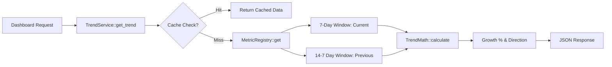

  

:::info Función Pro
Esta página documenta una funcionalidad del complemento **MHM Rentiva Pro**. No forma parte de la edición gratuita
Lite de WordPress.org y requiere tener Pro instalado junto a Lite, además de una licencia válida.
Consulta [Ediciones — Lite vs Pro](/docs/) para ver la división completa, o consigue Pro en [wpalemi.com/rentiva](https://wpalemi.com/rentiva/).
:::

:::info Propósito
Esta página explica cómo se calculan las tasas de crecimiento, los datos de tendencia y las métricas periódicas que se muestran en el panel. `TrendService` actúa como la «inteligencia analítica» del sistema.
:::

# 📈 TrendService e infraestructura de métricas

`TrendService` es un motor central que analiza métricas dinámicas (reservas, mensajes, recogidas, etc.) dentro de ventanas de tiempo concretas.

---

## 🏗️ Arquitectura

El sistema ofrece una estructura de métricas ampliable:
1.  **MetricRegistry:** cada métrica (p. ej., `total_bookings`) se registra en el sistema como una clase que contiene su propia lógica de cálculo.
2.  **TrendService:** utiliza las métricas registradas para comparar «Semana pasada» con «Esta semana».
3.  **TrendMath:** convierte los resultados de la comparación en información de crecimiento porcentual (%) y de dirección (subida/bajada).

---

## 🔄 Flujo de cálculo de métricas

---

## ⏱️ Ventanas de tiempo (windowing)

`TrendService` utiliza dos ventanas de **7 días** para el análisis comparativo:
-   **Periodo actual:** los últimos 7 días (incluido hoy).
-   **Periodo anterior:** los 7 días previos (desde hace 14 días hasta hace 7 días).

Así los usuarios obtienen datos como «X % de crecimiento/descenso respecto a la semana pasada».

---

## 📋 Tipos de métricas disponibles

| Clave de métrica | Contexto | Descripción |
| :--- | :--- | :--- |
| `total_bookings` | `customer` | Número total de reservas del usuario y de las del periodo reciente. |
| `upcoming_pickups`| `customer` | Número de recogidas de vehículos en los próximos 7 días. |
| `unread_messages` | `customer` | Tendencia de los mensajes no leídos recibidos de los vendedores. |
| `net_revenue` | `vendor` | Tendencia de crecimiento de las ganancias del vendedor (basada en el libro contable). |

---

## ⚡ Rendimiento y caché

Los cálculos de métricas pueden generar carga de `WP_Query` en bases de datos grandes. Gracias a `MetricCacheManager`:
-   Las tendencias calculadas se almacenan como transients durante **1 hora**.
-   Las claves de caché se basan en `context`, `metric` y `subject_id` (ID de usuario/correo electrónico).
-   Cuando llega una nueva reserva o un nuevo mensaje, la caché correspondiente se invalida automáticamente.

## Resumen de la sección
-   Las tendencias siempre funcionan sobre una base de **comparación de 7 días**.
-   Se pueden añadir fácilmente nuevos tipos de métricas mediante `MetricRegistry`.
-   Todos los datos se sirven a través de una **capa de caché** virtualizada.

## Registro de cambios
| Fecha | Versión | Nota |
|---|---|---|
| 23.04.2026 | 4.27.2 | Se ha añadido la traducción al inglés. |
| 19.03.2026 | 4.21.2 | Página reescrita desde cero para reflejar la arquitectura de TrendService y MetricRegistry. |
