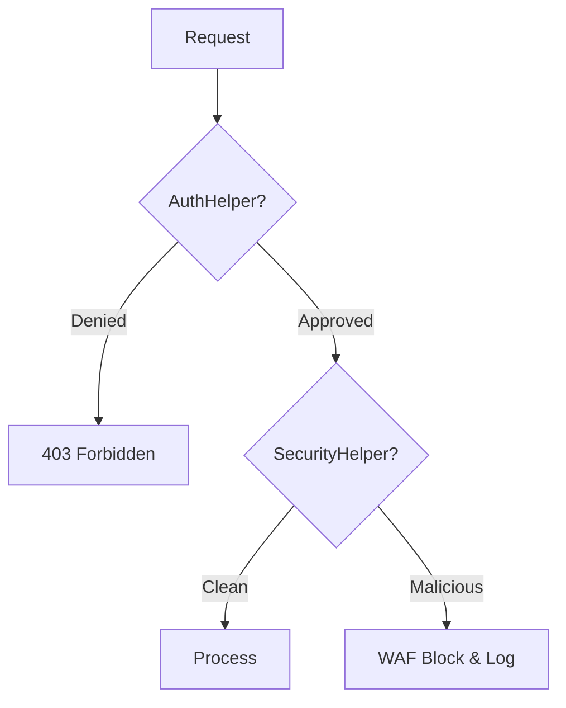

  

:::info Función Pro
Esta página documenta una funcionalidad del complemento **MHM Rentiva Pro**. No forma parte de la edición gratuita
Lite de WordPress.org y requiere tener Pro instalado junto a Lite, además de una licencia válida.
Consulta [Ediciones — Lite frente a Pro](/docs/) para ver la división completa, o consigue Pro en [wpalemi.com/rentiva](https://wpalemi.com/rentiva/).
:::

:::info Propósito
Esta guía trata la protección de datos en la infraestructura de Rentiva, el cumplimiento del RGPD/KVKK y los procesos de respuesta ante incidentes.
:::

# 🔒 Operaciones de seguridad y privacidad

Rentiva funciona bajo el principio de «seguridad desde el diseño» y mantiene un control estricto sobre los datos desde el momento en que se recopilan hasta el momento en que se destruyen.

---

## 🛡️ Capas y herramientas de seguridad

### 🔑 Control de acceso (`AuthHelper`)
Todo el acceso de administración y de la API pasa por `AuthHelper::verify_request()`.
- **Comprobaciones de capacidades:** las acciones operativas pueden restringirse con la capacidad personalizada `rentiva_financial_manager` en lugar de `manage_options`.
- **Rotación de claves API:** las claves API deben rotarse cada 90 días como precaución ante un posible compromiso.

### 🛡️ Seguridad de las entradas (`SecurityHelper`)
Cada valor que entra en la base de datos pasa por los métodos `SecurityHelper::validate_*`:
- **Protección contra XSS:** el contenido HTML se filtra mediante una lista blanca a través de `wp_kses`.
- **Protección contra SQLi:** el SQL sin procesar está prohibido; todas las consultas se parametrizan con `$wpdb->prepare()`.

---

## ⚖️ Privacidad de los datos (privacidad y RGPD)

### 🧹 Anonimización de datos
Cuando se elimina una cuenta de usuario o vence el plazo legal de conservación:
- Se activa `PrivacyManager::anonymize_user_data()`, que enmascara los nombres, las direcciones de correo electrónico y las direcciones IP como `deleted_u_{id}`.
- **Regla:** los registros financieros de `Ledger` se anonimizan pero no se eliminan, para preservar la integridad contable.

### 📅 Política de conservación de datos
- **Registros web:** se purgan automáticamente a los 30 días.
- **Registros de auditoría:** se conservan en modo de solo lectura durante 2 años, según exige la ley.

---

## 🚨 Protocolo de respuesta ante incidentes

Cuando se detecta una brecha de datos o una anomalía:
1. **Aislamiento:** las direcciones IP afectadas se bloquean globalmente mediante `RateLimiter`.
2. **Instantánea:** se hace una copia de seguridad del estado actual de la base de datos para el análisis forense.
3. **Análisis:** se revisan los registros de `AdvancedLogger` para determinar el alcance de la brecha.
4. **Notificación:** se notifica a los usuarios afectados y a las autoridades dentro del plazo legal (72 horas en el caso del RGPD).

---

## 🔄 Diagrama del flujo de seguridad

## Resumen de la sección
- Las operaciones de seguridad siguen el principio de «mínimo privilegio».
- Los datos de `Ledger` son la parte más sensible del sistema; está prohibida la intervención directa.
- La privacidad y la seguridad se garantizan mediante una supervisión continua.

## Registro de cambios
| Fecha | Versión | Nota |
|---|---|---|
| 23.04.2026 | 4.27.2 | Se añadió la traducción al inglés. |
| 19.03.2026 | 4.21.2 | Página actualizada con SecurityHelper y los protocolos de anonimización. |
