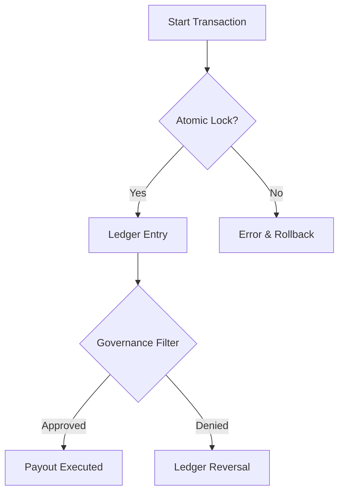

  

:::important Advertencia crítica
Las pruebas de la capa financiera deben superarse con una cobertura del 100 %. Cualquier fallo provoca el bloqueo de todo el sistema de pagos.
:::

# 🛡️ Estrategia de pruebas financieras

La capa financiera de Rentiva utiliza una estrategia de pruebas de varias capas para rastrear el dinero y evitar transacciones erróneas. Los principios fundamentales de esta estrategia son la **inmutabilidad** y la **atomicidad**.

---

## 🏗️ Capas de pruebas

### 1. Pruebas del libro mayor
`LedgerTest.php` verifica que los registros del libro mayor nunca puedan eliminarse ni actualizarse.
- **Regla:** Solo se permiten operaciones `INSERT`.
- **Verificación:** Comprobaciones de saldo negativo y coherencia del saldo total (suma de verificación).

### 2. Atomicidad y regresión (`AtomicPayoutServiceTest`)
Garantiza que el sistema se mantenga coherente cuando se interrumpe una transacción de pago (condición de carrera).
- **Escenario de prueba:** La transacción se revierte por completo cuando se pierde la conexión con la base de datos.
- **Idempotencia:** La misma solicitud de pago no puede procesarse dos veces.

### 3. Aislamiento de inquilinos (`TenantIsolationTest`)
Verifica que los datos de transferencias y pagos nunca se mezclen entre distintos vendedores (inquilinos).
- **Control:** Se bloquea el acceso de `vendor_a` a los datos del libro mayor de `vendor_b`.

---

## 🔒 Pruebas de refuerzo de seguridad (refuerzo forense)

`ForensicHardeningTest.php` audita la seguridad de los datos conforme a estándares forenses:
- **Detección de manipulaciones:** Detección de cualquier modificación no autorizada en los registros históricos.
- **Coherencia de auditoría:** Si las decisiones de gobernanza coinciden con los registros forenses.

---

## 🧪 Pruebas de gobernanza y congelación

Las clases `GovernanceFreezeTest.php` y `GovernanceAuthorizationTest.php` verifican:
- **Congelación:** El bloqueo inmediato de las solicitudes de pago de un vendedor de alto riesgo.
- **Autorización:** Que no se haya infringido el principio Maker-Checker (imposibilidad de aprobarse a uno mismo).

---

## 🔄 Diagrama del flujo de pruebas

## Resumen de la sección
- Todas las pruebas financieras se encuentran en el directorio `tests/Core/Financial`.
- El **refuerzo forense** preserva el valor probatorio forense del sistema.
- Las pruebas de regresión se ejecutan automáticamente antes de cada versión.

## Registro de cambios
| Fecha | Versión | Nota |
|---|---|---|
| 23.04.2026 | 4.27.2 | Se ha añadido la traducción al inglés. |
| 19.03.2026 | 4.21.2 | Página actualizada según las pruebas de refuerzo forense y de aislamiento de inquilinos. |
