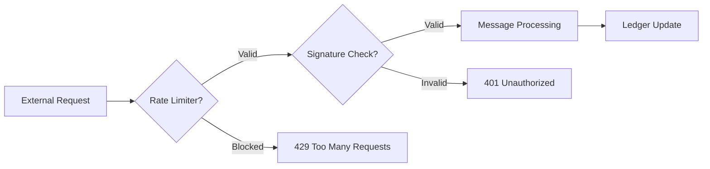

  

:::info Función Pro
Esta página documenta una funcionalidad del complemento **MHM Rentiva Pro**. No forma parte de la edición gratuita
Lite de WordPress.org y requiere tener Pro instalado junto a Lite, además de una licencia válida.
Consulta [Ediciones — Lite frente a Pro](/docs/) para ver la división completa, o consigue Pro en [wpalemi.com/rentiva](https://wpalemi.com/rentiva/).
:::

:::info Propósito
Esta página documenta los procesos de prueba del módulo de transferencias de Rentiva, que funciona de forma asíncrona, y de los endpoints de webhook expuestos al exterior.
:::

# 🛰️ Modelo de pruebas de transferencias y webhooks

Las capas de transferencias y webhooks son los endpoints más críticos a través de los cuales el sistema se comunica con el mundo exterior. Por este motivo, los escenarios de prueba se basan en el principio de «Rechazo seguro» (Safe Reject).

---

## 🛣️ Pruebas de transferencias y ubicaciones

Las pruebas ejecutadas mediante `HybridLocationTest.php` verifican la lógica de búsqueda basada en ubicaciones y de cálculo de rutas:
- **Lógica de datos híbrida:** verifica que las ubicaciones se obtienen de forma coherente tanto de los metadatos como de las tablas personalizadas.
- **Integridad de rutas:** comprueba si el sistema genera el «Fallback» correcto (mensaje de error o ruta alternativa) para rutas no definidas.
- **Búsqueda asíncrona:** ejecuta pruebas de rendimiento y precisión sobre las consultas de búsqueda basadas en ubicaciones realizadas desde el frontend.

---

## 🛡️ Seguridad de webhooks y limitación de frecuencia

Las notificaciones procedentes de fuentes externas (banco, proveedor de pagos, etc.) se someten a un control estricto con `WebhookRateLimiterTest.php`:
- **Limitación de frecuencia:** bloqueo inmediato de picos de tráfico anómalos (DDoS o intentos de fuerza bruta) procedentes de la misma IP u origen.
- **Validación de la carga útil:** verificación de la firma (HMAC) y validación del esquema JSON de los datos entrantes.
- **Idempotencia:** prevención del procesamiento doble de una misma notificación de webhook.

---

## ⚠️ Escenarios negativos (casos límite)

Las siguientes situaciones se prueban siempre para medir la resiliencia del sistema:
- **Conflicto entre líneas:** intento de reservar un vehículo en dos rutas de transferencia distintas al mismo tiempo.
- **Firma de webhook no válida:** las solicitudes con firmas incorrectas o caducadas deben devolver `401 Unauthorized`.
- **Parámetro ausente:** gestión de las solicitudes realizadas sin datos de coordenadas o de ciudad durante el cálculo de rutas.

---

## 📊 Diagrama de flujo de pruebas (webhook)

## Resumen de la sección
- Las pruebas de webhooks sitúan la seguridad en el centro.
- Las pruebas de transferencias validan la arquitectura de «Ubicación híbrida».
- Ambos módulos se someten a pruebas de resiliencia frente a errores asíncronos (tiempo de espera agotado, condición de carrera).

## Registro de cambios
| Fecha | Versión | Nota |
|---|---|---|
| 23.04.2026 | 4.27.2 | Se ha añadido la traducción al inglés. |
| 19.03.2026 | 4.21.2 | Página actualizada conforme a los estándares de HybridLocationTest y WebhookRateLimiterTest. |
