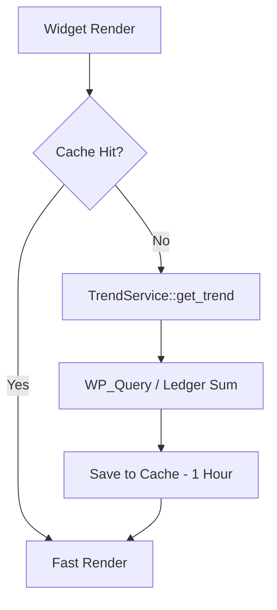

  

:::info Propósito
Esta página describe la arquitectura de las tarjetas KPI, los widgets y los componentes de analíticas que se usan tanto en el panel de administración de WordPress como en los paneles de usuario del frontend.
:::

# Arquitectura de widgets del escritorio

En la documentación de Rentiva, «widget» se refiere a bloques de interfaz independientes que visualizan datos y ofrecen interacciones. Estos bloques funcionan en dos capas principales: **Frontend (Elementor)** y **Administración (tablas de listas personalizadas)**.

---

## 1. Capa de widgets del frontend (Elementor)

Todos los componentes visuales de los paneles del frontend (cliente/vendedor) se gestionan a través de la clase `ElementorIntegration`.

### Widgets KPI principales
Todas las tarjetas KPI obtienen sus datos de forma asíncrona mediante `TrendService`:
- **Widget Mis reservas:** muestra el número de reservas activas y las tendencias de crecimiento.
- **Widget Historial de pagos:** presenta en una tabla las ganancias y el historial de pagos del vendedor.
- **Widget Mis mensajes:** refleja en tiempo real el número de mensajes sin leer.

---

## 2. Capa de widgets de administración

Los widgets del panel de administración se gestionan mediante las clases `DashboardPage.php`, `Reports.php`, `Messages.php` y `RevenueReport.php`.

### Widget de estadísticas (Stats)
- **Diseño:** cuadrícula de 2×2 con iconos y colores mediante CSS en línea.
- **Caché:** prefijo de clave de caché `mhmrentiva_dashboard_stats` (corregido en la v4.23.0; prefijo incorrecto anterior: `mhm_dashboard_stats`).
- **Archivo:** `Reports.php`

### Gráfico de ingresos
- **Formato de fecha:** fechas localizadas mediante `date_i18n(get_option('date_format'))`.
- **Conjunto de datos de cancelaciones:** las reservas canceladas se muestran por separado con una línea discontinua roja.
- **Zona horaria:** usa `wp_date('Y-m-01')` en lugar de `gmdate('Y-m-01')` (para las fechas de ingresos mensuales).
- **Archivos:** `RevenueReport.php` + `reports-charts.js`

### Próximas operaciones
- **Visualización de la hora:** `start_date + start_time` se combinan y se muestran (se ha corregido el error anterior de 00:00).
- **ID mostrado:** el ID del pedido de WC se muestra mediante `mhmrentiva_get_display_id()` con un enlace en el que se puede hacer clic.
- **Archivo:** `Reports.php`

### Reservas recientes
- **Visualización del ID:** compatibilidad con el ID de pedido de WC mediante `mhmrentiva_get_display_id()`.
- **Archivos:** `recent-bookings.php` + `transfer-widget.php`

### Widget de mensajes
- **Diseño:** CSS en línea autónomo, insignia de mensajes sin leer, iniciales en el avatar y formato «hace X tiempo».
- **Archivo:** `Messages.php`

### Ventana emergente del calendario
- **Visualización de la hora:** campos `_mhmrentiva_start_time`/`_mhmrentiva_end_time` mediante `get_post_meta()` (en lugar de un JOIN de SQL).
- **Archivo:** `BookingColumns.php`

### Tabla de lista de pagos al proveedor (`PayoutListTable.php`)
La tabla central para las operaciones financieras, que contiene:
- **Columnas de analíticas:** saldo actual, importe solicitado y estado de la transacción.
- **Acciones en lote:** aprobación en lote de los pagos pendientes con un solo clic.
- **Compatibilidad bancaria:** actualiza en tiempo real los estados de las transacciones (Confirmada / Fallida) desde la capa Processor.

---

## 3. Control de acceso a widgets Lite / Pro

Ningún widget del escritorio de administración está reservado a Pro:

| Widget | Acceso | Restricción |
|---|---|---|
| Widget de estadísticas | Lite + Pro | — |
| Reservas recientes | Lite + Pro | — |
| Gráfico de ingresos | Lite + Pro | — |
| Próximas operaciones | Lite + Pro | — |
| Acciones rápidas de Pro (Informes, Vendedores, Mensajes, Exportar) | Pro | cada una según su propia función de licencia, mediante el filtro `mhmrentiva_dashboard_quick_actions` |

---

## 4. Gestión de la zona horaria y las fechas

Desde la v4.23.0, todos los widgets del escritorio usan la zona horaria de WordPress:

| Anterior (incorrecto) | Actual (correcto) | Descripción |
|---|---|---|
| `time()` | `current_time('timestamp')` | Cálculos de cuenta atrás |
| `strtotime('today')` | `strtotime(wp_date('Y-m-d'))` | Inicio del día |
| `gmdate('Y-m-01')` | `wp_date('Y-m-01')` | Fechas de ingresos mensuales |

**Archivos:** `DashboardPage.php`, `upcoming-operations.php`, `Reports.php`

---

## 5. Sincronización de estados

Las llamadas a `update_post_meta` no activan el hook `save_post`. Se han añadido hooks adicionales para garantizar que el escritorio refleje correctamente el estado:
- `updated_post_meta` — cuando cambia un meta existente
- `added_post_meta` — cuando se añade un meta nuevo

**Archivo:** `DashboardPage.php`

---

## 6. Integración con WooCommerce

- **Imagen del vehículo en el correo electrónico:** el filtro `woocommerce_order_item_thumbnail` añade una imagen del vehículo a los correos electrónicos de pedidos de WC.
- **Archivo:** `WooCommerceBridge.php`

---

## 7. Flujo de datos y rendimiento

Los widgets usan una capa de **caché de nivel 1 (Tier-1 Cache)** para minimizar la carga de la base de datos:

---

## 8. Reglas de seguridad

- **Aislamiento de datos:** un vendedor solo puede ver sus propios datos (coincidencia de `post_author`).
- **Comprobación de capacidades:** el botón de aprobación en lote de `PayoutListTable` solo es visible para los usuarios con la capacidad `mhmrentiva_approve_payout`.
- **Seguridad del nonce:** todas las peticiones AJAX realizadas a través de los widgets de Elementor se verifican con la clave nonce `mhmrentiva_elementor`.

## Resumen de la sección
- Los widgets del frontend se basan en **Elementor** y usan `TrendService`.
- Los widgets de administración se gestionan mediante las clases `DashboardPage`, `Reports`, `Messages` y `RevenueReport`.
- El gráfico de ingresos y Próximas operaciones funcionan en Lite; Pro solo añade accesos directos de acciones rápidas a sus propias pantallas.
- Todos los widgets usan la zona horaria de WordPress (`current_time`, `wp_date`).
- Prefijo de clave de caché: `mhmrentiva_dashboard_stats`.

## Registro de cambios
| Fecha | Versión | Nota |
|---|---|---|
| 09.11.2026 | 6.3.1 | Corrección: el gráfico de ingresos y Próximas operaciones no son exclusivos de Pro; se ha eliminado la fila del widget de mensajes, que no se podía verificar, y se han añadido las acciones rápidas de Pro. |
| 23.04.2026 | 4.27.2 | Se ha añadido la traducción al inglés. |
| 27.03.2026 | 4.23.0 | Se han documentado 12 correcciones de widgets del escritorio: zona horaria, sincronización de estados, hora del calendario, compatibilidad de ID, imagen en el correo electrónico de WC, diseño de mensajes, gráfico de ingresos, caché de estadísticas y restricción Lite/Pro. |
| 19.03.2026 | 4.21.2 | Página actualizada para reflejar la integración con Elementor y la estructura de KPI de TrendService. |
