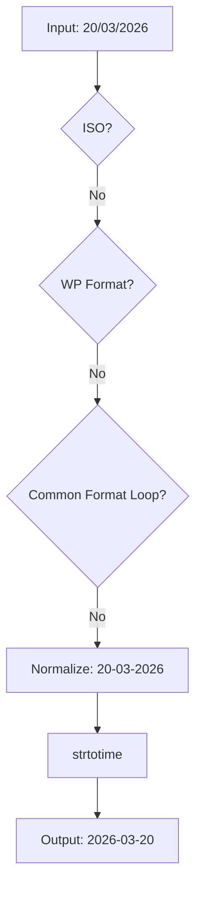

  

:::info Propósito
Este documento explica los principios de funcionamiento del método `SecurityHelper::validate_date` y los estándares de normalización de fechas que se usan en todo el ecosistema de Rentiva.
:::

# 📅 Validación y normalización de fechas

En Rentiva, las fechas pueden llegar en distintos formatos (UI, API, DatePicker). El método `SecurityHelper::validate_date` actúa como una «puerta segura» que convierte todas estas entradas al formato estándar **ISO (YYYY-MM-DD)**.

---

## 🛠️ Jerarquía de validación

El método intenta normalizar los datos entrantes en el siguiente orden:

1.  **Comprobación ISO:** si el valor ya está en formato `YYYY-MM-DD`, se devuelve directamente.
2.  **Formato de fecha de WP:** intenta analizarlo usando el valor `date_format` de los ajustes de WordPress (p. ej., `d/m/Y`).
3.  **Formatos habituales:** recorre en un bucle `d/m/Y`, `m/d/Y`, `d-m-Y` y `Y/m/d`.
4.  **Normalización y alternativa:** convierte los separadores (`.`, `/`, ` `) en `-` y hace un último intento con `strtotime`.

---

## 🔄 Diagrama de flujo



---

## 💻 Ejemplo de uso

```php
use MHMRentiva\Admin\Core\SecurityHelper;

try {
    // Validation with different formats
    $date1 = SecurityHelper::validate_date('2026-01-01'); // Returns '2026-01-01'
    $date2 = SecurityHelper::validate_date('31/12/2025'); // Returns '2025-12-31'
    $date3 = SecurityHelper::validate_date('2025.05.20'); // Returns '2025-05-20'
} catch (\InvalidArgumentException $e) {
    // Invalid format handling
    AdvancedLogger::error('Invalid date attempt: ' . $e->getMessage());
}
```

---

## 🛡️ Seguridad y gestión de errores

-   **Validación estricta:** si no coincide ningún formato, el método lanza una `InvalidArgumentException`.
-   **Seguridad ante valores nulos:** si la entrada está vacía o es null, se limpia mediante `sanitize_text_field_safe` y se lanza una excepción.
-   **Zona horaria:** la salida final siempre se genera en UTC mediante `gmdate('Y-m-d')`.

## Resumen de la sección
-   Todas las entradas de fecha deben pasar por el filtro `validate_date`.
-   La salida es siempre una cadena en formato **ISO (YYYY-MM-DD)**.
-   En caso de fallo, se lanza una `Exception` que interrumpe el flujo de la aplicación.

## Registro de cambios
| Fecha | Versión | Nota |
|---|---|---|
| 23.04.2026 | 4.27.2 | Se ha añadido la traducción al inglés. |
| 19.03.2026 | 4.21.2 | Actualizado para reflejar la normalización y la lógica alternativa de SecurityHelper::validate_date. |
