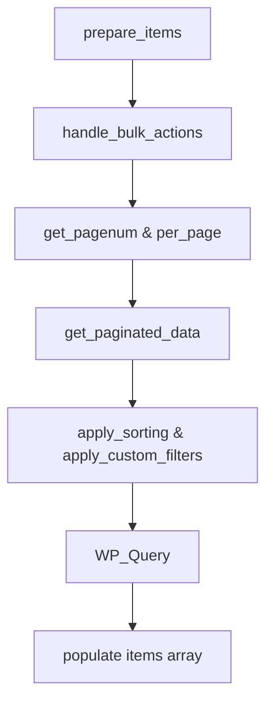

  

:::info Propósito
Esta página describe la clase `AbstractListTable` —la base de todas las tablas del panel de administración de Rentiva— y los estándares de listado de datos que impone.
:::

# 📋 Estándares de tablas de listado

Rentiva utiliza una capa **abstracta** que moderniza la clase `WP_List_Table` integrada de WordPress y elimina la duplicación de código.

---

## 🏗️ Arquitectura de AbstractListTable

`AbstractListTable` gestiona de forma centralizada las necesidades comunes de todas las subtablas (Pagos, Clientes, Mensajes, etc.):
- **Paginación automática:** gestión del límite y el desplazamiento (offset) mediante `set_pagination_args`.
- **Ordenación:** aplicación automática de la lógica ASC/DESC por columna.
- **Búsqueda:** integración de la búsqueda global mediante el parámetro `s`.
- **Seguridad (nonce):** verificación automática del nonce en las acciones masivas.

---

## 🛠️ Crear una tabla de listado

Para añadir una nueva tabla al sistema, extiende la clase `AbstractListTable` e implementa los siguientes métodos:

| Método | Responsabilidad |
| :--- | :--- |
| `get_singular_name()` | Nombre en singular (p. ej., `payout`). |
| `get_plural_name()` | Nombre en plural (p. ej., `payouts`). |
| `get_data_query_args()` | Argumentos para obtener los datos (compatibles con `WP_Query`). |
| `get_total_count()` | Número total de registros (para la paginación). |
| `process_bulk_action()` | Lógica de las acciones masivas (Aprobar, Eliminar, etc.). |

---

## 🔄 Flujo de preparación de datos

---

## 🧩 Métodos auxiliares integrados

Las subclases pueden usar métodos integrados en lugar de estructuras HTML complejas:
- **`render_status_badge()`:** convierte los códigos de estado en insignias de colores.
- **`format_price()`:** da formato a la moneda y a los separadores de miles.
- **`render_row_actions()`:** genera enlaces de acción rápida como Editar/Eliminar.
- **`create_view_link()`:** proporciona un enlace seguro a la página de detalles de un elemento.

## 🛡️ Protocolo de seguridad

- **Obligatoriedad del nonce:** todas las acciones masivas se verifican mediante `mhmrentiva_listtable_nonce`.
- **Redirecciones:** se utiliza `wp_safe_redirect` después de las acciones masivas para evitar errores de «reenvío del formulario».
- **Saneamiento:** todos los parámetros de filtro que llegan a la tabla se pasan por `sanitize_text_field_safe`.

## Resumen de la sección
- Las tablas nuevas deben usar siempre la clase `AbstractListTable`.
- La lógica de obtención de datos debe encapsularse en `get_data_query_args`.
- Es obligatorio usar `safe_output` o las funciones de escape de WordPress en todas las capas de salida.

## Registro de cambios
| Fecha | Versión | Nota |
|---|---|---|
| 23.04.2026 | 4.27.2 | Se ha añadido la traducción al inglés. |
| 19.03.2026 | 4.21.2 | Página reescrita desde cero para reflejar la arquitectura central de AbstractListTable. |
