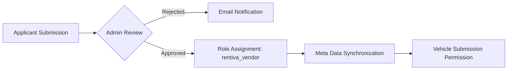
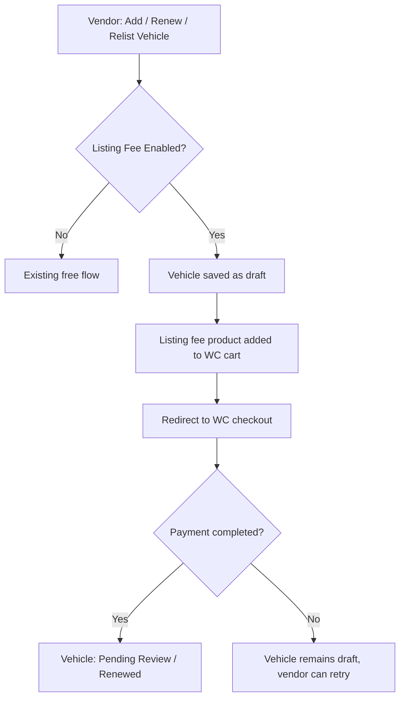

  

:::info Función Pro
Esta página documenta una funcionalidad del complemento **MHM Rentiva Pro**. No forma parte de la edición gratuita
Lite de WordPress.org y requiere tener Pro instalado junto a Lite, además de una licencia válida.
Consulta [Ediciones — Lite frente a Pro](/docs/) para ver la división completa, o consigue Pro en [wpalemi.com/rentiva](https://wpalemi.com/rentiva/).
:::

:::info React SPA — Página de administración (desde la v4.40.0)
La página de administración **Gestión de vendedores** se migró a una **React SPA** en la v4.40.0. `VendorManagementRestController` registra 7 rutas REST bajo `/wp-json/mhm-rentiva/v1/vendor-management/*`. Componentes: `VendorManagementPage`, `ApplicationTable`, `VendorTable`, `VendorDetailPanel`, `ActionBar`. Los datos se obtienen en el lado del cliente, sin renderizar la página completa en PHP.
:::

:::info Propósito
Rentiva puede pasar de ser un sistema centralizado de alquiler de vehículos a un marketplace multivendedor. Este documento explica en detalle técnico el ciclo de vida del vendedor.
:::

# 🤝 Gestión de vendedores

A continuación se resumen las etapas por las que debe pasar un usuario para convertirse en vendedor en el sistema y las estructuras técnicas que hay detrás de ese proceso.

---

## 🏗️ 1. Rol de vendedor y autorización

### Rol `rentiva_vendor`
A cada vendedor aprobado se le asigna este rol, que incluye las siguientes capacidades:
- `edit_posts`: puede añadir sus propios vehículos.
- `upload_files`: puede subir imágenes de vehículos.
- `read`: puede acceder al panel del vendedor.

### 🛡️ Control de propiedad (`VendorOwnershipEnforcer`)
Se usa el filtro `user_has_cap` para impedir que los vendedores accedan a los vehículos o reservas de otros:
- Un vendedor solo puede editar registros `mhmrentiva_vehicle` cuyo valor `post_author` coincida con su propio `user_id`.
- La lista «Todos los vehículos» del portal de administración se filtra para mostrar solo los registros propios del vendedor.

---

## 📋 2. Gestión de solicitudes (`mhmrentiva_vendor_app`)

Los datos de los solicitantes a vendedor se almacenan en el tipo de contenido personalizado (CPT) `mhmrentiva_vendor_app`:
- **Flujo de incorporación:** `Pending` → `Approved` / `Rejected`.
- **Seguridad de los datos:** el IBAN recogido durante la solicitud se cifra con `VendorApplicationManager::encrypt_iban()` mediante el método **AES-256-CBC**.
- **Seguimiento de documentos:** los documentos de identidad, carné de conducir y justificante de domicilio se asocian a la biblioteca de medios de WordPress mediante las claves meta `_vendor_doc_*`.

---

## ⚙️ 3. Controles operativos

### Aprobación y sincronización de metadatos (`VendorOnboardingController`)
Cuando un administrador aprueba una solicitud:
1. Los datos de teléfono, ciudad e IBAN del registro `mhmrentiva_vendor_app` se copian a las tablas meta del usuario (WP_User).
2. El rol del usuario pasa de `customer` a `rentiva_vendor`.
3. Se dispara el hook `mhmrentiva_vendor_approved` y se envía un correo electrónico de bienvenida.

### Gestión del perfil (`VendorProfileExtension`)
La página de perfil de WordPress (`wp-admin/profile.php`) se amplía con campos específicos del vendedor:
- **Información de la tienda:** biografía, número de identificación fiscal y zonas de servicio.
- **Información financiera:** visualización enmascarada del IBAN (p. ej., TR***5678).

### Página de ajustes del vendedor (v4.23.1)

La página de ajustes del panel del vendedor (`vendor-settings.php`) se rediseñó por completo en la v4.23.1:

- **Arquitectura CSS:** se eliminaron todos los estilos en línea y se trasladaron a `vendor-forms.css` usando la estructura de clases CSS `.mhm-vendor-form__*`.
- **Nuevos campos:** se añadieron los campos Titular de la cuenta y Delegación de Hacienda.
- **Selección de ciudad:** usa el componente SelectWoo (`CityHelper::render_select()`) en lugar de un campo de texto.
- **Sistema de avisos:** los avisos de éxito/error se estandarizaron usando la estructura de clases `mhm-vendor-notice`.

:::tip Nota técnica
Todos los campos del formulario de la página de ajustes del vendedor tienen estilos basados en clases de tipo BEM como `.mhm-vendor-form__group`, `.mhm-vendor-form__label`, `.mhm-vendor-form__input`. Sigue la misma estructura de clases al añadir campos nuevos.
:::

---

## Resumen del ciclo de vida

---

## 🚐 5. Gestión de ubicaciones y rutas de transferencia del vendedor (v4.23.0)

A partir de la v4.23.0, los vendedores pueden seleccionar ubicaciones y rutas para los servicios de transferencia:

### Filtrado por ciudad
En el formulario de envío de vehículos del vendedor (`[rentiva_vehicle_submit]`) solo se muestran las **ubicaciones** y **rutas** de la ciudad indicada en la solicitud del vendedor. Esto forma parte de la jerarquía **Ciudad → Punto**.

### Precios por ruta
- El vendedor selecciona las rutas en las que quiere prestar servicio.
- Para cada ruta, introduce su propio precio dentro del rango `min_price` — `max_price` establecido por el administrador.
- Los detalles de capacidad (pasajeros, equipaje) se definen a nivel de vehículo.

### Estructura de metadatos
- `_mhmrentiva_transfer_locations`: ubicaciones en las que presta servicio el vendedor (array)
- `_mhmrentiva_transfer_routes`: rutas en las que presta servicio el vendedor (array)
- `_mhmrentiva_transfer_route_prices`: precios del vendedor por ruta (JSON)

### Vista del administrador
En la pantalla de edición del vehículo (`VehicleTransferMetaBox`) se muestran la ciudad del vendedor y las ubicaciones/rutas que ha seleccionado.

---

## 🔄 Gestión del ciclo de vida de los vehículos (v4.24.0)

En la v4.24.0 se implementó un sistema completo de ciclo de vida de los vehículos:

| Función | Detalle |
|---------|-------|
| **Estados** | Activo / En pausa / Retirado / Caducado / Pendiente de revisión |
| **Periodo de publicación** | 90 días (configurable por el administrador), renovable por el vendedor |
| **Sistema de penalización por cancelación** | Puntos de penalización progresivos (2.ª retirada 10 %, 3.ª y siguientes 25 %) |
| **Puntuación de fiabilidad** | Valoración de rendimiento de 0 a 100 |
| **Periodo de espera** | Periodo de espera de 7 días tras la retirada |
| **Antifraude** | Las fechas de reservas canceladas se bloquean durante 30 días |

### Tiempo restante en las tarjetas de vehículos del vendedor (v4.24.1)

Cada tarjeta de vehículo del panel del vendedor muestra el tiempo de publicación restante:

| Estado | Visualización | Color |
|-------|----------|------|
| > 50 % de tiempo restante | «Quedan: X días» | 🟢 Verde |
| 20 %–50 % de tiempo restante | «Quedan: X días» | 🟡 Amarillo |
| < 20 % de tiempo restante | «Quedan: X días» | 🔴 Rojo |
| Caducado | Insignia «Caducado» | — |

**Clases CSS:** `.mhm-vendor-listing-card__remaining` con las variantes `.is-green`, `.is-yellow`, `.is-red`.

---

## 💰 Sistema de publicación de pago (v4.24.1)

Puede exigirse a los vendedores que paguen a través de WooCommerce para publicar un anuncio de vehículo. El administrador puede activar o desactivar esta función.

### Ajustes del administrador (Ajustes → Marketplace de vendedores → Tarifa de publicación)

| Ajuste | Tipo | Predeterminado | Descripción |
|------|-----|-----------|----------|
| Activar tarifa de publicación | Casilla | Desactivado | Activa/desactiva el sistema de publicación de pago |
| Modelo de tarifa | Desplegable | Pago único | `one_time` o `per_period` (cada periodo de 90 días) |
| Importe de la tarifa de publicación | Número | 0 | Importe de la tarifa en la moneda de la tienda |

### Flujo de pago

### Puntos de activación

| Acción | Flujo gratuito | Flujo de pago |
|-------|---------------|-------------|
| **Vehículo nuevo** | Formulario → Pendiente de revisión | Formulario → Borrador → Pago en WC → Pendiente de revisión |
| **Renovación** (caducado) | AJAX → Renovación del ciclo de vida | AJAX → Pago en WC → Renovación del ciclo de vida |
| **Volver a publicar** (retirado) | AJAX → Nueva publicación del ciclo de vida | AJAX → Pago en WC → Nueva publicación del ciclo de vida |

### Producto de WooCommerce

- **Tipo:** `WC_Product_Simple` (virtual, oculto)
- **SKU:** `mhm-rentiva-listing-fee`
- **Visibilidad:** oculto en la tienda (no aparece en la tienda ni en los resultados de búsqueda)
- **Precio:** se lee dinámicamente de los ajustes del administrador
- **Meta del carrito:** `_mhmrentiva_listing_vehicle_id`, `_mhmrentiva_listing_action` (new/renew/relist)
- **Creación automática:** se crea automáticamente la primera vez que se activa la función

### Regla de derechos adquiridos

- Los vehículos activos existentes no se ven afectados al activar la función
- Se exige el pago de renovación cuando caduca el periodo de publicación de 90 días
- No se aplican tarifas con carácter retroactivo

### Relación con la comisión

La tarifa de publicación y la comisión son **independientes entre sí:**
- El vendedor paga la tarifa de publicación (por adelantado, por anuncio)
- El vendedor paga la comisión (porcentaje, por reserva)
- No hay descuento ni compensación entre ambas

### Clase técnica

**`ListingFeeManager`** (`src/Admin/Vehicle/ListingFeeManager.php`):
- `is_enabled()` — Comprueba si la función está activa
- `requires_payment(string $action)` — Determina si se requiere pago para la acción indicada
- `get_or_create_product()` — Crea el producto de WC o devuelve el existente
- `add_to_cart(int $vehicle_id, string $action)` — Lo añade al carrito y devuelve la URL de pago
- `on_order_completed()` — Publica el vehículo cuando se completa el pedido

---

## 🔗 Mi cuenta de WooCommerce — Enlace de menú al panel del vendedor (v4.24.1)

Los usuarios con el rol de vendedor ven un enlace de menú **«Panel del vendedor»** en la barra lateral de la página Mi cuenta de WooCommerce. Este enlace redirige a `/panel/`.

| Rol de usuario | Elemento de menú | URL |
|----------------|------------|-----|
| `rentiva_vendor` | Panel del vendedor | `/panel/` |
| Otros roles (cliente, etc.) | Hazte vendedor | `/hesabim/vendor-apply/` |

**Detalles técnicos:**
- `WooCommerceIntegration::add_menu_items()` — El elemento de menú cambia según la comprobación del rol de vendedor
- `WooCommerceIntegration::vendor_panel_endpoint_url()` — Redirige el endpoint `vendor-panel` a la página `/panel/`
- El slug de la URL de solicitud de vendedor se puede traducir mediante la función `_x()` (compatible con SEO)

---

## 🔓 Acción de reactivar (v4.43.0)

Ahora los administradores pueden **reactivar** a un vendedor suspendido directamente desde la página de administración Gestión de vendedores, sin tener que ir al perfil del usuario. La acción de reactivar:

- Restaura el rol `rentiva_vendor` del vendedor (desde el estado suspendido).
- Vuelve a publicar los vehículos que se despublicaron en el momento de la suspensión.
- Envía al vendedor un correo electrónico de reactivación.
- Registra la acción en el registro de auditoría de comisiones.

**Endpoint REST:** `POST /wp-json/mhm-rentiva/v1/vendor-management/unsuspend` (requiere `manage_options`).

---

## 📋 Registro de auditoría de comisiones (v4.43.0)

Ahora cada transacción de comisión se escribe en un registro de auditoría persistente, accesible desde el panel de detalles de Gestión de vendedores. Cada entrada registra:

| Campo | Descripción |
| :--- | :--- |
| `event_type` | `commission_applied`, `commission_reversed`, `vendor_suspended`, `vendor_unsuspended`, `penalty_applied`, `penalty_deferred` |
| `vendor_id` | ID de usuario del vendedor |
| `booking_id` | Reserva asociada (cuando corresponda) |
| `amount` | Importe de la comisión o penalización (float con signo) |
| `note` | Nota del administrador o generada por el sistema |
| `created_at` | Marca de tiempo |
| `admin_user_id` | Administrador que desencadenó el evento (NULL para eventos del sistema) |

El registro de auditoría es de solo anexión: las entradas nunca se eliminan ni se modifican. Úsalo para rastrear disputas, verificar liquidaciones y auditar los eventos de penalización automáticos.

**Endpoint REST:** `GET /wp-json/mhm-rentiva/v1/vendor-management/{vendor_id}/audit-log`

---

## Componentes React (v4.40.0+)

| Componente | Propósito |
| :--- | :--- |
| `VendorManagementPage` | Raíz — navegación por pestañas (Solicitudes / Vendedores / Auditoría) |
| `ApplicationTable` | Lista paginada de solicitudes pendientes con acciones de aprobar/rechazar |
| `VendorTable` | Lista de vendedores activos con búsqueda y filtro de estado |
| `VendorDetailPanel` | Panel deslizante: IBAN (enmascarado), documentos, registro de auditoría, acciones |
| `ActionBar` | Fila de acciones rápidas Suspender / Reactivar / Editar |

**Espacio de nombres REST:** `GET/POST /wp-json/mhm-rentiva/v1/vendor-management/*`

---

## Problemas conocidos (detectados en la v4.23.1)

| Problema | Detalle | Estado |
|-------|-------|-------|
| Filtro de estado del vehículo | `_mhmrentiva_vehicle_status` no se comprueba en las consultas de búsqueda: los vehículos en mantenimiento son visibles. | Detectado |
| Suspensión de vendedores | `VendorOnboardingController::suspend()` no despublica los vehículos del vendedor. | Detectado |

---

## Resumen de la sección
- El aislamiento de los datos está garantizado por `VendorOwnershipEnforcer`.
- Todos los datos críticos de las solicitudes se almacenan cifrados.
- Las capacidades `rentiva_vendor` solo se aplican a las entradas propiedad del vendedor.
- Los vendedores solo pueden acceder a las ubicaciones y rutas de su propia ciudad. *(v4.23.0)*
- La página de ajustes del vendedor se rediseñó con una estructura de clases CSS de tipo BEM. *(v4.23.1)*
- La selección de ciudad usa el componente SelectWoo en todos los formularios. *(v4.23.1)*
- Se implementó el sistema de ciclo de vida de los vehículos (publicación de 90 días, pausa, renovación, retirada). *(v4.24.0)*
- Sistema de publicación de pago: pasarela de pago basada en el checkout de WooCommerce, configurable por el administrador. *(v4.24.1)*
- Visualización del tiempo restante en las tarjetas de vehículos del vendedor (con código de colores). *(v4.24.1)*
- Se añadió el enlace «Panel del vendedor» para los vendedores en el menú Mi cuenta de WC. *(v4.24.1)*

## Registro de cambios
| Fecha | Versión | Nota |
| :--- | :--- | :--- |
| 07.05.2026 | 4.43.0 | Acción de reactivar (restauración del rol + nueva publicación de vehículos + correo electrónico). Registro de auditoría de comisiones (solo anexión, 6 tipos de eventos). |
| 06.05.2026 | 4.40.0 | Migración completa a React SPA. VendorManagementRestController (7 rutas REST). Componentes VendorManagementPage, ApplicationTable, VendorTable, VendorDetailPanel y ActionBar. |
| 23.04.2026 | 4.27.2 | Se añadió la traducción al inglés. |
| 01.04.2026 | 4.24.1 | Sistema de publicación de pago (ListingFeeManager), visualización del tiempo restante, enlace de menú «Panel del vendedor» en Mi cuenta de WC, 18 pruebas nuevas. |
| 29.03.2026 | 4.24.0 | Se implementó el sistema de ciclo de vida de los vehículos (fases 0-4, 6-7). Pausa, renovación, retirada, puntuación de fiabilidad. |
| 28.03.2026 | 4.23.1 | Rediseño de la página de ajustes del vendedor, campos Titular de la cuenta y Delegación de Hacienda, migración de la ciudad a SelectWoo. |
| 26.03.2026 | 4.23.0 | Se añadieron la gestión de ubicaciones/rutas de transferencia del vendedor, la jerarquía Ciudad→Punto y los precios por ruta. |
| 19.03.2026 | 4.21.2 | Se añadieron detalles del CPT, del Enforcer y de la incorporación. |
