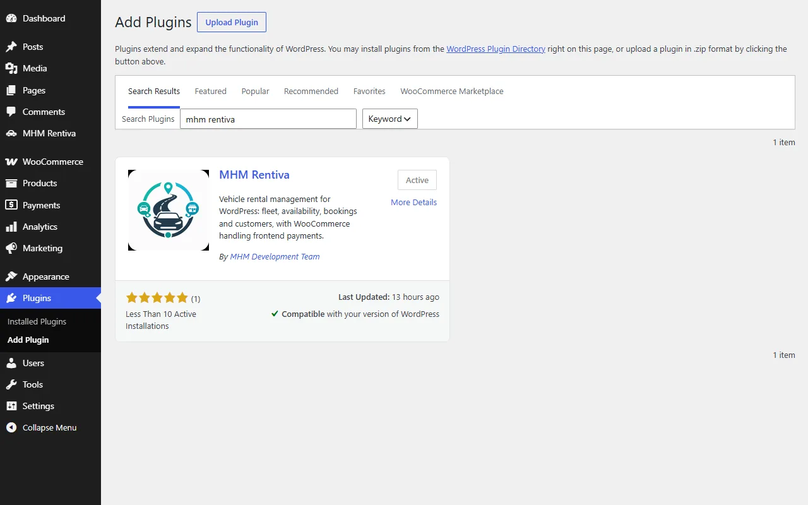
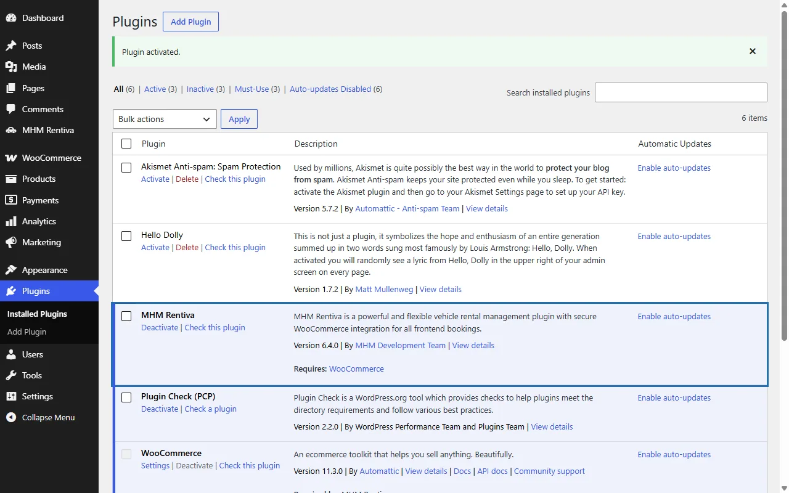

  

MHM Rentiva, WordPress sitenizi güçlü bir araç kiralama platformuna dönüştürmek için tasarlanmış profesyonel bir eklentidir. Bu rehberde, eklentinin sıfırdan kurulumunu ve ilk yapılandırma adımlarını bulacaksınız.

:::tip Eğitim Videosu
Eklentinin kurulumunu adım adım izlemek için aşağıdaki video kutusuna tıklayabilirsiniz.

  
<strong>🎥 Eğitim Videosu Yakında Gelecektir</strong>

  <small>Resmi YouTube kanalımızda yayına girdiğinde burada izlenebilir olacak.</small>

:::

---

## 1. Sistem Gereksinimleri

Eklentinin stabil çalışması için sunucunuzun ve WordPress kurulumunuzun aşağıdaki minimum gereksinimleri karşılaması gerekir:

| Gereksinim | Minimum Versiyon | Notlar |
| :-- | :-- | :-- |
| **WordPress** | 7.0+ | En güncel kararlı sürüm önerilir. |
| **PHP** | 8.1+ | Güvenlik ve performans için zorunludur. |
| **WooCommerce** | Aktif, güncel sürüm | Tüm frontend ödeme akışları için **zorunludur**. O olmadan eklenti etkinleşmez. |
| **Rentiva Pro** (isteğe bağlı) | MHM Rentiva 6.4.0+ | Pro 6.5.0, MHM Rentiva 6.4.0 veya üstünü gerektirir; daha eski MHM Rentiva ile Pro kendini kapatır ve yönetici bildirimi gösterir. |
| **SSL Sertifikası** | HTTPS | Ödeme ağ geçitlerinin (Stripe, iyzico vb.) çalışması için gereklidir. |
| **Permalink Yapısı** | Yazı İsmi | `%postname%` yapısı SEO ve rotalar için önerilir. |

---

## 2. Adım Adım Kurulum

MHM Rentiva [WordPress.org eklenti dizininde](https://wordpress.org/plugins/mhm-rentiva/) yayınlanmıştır; olağan yol WordPress'in kendi sunduğu yoldur. Diğer iki yöntem, güncel sürüm yerine **belirli bir yapıyı** kurmak içindir.

### Yöntem A: WordPress.org dizininden (Önerilen)
1. WordPress panelinizden **Eklentiler > Yeni Ekle** sayfasına gidin.
2. **MHM Rentiva** araması yapın.
3. **Şimdi Kur** butonuna basın ve işlem tamamlandığında **Etkinleştir**'e tıklayın.

Bundan sonra WordPress eklentiyi, dizindeki diğer eklentileri güncellediği gibi kendisi güncel tutar — elle bir şey indirmeniz gerekmez.

---

*Eklentiler > Yeni Ekle arama sonuçlarında MHM Rentiva'yı gösteren ekran görüntüsü*

---

### Yöntem B: ZIP dosyası yükleyerek
Bunu, dizindeki güncel sürüm yerine belirli bir yapıya ihtiyacınız olduğunda kullanın — örneğin [GitHub releases sayfasındaki](https://github.com/MaxHandMade/mhm-rentiva/releases) bir sürüm.

1. **Eklentiler > Yeni Ekle** sayfasına gidip **Eklenti Yükle** butonuna tıklayın.
2. ZIP dosyasını seçip **Şimdi Kur** butonuna basın.
3. İşlem tamamlandığında **Eklentiyi Etkinleştir**'e tıklayın.

---

*Eklenti başarıyla yüklendiğinde "Eklentiyi Etkinleştir" butonunun olduğu ekran*

---

### Yöntem C: FTP/SFTP Üzerinden
1. Eklentinin ZIP dosyasını bilgisayarınızda bir klasöre çıkarın.
2. FTP istemciniz (örneğin FileZilla) ile sunucunuza bağlanın.
3. Çıkardığınız klasörü `/wp-content/plugins/` dizinine yükleyin.
4. WordPress panelinizden eklentiyi etkinleştirin.

---

## 3. Kurulum Sonrası Otomatik İşlemler

Eklenti etkinleştirildiğinde arka planda aşağıdaki işlemler otomatik olarak gerçekleştirilir:

1. **Veritabanı Tabloları:** `payment_log`, `sessions`, `transfer_routes` gibi fonksiyonel tablolar oluşturulur.
2. **CPT Kaydı:** `mhmrentiva_vehicle` (Araçlar), `mhmrentiva_booking` (Rezervasyonlar) ve `mhmrentiva_addon` (Ek Hizmetler) özel yazı tipleri ve ilgili taksonomiler sisteme tanıtılır.
3. **Müşteri Rolü:** `mhmrentiva_customer` adında özelleştirilmiş bir kullanıcı rolü eklenir.
4. **Rewrite Rules:** Kalıcı bağlantılar araç sayfaları için otomatik olarak yenilenir.

---

## 4. İlk Kurulum Sihirbazı

Eklentiyi ilk kez etkinleştirdiğinizde sistem sizi otomatik olarak **Kurulum Sihirbazı**'na yönlendirecektir. Bu sihirbaz:
- Sunucunuzu denetler (PHP, WordPress, WooCommerce, HTTPS, WP-Cron, e-posta teslimatı).
- Gerekli sayfaları (Rezervasyon formu, Araç arama, Arama sonuçları, Araç ayrıntıları, Araç listesi, İletişim formu) otomatik oluşturur.
- E-postalar için gönderen bilgilerini ve temel görünüm ile kiralama günü varsayılanlarını ayarlar.

:::info Manuel Yönlendirme
Eğer sihirbaz otomatik açılmazsa, WordPress admin menüsünden **MHM Rentiva > Kurulum sihirbazı** yolunu izleyerek manuel olarak başlatabilirsiniz.
:::

---

## Teknik Detaylar (Geliştiriciler İçin)

Eklenti etkinleştirme sırasında `register_activation_hook` kullanarak `mhmrentiva_single_site_activation()` fonksiyonunu tetikler. Bu fonksiyon `DatabaseMigrator` sınıfı üzerinden veritabanı şemasını güncel tutar.

Geliştirme aşamasında `WP_DEBUG` açıksa, kurulum hataları PHP loglarına veya ekranın üst kısmındaki hata bildirim kutularına yansıyacaktır.

---

## Güncelleme

WordPress, MHM Rentiva'yı dizindeki diğer eklentiler gibi günceller. **Rentiva Pro** da kullanıyorsanız önce MHM Rentiva'yı (Lite), sonra Pro'yu güncelleyin.

:::info 6.4.0'da değişti
MHM Rentiva artık WordPress 7.0 veya üstünü gerektirir (önceden 6.7). Güncellemeden sonra **sayfa önbelleğinizi temizleyin** (barındırma firmanız, LiteSpeed Cache, WP Rocket vb.): 6.3.x'in önbelleğe aldığı bir sayfa eski rezervasyon formu ve takvim işaretlemesini tutar, yeni betikler onun üzerinde çalışmaz. Rentiva'nın kendi kısa süreli önbelleği kendiliğinden yenilenir.
:::

---

### Bölüm Özeti
- En az **WordPress 7.0**, **PHP 8.1** ve **WooCommerce** gereklidir.
- Kurulum sonrası **Setup Wizard** takip edilmelidir.
- Veritabanı tabloları aktivasyonda otomatik kurulur.

### Değişiklik Günlüğü
| Tarih | Sürüm | Not |
| :--- | :--- | :--- |
| 18.11.2026 | 6.4.0 | En düşük WordPress sürümü 7.0 oldu; Pro gereksinimi ve güncelleme notları (sayfa önbelleği) eklendi; sihirbaz açıklaması güncellendi. |
| 23.08.2026 | 6.0.7 | Kurulum artık WordPress.org dizininden başlıyor; etkinleştirme sonrası tanımlayıcılar 6.0.0 yeniden adlandırmasına göre güncellendi. |
| 18.03.2026 | 4.21.2 | Tasarım revizyonu yapıldı ve içerik zenginleştirildi. |
| 26.02.2026 | 4.21.0 | İlk sürüm oluşturuldu. |

