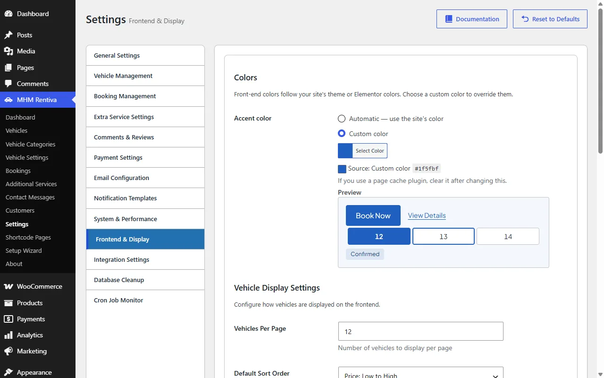

  

Ön Yüz ve Ekran sekmesi, eklentinin kullanıcı tarafındaki (frontend) görünümünü, buton metinlerini, uyarı mesajlarını ve sayfa bağlantılarını (URL) özelleştirdiğiniz kapsamlı bir yönetim alanıdır. **MHM Rentiva > Ayarlar > Ön Yüz ve Ekran** altından ulaşılır.

---

## 🎨 Renkler

**Renkler** bölümü sekmenin en üstündedir. Eklentinin sitenizde kullandığı tek ana rengi belirler: birincil düğmeler, bağlantılar, seçili takvim günleri ve rezervasyon ekranlarının hafif tonlu sayfa zemini. Rentiva ön yüzü ayrıca Plus Jakarta Sans yazı tipini eklentinin kendi dosyalarından sunar (Google'a istek gitmez) ve kartlarda, düğmelerde, rezervasyon kutularında 4 px köşe kullanır.

**Ana renk** altında bir kip seçersiniz:

- **Otomatik — sitenin rengini kullan:** Rentiva rengi sitenizden okur. Kaynakları şu sırayla dener ve bulduğu ilk gerçek rengi kullanır:
  1. **Tema ayarı:** desteklenen bir temanın ana rengi (Thembay temaları, Avanam, listeo, politic, upstudy ve Astra). Hiç değiştirmediyseniz temanın kendi varsayılanı kullanılır ve kaynak satırında "tema varsayılanı" yazar.
  2. **Elementor global rengi:** **Vurgu** global rengi, sonra **Birincil**. Elementor'un fabrika renkleri yok sayılır; yalnız sizin belirlediğiniz renk sayılır.
  3. **Tema renk paleti (theme.json):** blok temanın düğme rengi, sonra `primary` ve `accent` palet renkleri.
  4. **Rentiva varsayılanı:** yukarıdakilerden renk çıkmazsa bir mavi (`#2271b1`).
- **Özel renk:** renk seçiciyle kendi rengini seçersiniz. Otomatik sonucun yerine geçer.

Seçicinin altında şunları görürsünüz:

- **Kaynak:** geçerli rengin hangi kaynaktan geldiği, renk örneği ve hex koduyla; örneğin "Kaynak: tema ayarı (Astra)".
- **Önizleme:** rengi değiştirdikçe yenilenen küçük bir örnek (düğme, bağlantı, üç takvim günü, "Onaylandı" etiketi).
- **İki okunabilirlik uyarısı**, yalnız gerektiğinde çıkar:
  - "Bu renk sayfadaki yazı için fazla açık..." Ana renk düğme dolgusu olarak kalır; ancak bağlantılar ve yazılar okunur kalsın diye daha koyu bir ton kullanır. Üzerine gelme (hover) tonu otomatik türetilir; çok koyu bir ana renkte daha koyu yerine daha açık açılır.
  - "Bu açık renk beyaz zeminden zor ayırt edilir."

:::tip Sayfa önbelleğinizi temizleyin
Renkler sayfaya yazılır. Bir sayfa önbelleği eklentisi kullanıyorsanız ya da barındırmanız sayfaları önbelleğe alıyorsa, rengi değiştirdikten sonra o önbelleği temizleyin; bölümün kendisi de bunu hatırlatır.
:::

:::info 6.4.0'da değişti
Renkler artık sitenizi otomatik izler. Önceki sürümlerde ön yüz her zaman sabit bir mavi kullanıyordu.
:::

### Geliştiriciler için
Üç filtre bir temanın ya da özel eklentinin işe karışmasını sağlar. `mhmrentiva_accent_color` hex rengi ve kaynak kimliğini alır, nihai rengi döndürür (Özel kipte bile son söz onundur; o zaman kaynak satırında "geliştirici filtresi" yazar). `mhmrentiva_accent_sources` otomatik kaynakların sıralı listesini değiştirir, `mhmrentiva_theme_adapters` başka bir tema için destek ekler.

---

## 🖼️ Temel Araç Görüntüleme Ayarları

Araç listeleme sayfalarındaki görsel hiyerarşiyi buradan kontrol edebilirsiniz:

- **Sayfa Başına Araç Sayısı:** Tek bir sayfada listelenecek maksimum araç sayısı (Örn: 12).
- **Varsayılan Sıralama:** Listeleme sayfasının ilk açılışta hangi kritere göre dizileceği (Fiyata göre artan, Yıla göre azalan vb.).

:::note Kaldirilan Ayarlar (v4.22.1)
Daha önceki sürümlerde bulunan **Araç Resimlerini Göster** (`mhmrentiva_vehicle_show_images`), **Özellikleri Göster** (`mhmrentiva_vehicle_show_features`) ve **Müsaitlik Durumunu Göster** (`mhmrentiva_vehicle_show_availability`) ayarlari kodda hicbir yerde kullanilmadigi için v4.22.1 ile kaldirilmistir. Bu görüntüleme kontrolleri artik dogrudan kisa kod (shortcode) parametreleri üzerinden yönetilmektedir (`show_features`, `show_badges` vb.).
:::

---

## ✍️ Özel Etiketler ve Metinler (Labels)

Eklentideki tüm buton ve form metinlerini dilinize veya marka dilinize göre saniyeler içinde değiştirebilirsiniz. Bu bölüm akordiyon yapısındadır:

- **Genel Butonlar:** "Hemen Kirala", "Detayları Gör", "Rezervasyon Yap" gibi buton metinleri.
- **Bildirim Mesajları:** "Favorilere eklendi", "Giriş yapmalısınız", "İşlem yapılıyor..." gibi anlık uyarılar.
- **Form Etiketleri:** Rezervasyon formundaki "Ad", "Soyad", "Telefon" gibi alan isimleri.
- **Ödeme ve Doğrulama:** "Hesaplanıyor...", "Ödeme başarılı", "Geçersiz tarih seçimi" gibi kritik sistem mesajları.

---

*Ayarlar > Ön Yüz ve Ekran sekmesi, etiket grupları ve görüntüleme ayarları*

---

## 🔗 Kalıcı Bağlantılar ve Sayfa URL Yapısı

Eklentinin doğru çalışması için kritik olan sayfa yollarını buradan elle belirleyebilirsiniz:

- **Rezervasyon Formu URL:** `[rentiva_booking_form]` kısa kodunun bulunduğu sayfanın tam adresi.
- **Giriş ve Kayıt Sayfası:** Müşterilerin yönlendirileceği özel giriş ve üyelik sayfaları.

:::tip Otomatik Tespit
Eğer bu alanları boş bırakırsanız, sistem ilgili kısa kodun bulunduğu sayfaları veritabanında otomatik olarak tarayacak ve bulacaktır. Ancak özel bir sayfa yapınız varsa buraya tam URL girmeniz önerilir.
:::

---

### Bölüm Özeti
- **Kullanıcı Deneyimi** için tüm butonları hedef kitlenizin diline göre özelleştirin.
- **Görsel Düzen** ile listeleme sayfalarınızı sitenizin tasarımına uydurun.
- **Sayfa Bağlantıları** ile rezervasyon akışının kesintisiz çalıştığından emin olun.

### Değişiklik Günlüğü
| Tarih | Sürüm | Not |
| :--- | :--- | :--- |
| 18.11.2026 | 6.4.0 | Renkler bölümü eklendi (otomatik site rengi, özel renk, uyarılar, filtreler). |
| 27.03.2026 | 4.22.1 | Kullanilmayan görsel kontrol ayarlari (`show_images`, `show_features`, `show_availability`) kaldırıldı notu eklendi. |
| 19.03.2026 | 4.21.2 | Ön Yüz ve Ekran dökümanı tüm etiket grupları ve URL yapılandırmasıyla oluşturuldu. |
