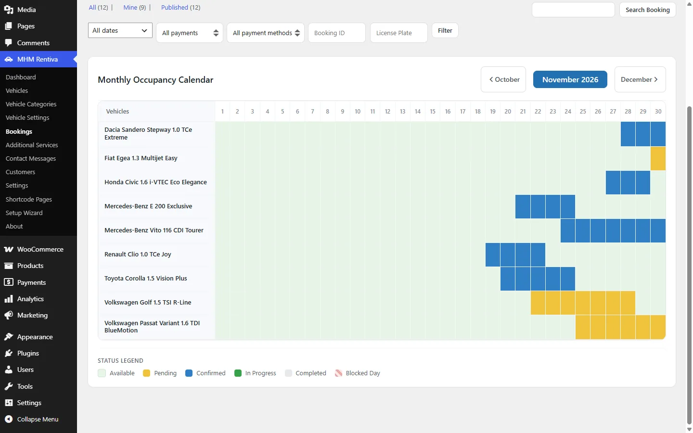

  

Rezervasyonlar, MHM Rentiva sisteminin operasyonel ve finansal kalbidir. **MHM Rentiva > Rezervasyonlar** menüsü üzerinden tüm rezervasyon trafiğini izleyebilir, yeni kayıtlar açabilir ve finansal akışları yönetebilirsiniz.

Müşterinin gördüğü sepet ve ödeme sayfası (ödeme etiketleri, kapora satırları, misafir hesabı, ödenmemiş siparişin neden ödenemediği) için [Ödemeler](../02-core-configuration/payments.md) sayfasına bakın.

---

## 📊 Rezervasyon Listesi ve Filtreler

Sayfanın en üstünde, filonuzun anlık durumunu gösteren dört kart bulunur:
- **Toplam rezervasyon:** Çöpte olmayan tüm rezervasyonlar ve bu ay kaç tanesinin oluşturulduğu.
- **Bekleyen:** Onay ya da ödeme bekleyen rezervasyonlar ve bu hafta kaç tanesinin oluşturulduğu.
- **Tamamlandı:** Sonuçlanmış kiralamalar ve bu ay kaç tanesi.
- **Bu ay rezervasyon tutarı:** Bu ay oluşturulan onaylı, devam eden ve tamamlanan rezervasyonların rezervasyon tutarı (tahsilat değil) ve geçen aya göre değişim.

Kartların altındaki durum çipleri listeyi süzer: **Tümü**, **Bekleyen**, **Onaylandı**, **Devam ediyor**, **Tamamlandı** ve **İptal edildi** her zaman, sayılarıyla birlikte görünür. Diğer durumlar (örneğin İade edilen) yalnızca en az bir rezervasyonda bulunuyorsa çıkar.

Çiplerin yanındaki **Tüm ödemeler** ve **Tüm ödeme yöntemleri** listeleri ile **Rezervasyon kimliği** ve **Plaka** kutuları listeyi daha da daraltır.
- Ödeme filtresi, **Ödeme** sütunundaki rozetlerle aynı durumları sunar: Ödenmemiş, Bekleyen, Ödenen, Kısmen ödendi, Kısmen iade edildi, İade edilen, İptal edildi vb. Yalnızca en az bir rezervasyonda bulunan durumlar listelenir.
- **Ödenen** filtresi, bakiyesi kalan kapora rezervasyonlarını getirmez; onlar **Kısmen ödendi** altındadır.
- Ödeme filtresi durum çipiyle birlikte daralır ve Çöp kutusu görünümünde de çalışır.

**Liste sütunları:** Müşteri, Rezervasyon kimliği, Araç, Tarihler, Toplam, Kapora tutarı, Kalan tutar, Ödeme, Durum ve Rezervasyon türü. Türün yanındaki küçük **M**, elle girilmiş rezervasyonu belirtir. Ödeme sütunundaki rozet: Ödenmemiş ya da Bekleyen (sarı), Ödenen (yeşil), Kısmen ödendi (mavi), İade edilen / Başarısız / İptal edildi (kırmızı).

**Bekleyen** bir rezervasyonun satırında, rezervasyonu açmadan onaylayan bir **Onayla** bağlantısı bulunur.

### Takvim görünümü

Tablonun üstündeki **Liste** / **Takvim** anahtarı aynı rezervasyonları filo takvimi olarak gösterir: her araç bir satır, seçili ayın her günü bir sütundur. Aylar arasında ay okları ile gezinirsiniz; durum çipleri ve filtreler takvime de uygulanır.

**Hücre renkleri (açıklama):**
- ● **Bekleyen**
- ● **Onaylandı**
- ● **Devam ediyor**
- ● **Tamamlandı** (açık gri)
- Kırmızı çapraz çizgiler: **Kapalı gün** (aracın düzenleme ekranında kapatılmış gün)
- Beyaz: **Müsait**

İptal edilen ve iade edilen rezervasyonlar aracı meşgul etmez, bu yüzden boyanmaz. Takvimde **İptal edildi** çipini seçerseniz sayfa Liste görünümüne geçmenizi söyler.

Boyalı bir hücreye tıkladığınızda müşteri, araç, plaka, teslim alma ve dönüş zamanı, toplam fiyat ve **Rezervasyonu düzenle** düğmesini içeren bir özet açılır. Aynı güne birden çok rezervasyon düşüyorsa hepsi listelenir.

---

## ➕ Yeni Rezervasyon

Ofisinizden veya telefonla gelen talepleri sisteme işlemek için **Yeni Ekle** düğmesini kullanın. Sayfa başlığı "← Rezervasyonlar · Yeni kayıt · yönetici tarafından" biçimindedir. Form şu bölümlerden oluşur:

1.  **Araç ve müşteri:** Aracı seçin, ardından mevcut bir müşteriyi seçin ya da **+ Yeni müşteri oluştur** seçeneğiyle ad, soyad, e-posta ve telefonu girin.
2.  **Tarihler ve süre:** Teslim alma ile dönüş tarihi ve saati. Dönüş, teslim almadan sonra olmalıdır.
3.  **Ek hizmetler:** Müşterinin istediği ek donanımları işaretleyin ve adetleri belirleyin. Günlük ücretli bir hizmetin tutarı, kiralama gün sayısıyla çarpılarak gösterilir.
4.  **Ödeme ve notlar:** **Ödeme türü** (**Tam ödeme** ya da **Kapora**; Kapora seçili gelir), **Ödeme yöntemi** (**Çevrim dışı** seçili gelir, ya da **Çevrim içi**), **Durum** (**Bekleyen** ya da **Onaylandı**; Onaylandı seçili gelir) ve notlar. **Çevrim içi** seçeneğinin altında ödeme bağlantısının ayrıca gönderileceğini söyleyen bir not görünür.

**Fiyatı hesapla** düğmesine basın. Fiyat paneli araç toplamını, ek hizmetleri ve genel toplamı gösterir; kapora seçiliyse **Kapora** ve **Kalan** satırları da görünür. Ardından **Rezervasyon oluştur** düğmesine basın. Misafir sayısı alanı yoktur.

**Yeni müşterinin ülkesi ve ili.** Yeni müşteri kartında isteğe bağlı **Ülke** ve il alanları bulunur. Ülke listesi WooCommerce'ten gelir (mağazanızın sattığı ülkeler; mağazanın kendi ülkesi seçili gelir). İl listesi olan ülkede listeden seçersiniz; il listesi olmayan ülkede bölgeyi yazarsınız; il kullanmayan ya da ödeme sayfasının il alanını gizlediği ülkede (örneğin Kıbrıs, Bosna-Hersek, Botsvana) alan gösterilmez. Değerler, müşterinin WooCommerce fatura ülkesine ve iline kaydedilir.

**Müşteri hesabı.** Burada yeni müşteri oluşturulduğunda müşteriye kendi parolasını belirleyeceği bir e-posta gider; başarı iletisi bunu söyler.

### Site dışında ödenen rezervasyonlar

**Çevrim dışı** ödeme yöntemiyle elle girdiğiniz rezervasyonun (teslimde nakit ya da kart, kendi kontrol ettiğiniz bir havale) ödeme süresi yoktur. Ödeme süresi dolunca ya da teslim günü geçince kendiliğinden iptal edilmez ve müşteriye "ödeme süresi doldu" e-postası gitmez. **Çevrim içi** yöntemle elle girilen rezervasyon ve sitede yapılan her rezervasyon ödeme süresini korur (**Ayarlar › Rezervasyon** altındaki **Ödeme son tarihi (dakika)**, **Otomatik iptali etkinleştir** ile birlikte).

:::info 6.4.0'da değişti
Elle girilen çevrim dışı rezervasyonlar eskiden otomatik tarama ile iptal ediliyordu. Yükseltmede, bu yolla iptal edilmiş eski kayıtlar aracı yeniden tutar. Tarihler arada başka bir müşteriye geçtiyse kayıt olduğu gibi kalır ve **Günlükler**'de o rezervasyona bağlı bir uyarı çıkar.
:::

---

## 📝 Rezervasyon Düzenle (Ekran Düzeni)

Düzenlemek için listeden bir rezervasyon açın. Başlık "← Rezervasyonlar · Müşteri, araç ve ödeme bilgileri" biçimindedir. Varsayılan düzen:

**Sağ sütun**
- **Rezervasyon durumu:** kısa bir özet (araç, gün sayısı, toplam), "İptal, ödenmiş tutarın iadesini başlatır ve müşteriye bildirim gönderir." notuyla **Rezervasyonu iptal et** düğmesi ve her zamanki **Güncelle** ile **Çöpe taşı** düğmeleri.
- **Müşteri hesabı:** müşterinin adı, e-postası, **Müşteri profilini görüntüle** bağlantısı ve **Ülke / il** satırı (müşterinin WooCommerce fatura ülkesi ve ili). Bağlı hesap yoksa ve rezervasyonda e-posta varsa **Müşteri hesabı oluştur** düğmesi hesap açar; müşteriye parolasını belirleyeceği bir e-posta gider. Kutuda ayrıca **Kiralama sözleşmesi** satırı görünür: tarih ve metin sürümüyle **Kabul edildi**, ya da elle girdiğiniz rezervasyonda "Kabul kaydı yok (yönetici rezervasyonu)".
- **Ödeme dekontu:** yalnızca müşteri havale dekontu yüklediyse görünür. Bkz. [Müşteri dekontu](#müşteri-dekontu).
- **İade:** iade durumu ve iade işlemleri. Bkz. [İptal ve İade](#cancellation-and-refund).
- **Müşteriye e-posta gönder:** bkz. [Müşteriye E-posta Gönder](#send-email-to-customer).

**Sol sütun**
- **Rezervasyon ayrıntılarını düzenle:** rezervasyon referansı ve türü, araç, teslim alma ve dönüş tarihi ve saati, durum, adetleriyle ek hizmetler ve özel notlar. Kişi sayısı alanı yoktur (kayıtlı değer korunur).
- **Ödeme yönetimi:** tutarlar, ödeme durumu, son tarihler, ödeme geçmişi, rezervasyon geçmişi ve not ekleme (aşağıda).

Kutuları sürükleyebilirsiniz; düzen kullanıcı başına hatırlanır. Siz yeniden düzenleyene kadar yukarıdaki sıra geçerlidir.

**Ödeme durumu rozetleri** (Ödeme yönetimi kutusunda): Ödenen yeşil; Kısmen ödendi, Bekleyen ve Bekleyen doğrulama sarı; Ödenmemiş, Başarısız ve İptal edildi kırmızı; İade edilen ve Kısmen iade edildi mavidir.

### Araç çöpte

Rezervasyonun aracı çöpe atılmışsa ya da yayında değilse araç listesi onu yine seçili gösterir ve adının yanında "— Çöpte" yazar; altında müşterilerin artık araç sayfasını açamadığını, aracı Araçlar listesinden geri yükleyebileceğinizi ya da başka bir araç seçebileceğinizi söyleyen bir not çıkar. Başka bir araç seçildiğinde not gizlenir.

### Tarihler ve kapalı günler

Dönüş tarihi ve saati teslim almadan sonra olmalıdır. Olmazsa tarayıcı kaydı durdurur; hatalı bir aralık yine de sunucuya ulaşırsa kaydedilmez ve tarihler değişmeden kalır. Aracın o dönemde kapalı günleri varsa rezervasyon kaydedilir ve bir bildirim bu günleri adıyla söyler.

### Müşteri dekontu

Müşteri havale dekontu yüklediyse **Ödeme dekontu** kutusu dosyayı (**Görüntüle / indir**), durumunu (Gönderildi, Onaylandı ya da Reddedildi), bir **Yönetici notu** alanını ve **Dekontu onayla** ile **Dekontu reddet** düğmelerini gösterir.

---

## 🔄 Fiyatın Yeniden Hesaplanması

**Güncelle**, fiyatı yalnızca fiyatı etkileyen bir girdi değiştiyse yeniden hesaplar: araç, teslim alma ya da dönüş tarihi veya saati, ek hizmetler ve adetleri. Ödenmiş bir rezervasyonda yalnızca durumu ya da notu değiştirirseniz toplam tutar ve ek hizmet satırları olduğu gibi kalır.

Fiyat değiştiğinde:
- **Tahsil edilen tutar korunur.** Ödenmiş bir rezervasyonu uzatır ya da pahalılaştırırsanız rezervasyon kaporalıya döner: ödenen kapora olur, fark **Kalan tutar** olur ve **Kalan tutarı işle** ile ya da ödeme bağlantısı göndererek tahsil edersiniz.
- **Tahsil edilenin altına düşen yeni toplam kaydedilmez.** Araç, tarihler ve ek hizmetler kayıtlı hâliyle kalır (notlar ve diğer alanlar kaydedilir) ve bir ileti rezervasyonu iptal etmenizi, ödemeyi iade etmenizi ve yeni bir rezervasyon oluşturmanızı söyler.
- **Toplam değiştirilemez:** rezervasyon için bir kalan ödeme bağlantısı varken, iade edilmiş bir rezervasyonda toplam artacaksa, rezervasyon birden fazla para biriminde ya da mağazanın para biriminden başka bir birimde ödenmişse, ya da başka rezervasyon veya ürünle aynı siparişte ödenmişse. İleti hangi durum olduğunu söyler; bu durumlarda fiyatı değiştirmek için rezervasyonu iptal edip yenisini oluşturun.

Hiç ödeme alınmamış (tahsilat yok, siparişe bağlı değil) yüzde kaporalı bir rezervasyonda kapora, yeni toplama rezervasyonun kendi oranıyla uyar: %10'luk kapora yeni toplamın %10'u olur ve kalan tutar buna göre yazılır. Ayarlardaki bugünkü kapora oranı eski rezervasyona uygulanmaz. Sabit tutarlı kapora, siparişe bağlı ya da ödemesi olan rezervasyonda kapora olduğu gibi kalır; yalnızca kalan tutar yeni toplamı izler.

---

## 💰 Kapora ve Kalan Ödeme

**Ödeme yönetimi** kutusu **Ödeme türü** (Kapora ya da Tam ödeme), **Ödeme yöntemi** (Çevrim içi ya da Çevrim dışı), **Toplam tutar**, **Kapora tutarı**, **Kalan tutar**, **Kiralama günleri** ve **Kapora türü** bilgilerini, ardından ödeme durumunu, **İptal politikası**nı (son tarih ve rezervasyonun hâlâ iptal edilip edilemeyeceği) ve **Ödeme son tarihi**ni gösterir.

Kaporası ödenmiş ama bakiyesi kalan bir kapora rezervasyonu hem kutuda hem listede **Kısmen ödendi** görünür. Kapora sistemi gelmeden önce yapılmış bir rezervasyonda kapora bilgisinin bulunmadığını söyleyen bir not çıkar.

**Düğmeler:**
- **Ödeme alındı olarak işaretle:** Bekleyen ya da Onaylandı durumundaki, henüz ödenmemiş rezervasyon için (örneğin kontrol ettiğiniz bir havale). Ödemeyi alındı olarak işaretler ve rezervasyonu onaylar.
- **Kalan tutarı işle:** kaporası ödenmiş ve bakiyesi kalmış kapora rezervasyonu için. Bakiyeyi tahsil edilmiş olarak kaydeder; rezervasyon Onaylandı olur, kiralama bitmişse Tamamlandı olur.
- **Ödeme bağlantısı gönder:** müşteriye kalan tutar için ödeme bağlantısını e-postayla gönderir. Kapora WooCommerce dışında ödendiyse sunulmaz; orada **Kalan tutarı işle** kullanılır.

### Müşteri kalan tutarı öder

Kapora rezervasyonunda müşteri, **Hesabım** içinde rezervasyon ayrıntısındaki **Kalan tutarı öde** düğmesine basabilir. Ödenmemiş tutar için küçük bir WooCommerce siparişi oluşturulur ve müşteri bunu sitenizdeki etkin herhangi bir ödeme yöntemiyle öder. Kapora web sitesi dışında ödendiyse sayfa, bakiyeyi tahsil etmek için sizin müşteriyle iletişime geçeceğinizi söyler.

- Yalnızca rezervasyonun güncel ödeme bağlantısı ödeme alır. Eski bağlantı, tutarın artık geçerli olmadığını söyler ve müşteri yeni bağlantı ister. Reddedilen kart aynı bağlantıyla yeniden denenebilir.
- Kalan ödeme siparişi başarısız olursa ya da iptal edilirse rezervasyon iptal edilmez. Ödenmiş bir kalan sipariş sonradan iptal edilirse para o siparişte durur; iade ya da geri yükleme size kalır.
- Tutarı artık güncel olmayan bir ödeme gelirse kalan tutar sıfırlanmaz. Rezervasyon düzenleme ekranında, sipariş numarasını, tahsil edilen tutarı ve kalan tutarı söyleyen kalıcı bir uyarı kalır; **Kontrol ettim** düğmesine basana kadar durur. Bakiyeyi elle düzeltin.

:::info 6.4.0'da değişti
Yükseltmeden önce oluşturulmuş bir kalan ödeme bağlantısı, vergi ya da kur farkı nedeniyle ödemede reddedilebilir. Müşteri bu durumda yeni bağlantı ister.
:::

---

## 🧾 Rezervasyon Geçmişi

**Ödeme yönetimi** kutusu **Rezervasyon geçmişi** ile biter.

- **Not ekle:** bir not yazın, **Tür**ü seçin (**Not** ya da **Müşteri iletişimi**) ve **Not ekle** düğmesine basın. Boş not, **Güncelle**'yi engellemeden reddedilir ve sonuç kutunun içinde gösterilir. Durum, ödeme ve sistem satırlarını Rentiva kendisi yazar.
- **Geçmiş:** en yeni üstte; her satırda tür (Not, Durum değişikliği, Ödeme güncellemesi, Müşteri iletişimi, Sistem), tarih ve "… tarafından" adı. Otomatik işlerin yazdığı satırlar **Sistem** gösterir. Yalnızca son beş kayıt açıktır; kalanı "+ N daha fazla kayıt" altındadır.
- Her ödeme değişikliği tek satır yazılır, örneğin "Ödeme: Bekleyen → Kısmen ödendi". Kapora onayı, kalan ödeme, WooCommerce siparişi, iade, otomatik iptal, **Güncelle** ile yeniden fiyatlama ve ödeme türü değişimi böyle bir satır yazar.
- Diğer satırlar: elden iadenin kapatılması, iade yapılmayacağının gerekçesi, müşteriye gönderilen e-posta ve kalan ödeme bağlantısının oluşturulması ya da e-postalanması.
- Notlar müşterinin kişisel veri dışa aktarımında yer alır. Müşterinin Hesabım zaman çizelgesi ödeme satırlarını göstermez.

---

## ❌ İptal ve İade {#cancellation-and-refund}

**Rezervasyon durumu** kutusundaki **Rezervasyonu iptal et** düğmesi, Bekleyen ya da Onaylandı durumundaki bir rezervasyonu iptal eder. Ödenen tutarın iadesini başlatır ve müşteriye ile yöneticiye bildirim gönderir. Başlamış bir kiralama buradan iptal edilemez.

**Durum** listesinde **İptal edildi**yi seçip **Güncelle**'ye basmak tam olarak aynı işi yapar. Formdaki diğer değişiklikler kaydedilmez ve ekran bunu söyler ("önce rezervasyonu düzenleyin, sonra iptal edin"). Para yetkisi olmayan bir kullanıcı durum listesinde **İptal edildi**yi görmez.

**İptal son tarihi.** Süre, teslim almadan geriye sayılır (**Ayarlar › Rezervasyon › İptal son tarihi (saat)**). Müşteri bu tarihten sonra iptal edemez. Yöneticinin iptali süreyi atlar ve iade edilebilir bakiyenin tamamını iade eder. Ödeme yönetimi kutusunda "Bu rezervasyon iptal edilebilir." ve "İptal süresi doldu." cümleleri yalnızca açık rezervasyonlarda görünür; iptal edilmiş, tamamlanmış ve iade edilmiş rezervasyonda yalnızca son tarih satırları kalır.

**İade kutusu.** İlk satır **İade durumu:** satırıdır (örneğin İade devam ediyor, Elden transfer bekleniyor, Elden transfer onaylandı, Ödeme ağ geçidi üzerinden iade edildi, İade yapılması gerekmiyordu).
- **İadeyi işle**, iade edilebilir bakiyesi olan iptal edilmiş bir rezervasyonda görünür; iadeyi tamamlar ya da yeniden dener. Paranın bir kısmı zaten geri gittiyse kalanını sunar.
- İptal edilmemiş, ödenmiş bir WooCommerce rezervasyonunda "WooCommerce sipariş ekranından iade edilebilir." yazar.
- Çevrim dışı para için kutu **Kanal**, **Ödenen**, **Zaten iade edildi** ve **İade edilebilir kalan tutar** satırlarını listeler.

**Elden iade (nakit, havale).** İade elle geri ödenecekse durum **Elden transfer bekleniyor** olur. Parayı teslim ettiğinizde isteğe bağlı bir **Ödeme referansı (isteğe bağlı)** yazın ve **Elden transferi onayla** düğmesine basın. Rezervasyon geçmişine yazılır; referans girildiyse müşteriye, iadesinin o referansla aktarıldığını söyleyen bir e-posta gider. Elle geri ödenen iadede müşteri WooCommerce'in "siparişiniz iade edildi" e-postasını almaz; yalnızca Rentiva'nın "iade size manuel olarak aktarılacaktır" e-postası gider (Rentiva e-postası kapalıysa ya da adres yoksa WooCommerce'inki kalır). Ödeme ağ geçidinin geri verdiği iadede WooCommerce e-postası değişmez.

**İnceleme gerekiyor.** Otomatik iptal ödenmiş bir sipariş bulup para hareket ettirmediyse durum **İnceleme gerekiyor — ödenmiş bir sipariş bulundu, para hareket etmedi** olur. **İptal et ve iadeyi başlat** iptal eder ve iadeyi başlatır. **İade yapılmayacak** incelemeyi kapatır; **İade neden yapılmıyor?** alanına gerekçeyi yazmalısınız ve geçmişe kaydedilir. Rezervasyon zaten iptal edilmişse ödenmiş siparişi önce WooCommerce sipariş ekranından iade edin.

**WooCommerce sipariş ekranından iade.** Bir sipariş orada tamamen iade edilirse:
- Başlamamış bir rezervasyon (Bekleyen, Bekleyen ödeme, Onaylandı) iptal edilir ve tarihleri serbest kalır; ödeme durumu İade edilen olur.
- Tamamlanmış bir kiralama **İade edilen** olarak kalır.
- Devam eden bir kiralama, araç müşteride olduğu için tarihlerini tutar; kapatmak size kalır.
- Müşteri tek bir iade e-postası alır, ayrıca "rezervasyon iptal edildi" e-postası gitmez.

---

## ✉️ Müşteriye E-posta Gönder {#send-email-to-customer}

**Müşteriye e-posta gönder** kutusu müşterinin adını ve e-postasını, ardından şunları gösterir:
1.  **E-posta türü:** **Rezervasyon onayı**, **Rezervasyon hatırlatması**, **Rezervasyon iptali** ya da **Özel ileti**.
2.  **Konu** ve **İleti:** bir tür seçmek ikisini de **Ayarlar → E-posta şablonları** içindeki ilgili şablondan doldurur; göndermeden önce düzenleyebilirsiniz (türü yeniden değiştirirseniz düzenlemelerinizin değiştirilip değiştirilmeyeceğini sorar). **Özel ileti** boş başlar ve konu ile ileti gerektirir.
3.  **E-posta gönder.**

**Rezervasyon iptali** türü konuyu ve iletiyi doldurur ve gönderilir. Müşteri otomatik bildirimleri kapattıysa kutu bunu söyler; buradan gönderdiğiniz e-posta yine de gider. Gönderilen e-posta rezervasyon geçmişine yazılır.

---

## 🆔 Görüntülenen Kimlik

Rezervasyon listeleri ve widget'lar, WooCommerce entegrasyonu etkinse WooCommerce sipariş numarasını, değilse rezervasyonun kendi numarasını gösterir. Böylece müşterinin gördüğü numara yönetim panelindekiyle tutarlı kalır.

---

### Bölüm Özeti
- **Listeyi** durum, ödeme, yöntem, rezervasyon kimliği ya da plakaya göre süzün ya da **Takvim**'e geçin.
- **Yeni Ekle** telefonla ve yüz yüze gelen talepleri işler; elle girdiğiniz çevrim dışı rezervasyonlar kendiliğinden iptal edilmez.
- **Güncelle** fiyatı yalnızca bir fiyat girdisi değişirse yeniden hesaplar ve tahsil edilen tutarı asla düşürmez.
- Kapora ve bakiyeleri **Ödeme yönetimi** kutusunda izleyin; **Kalan tutarı işle** ya da **Ödeme bağlantısı gönder** düğmesini kullanın.
- **Rezervasyonu iptal et** ile **İptal edildi + Güncelle** aynı işi yapar ve iadeyi başlatır.
- **Rezervasyon geçmişi** her ödeme, durum ve e-posta değişikliğini kaydeder.

### Değişiklik Günlüğü
| Tarih | Sürüm | Not |
| :--- | :--- | :--- |
| 18.11.2026 | 6.4.0 | Rezervasyon listesi kartları, filtreler ve filo takvimi; yeni rezervasyon ve düzenleme ekranı düzeni; geçmişli Ödeme yönetimi kutusu; yeniden fiyatlama kuralları; düzenleme ekranından iptal ve iade; elden transfer onayı; elle girilen çevrim dışı rezervasyonlar artık otomatik iptal edilmiyor. |
| 23.04.2026 | 4.27.2 | Dokümantasyon güncel eklenti sürümüyle senkronize edildi. |
| 27.03.2026 | 4.23.0 | Takvim popup saat bilgisi, Display ID ve durum kancaları belgelendi. |
| 19.03.2026 | 4.21.2 | Rezervasyon listesi, takvim, manuel giriş ve ödeme yönetimi gerçek arayüze göre yeniden yazıldı. |
| 18.03.2026 | 4.21.0 | İlk sürüm oluşturuldu. |
