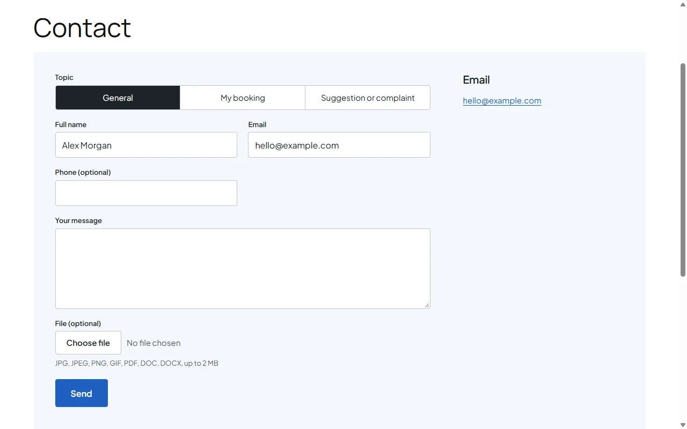

  

:::info Amaç
Bu sayfa, Contact form modülü konusunu teknik ve operasyonel açıdan standart bir referans formatında açıklar.
:::

# 🚗 Contact form

## İçindekiler
- Kullanım
- Parametreler
- Spam koruması
- Mesajları okuma
- Geliştirici Notları

İletişim formu, ziyaretçilerin sitenizden size yazmasını sağlar. Her mesaj **MHM Rentiva > İletişim iletileri** altında saklanır ve size e-posta ile de gönderilir.

## Kullanım



Bu modülü herhangi bir sayfaya veya yazıya eklemek için aşağıdaki kısa kodu (shortcode) kullanabilirsiniz:

```shortcode
[rentiva_contact]
```

Gutenberg blok editöründe **"MHM Rentiva -> Contact form"** bloğunu seçerek görsel olarak da ekleyebilirsiniz. Kurulum sihirbazı sizin için bir iletişim formu sayfası oluşturur.

### Parametreler

| Parametre | Varsayılan | Açıklama |
| :--- | :--- | :--- |
| `type` | `general` | Form türü: `general`, `booking`, `support` veya `feedback`. |
| `show_topic_selector` | `1` | Ziyaretçinin konuyu seçmesini sağlar. `type` değerini sabit tutmak için `0` yapın. |
| `title` | boş | Özel başlık. |
| `description` | boş | Özel açıklama. |
| `show_phone` | `1` | Telefon alanını gösterir. |
| `show_company` | `0` | Şirket alanını gösterir. |
| `show_vehicle_selector` | `0` | Araç seçiciyi gösterir (rezervasyon soruları için). |
| `show_priority` | `0` | Öncelik seçiciyi gösterir (destek talepleri için). |
| `show_attachment` | `1` | Dosya eki alanını gösterir. |
| `show_booking_id_field` | `0` | Rezervasyon numarası alanını gösterir. |
| `show_company_info` | `1` | İletişim bilgileri kutusunu gösterir (**Ayarlar > Genel > Marka ve iletişim bilgileri** altında doldurulur). |
| `redirect_url` | boş | Başarılı gönderimden sonra açılacak sayfa (yalnızca aynı site). |
| `success_message` | boş | Varsayılan başarı metninin yerine geçer. |
| `email_to` | boş | Bu formun mesajlarını varsayılan alıcı yerine başka bir adrese gönderir. |
| `auto_reply` | `1` | Ziyaretçiye otomatik yanıt gönderir. |
| `theme` | `default` | `default`, `compact` veya `detailed`. |
| `class` | boş | Ek CSS sınıfı. |

## Spam koruması

Form hiçbir kurulum gerektirmez ve ziyaretçiye çözülecek bir şey göstermez. Spam gibi görünen bir mesaj **Spam** durumuyla kaydedilir; e-posta ya da otomatik yanıt gitmez. Ziyaretçi her zamanki "alındı" yanıtını görür, böylece bot bir şey öğrenmez. Bir mesaj şu durumlarda spam sayılır:

- gizli tuzak alanı doldurulmuşsa;
- sayfa açıldıktan çok kısa süre sonra gönderilmişse;
- WordPress'in **Ayarlar > Tartışma > İzin Verilmeyen Yorum Anahtarları** listesiyle eşleşiyorsa;
- izin verilenden fazla bağlantı içeriyorsa;
- aynı mesaj aynı adresten son 10 dakika içinde geldiyse;
- Akismet kuruluysa ve anahtarı varsa Akismet spam olarak işaretlediyse.

İki sınır **MHM Rentiva > Ayarlar > Genel > Marka ve iletişim bilgileri** altında ayarlanır:

- **Göndermeden önce en az süre (saniye)** (varsayılan 3, 0 kapatır): sayfa açıldıktan bu süreden önce gönderilen form ya da yeni değerlendirme bot sayılır.
- **Bir mesajda en fazla bağlantı** (varsayılan 3): bundan fazla bağlantı içeren mesaj Spam'e gider. 0 olunca tek bir bağlantı bile yeter.

Aynı bölümde **Aydınlatma metni onayı** da bulunur: açıkken gönderenin göndermeden önce aydınlatma metni kutusunu işaretlemesi gerekir.

## Mesajları okuma

**MHM Rentiva > İletişim iletileri** sayfasını açın. Mesajlar Yeni, Okundu ya da Yanıtlandı olarak listelenir; yakalanan mesajlar **Spam** süzgecinin altındadır ve her birinde sebebi yazar. Mesaj spam değilse **Spam değil** düğmesini kullanın; mesaj normal bir yeni mesaj olur (bu sırada e-posta gönderilmez). Tür süzgeci formdaki türlerle aynıdır; Teknik destek yalnızca bu türde bir mesaj geldikten sonra görünür. Oturum açmış bir müşterinin kendi rezervasyonları için gönderdiği mesajda seçilen rezervasyon görünür.

## Özellikler

### 📱 Responsive Tasarım
- **Mobil:** Tek sütun düzeni.
- **Tablet (782px altı):** Optimize edilmiş görünüm.
- **Masaüstü:** Ayarlanan sütun veya genişlikte tam görünüm.

### 🚀 Performans Odaklı
- **Koşullu Yükleme:** Statik dosyalar sadece modülün kullanıldığı sayfalarda yüklenir.
- Form bir güvenlik anahtarı taşıdığı için HTML sayfa önbelleğinde saklanmaz.

## Geliştirici Notları

- **HTML Yapısı:** Tüm kapsayıcılar `.mhm-rentiva-contact-wrapper` sınıfı ile başlar.
- **Özelleştirme:** CSS değişkenleri (`--mhm-color-primary` vb.) global `css-variables.css` dosyasından miras alınır.
- **Filtreler:** `mhmrentiva_contact_min_seconds`, `mhmrentiva_contact_max_links`, `mhmrentiva_contact_spam_reason` ve `mhmrentiva_contact_attachment_max_bytes`.

## Bölüm Sonu Özeti
- Form kutudan çıktığı gibi spam korumalıdır; bir mesaj kayıp görünüyorsa **Spam** süzgecine bakın.

## Değişiklik Günlüğü
| Tarih | Sürüm | Not |
|---|---|---|
| 18.11.2026 | 6.4.0 | Spam koruması, aydınlatma metni onayı seçeneği, İletişim iletilerinde spam süzgeci ve rezervasyon bağlantısı; parametre tablosu tamamlandı. |
| 19.03.2026 | 4.21.0-docs | Sayfa alfabetik olarak sıralandı ve görsel yer tutucusu eklendi. |
